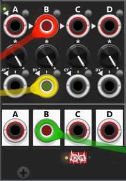
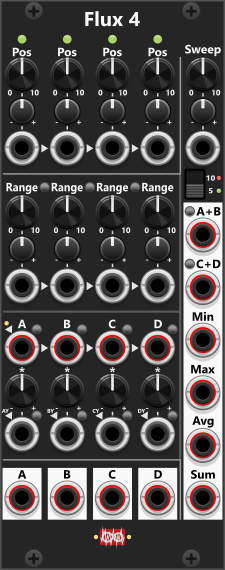
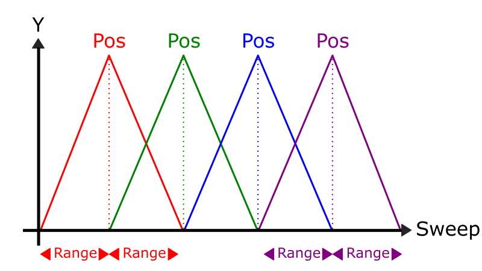
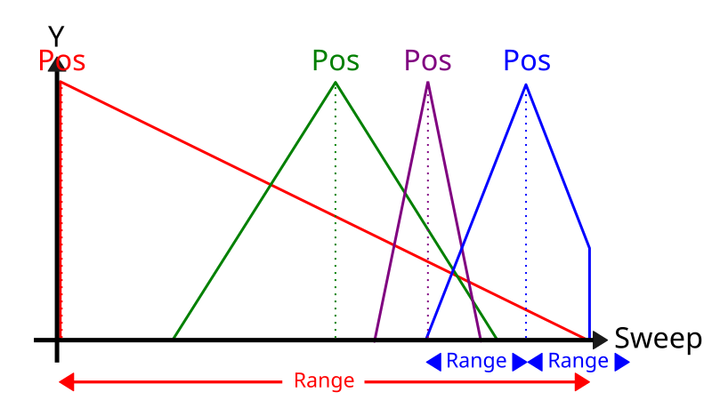
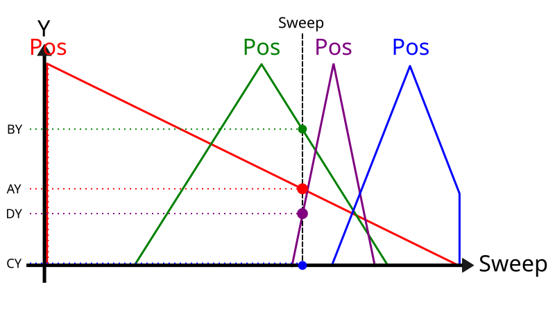

# Flux 4
 
**This VCV Rack module was inspired by [Joranalogue Morph 4](https://joranalogue.com/collections/eurorack/products/morph-4). It is not affiliated with, endorsed by, or supported by Joranalogue Audio Design**. If you own the real hardware Morph 4, you will notice some similarities, but don't expect this module to be a clone. While there are similarities, there are just as many differences (beyond the name and layout), making Flux 4 a distinct module in its own right. Flux 4 can be used for many different purposes. For example, it can function as a VCA, a mixer, a cross-fader, a signal processor, or a signal generator (e.g., generating various modulation signals that you can patch into other modules, such as oscillators, filters, effects, and whatnot).

At its core, Flux 4 is simply a Quad VCA, and you can choose to use it as such. The module has 4 "columns" (A–D), each with identical knobs, inputs, and outputs. Most of the inputs are normalized to the corresponding input of the previous section (e.g., the B-Pos input is normalized to the A-Pos input). However, as most of the Trim knobs default to 0%, this normalization won't have any effect until you start dialing in a non-zero Trim setting. *The Level knobs, which function as trim/attenuverters, however, default to +100%.*

If we simply look at the lower part of the module (disregarding Pos, Range, Sweep, and the rightmost outputs), the module can function as a simple Quad VCA. Each section has:
+ An input (where A is normalized to 5V or 10V, and the remaining inputs are normalized to the previous input).
+ A large Level knob (to trim/attenuvert the input below) — defaults to +100%.
+ A Level input normalized to a Y-value (AY, BY, CY, or DY) — more on this later.
+ An output at the bottom.

*In the screenshot above, a (red) cable is connected to the B-input (the signal to be amplified), a (yellow) cable is connected to the B-Level input (to control amplification/attenuvert), and the B-Level knob is used to attenuvert/trim this input. Finally, a (green) cable is connected to the B-output (the signal after amplification).*

In the upper-right corner, below the Sweep knob/input, you'll find the **5/10 switch**. This switch controls the normalization value used for the A-input. When switched to **5 (Green)**, the light near the A-input will also be green, indicating that the **A-input is normalized to 5V** (which is the default). When switched to **10 (Red)**, the light near the A-input will also be red, indicating that the **A-input is instead normalized to 10V**.

As indicated by the arrowheads, if no cables are connected, each subsequent input will be normalized to the previous input. The Level inputs below are normalized to the "Y-value" (more on this later), which is a value in the range 0–5V. The Level knob functions as an attenuverter/trim control for the Level input, with a range of −100% to +100% (defaulting to +100%).

Near both the A–D inputs and the 4 Level inputs, you'll find a 4-state toggle button that controls how the corresponding input signal is processed:
+ **Dim**: The input is **Unchanged** (default).
+ **Red**: The input is **Inverted** (multiplied by −1).
+ **Green**: The **Absolute** value of the input is used (negative values become positive).
+ **Blue**: **Cut negative** values (negative values are set to 0).

Simply using the VCA part of this module as described above is possible, but it won't unlock the full potential of the module. So, let's look at the interaction between Pos, Range, and Sweep. To explain this, **let me "paint a picture"**. Imagine you have a stretch of road that is 10 "units" long. The **Sweep** knob/CV controls your location along this road (0–10). Now, imagine that alongside this road, you have 4 "radio stations" (A–D), where each station's **Pos** knob/CV controls its position along the road (0–10), and its **Range** knob/CV controls the "strength of the radio signal" or, rather, how far the signal reaches (the distance "before and after Pos"). Hence, if "Station C" has a Pos of 6 and a Range of 2, you would have to Sweep between 4 (2 below 6) and 8 (2 above 6) to be "in range of this station". The signal will gradually fade-in as Sweep approaches Pos and fade-out as Sweep moves away from Pos. *I hope this little "picture" was useful.*

The positions of A–D default to 2, 4, 6, and 8, respectively, and they all have a Range of 2 (meaning they extend 2 units above and below their respective Pos values). This means that A covers the range 0–4 (centered at 2), B covers 2–6 (centered at 4), C covers 4–8 (centered at 6), and D covers 6–10 (centered at 8). The illustration below shows these 4 sections as differently colored **triangles** in an X/Y graph, where the X-axis spans 0–10 (the Pos/Sweep range) and the Y-axis spans 0–5V (red- for A, green- for B, blue- for C, and magenta triangle for D). *To avoid cluttering the illustration, I've only shown the Range for the red- and magenta triangles, but naturally, the green and blue triangles have identical, overlapping ranges.*

In its default configuration, the 4 sections will be laid out as shown in the illustration above. However, since both Pos and Range can be adjusted individually for each column (using knobs and/or CV inputs), these "triangles" can be **moved around (Pos)** and made **narrower or wider (Range)**. In the example below, the Pos of the **red "triangle"** has been set to 0, so you only see the "right half" of the triangle (as everything below 0 is ignored). Likewise, the Pos and Range of the **blue "triangle"** have been set so that its "right side" has been cut off (as everything above the maximum Sweep value of 10 is ignored). The illustration below uses the same 4 colored triangles as the previous example, but this time with custom Pos and Range settings for each column.

Between the 4 "Range" labels on the panel, you'll find 3 small Link buttons. When a button is pressed (green), the Range knob/Trim to its right will be linked to the Range knob/Trim to its left. This makes it easy to dial in exactly the same Range for 2 adjacent columns. Hence, if you enable all 3 Link buttons, simply changing the Range of column A will change the Range of all 4 columns. 

To understand the previously mentioned Y-value, let's use a slightly altered version of the previous illustration with custom positions and ranges (illustration above). In this new illustration *(below)*, an arbitrary **Sweep position** (vertical dashed line) has been added between the green and magenta triangles. By finding the intersections (marked by large dots) between the Sweep position and the triangles, we can **extract the Y-value for each of the 4 sections** (see AY, BY, CY, and DY on the far left). Each of these values will be in the range 0–5V. In this particular example, the selected Sweep position is outside the range of the blue triangle, so CY will have a value of 0V (whereas the other 3 values are all non-zero). *These 4 values are used as normalization values for the 4 Level inputs just above the 4 outputs.*

The **light above the "Pos" label** in each column provides visual feedback on the Y-value for that column. When Sweep is outside the range of a particular column (e.g., if Sweep is 10, while the Pos of that column is 2 and its Range is 2), the light will be dim (indicating that the Y-value for that column is 0V). As Sweep moves toward the Pos of that column, the light will begin to increase in brightness once Sweep enters the column's Range, eventually reaching 100% brightness when the Y-value reaches 5V (`Sweep = Pos`). The light is **green** while that column's Level input is unpatched (so the section uses Y as Level). It turns **red** when a cable is connected to that Level input (Y is still shown, but no longer used as Level). With an initialized module, as you begin a sweep from 0 to 10, the A-light will begin to fade in. When Sweep reaches 2, the A-light will be at 100% brightness (`AY = 5V`), and as you continue to increase Sweep, the A-light will begin to fade out while, at the same time, the B-light will begin to fade in ... and so on. *If you don't want to see these red lights, simply set the range to 0 when you connect cable to a level-input (in that case neither Pos nor Range is used for that section anyway).*

In isolation, that is how the 4 sections work. Each section (A–D) will "extract" its individual Y-value based on the (shared) Sweep value and its own Pos and Range settings, and then use this Y-value (as long as the corresponding level input is not connected) to scale the incoming signal (A–D). If you connect individual signals to the A–D inputs, these signals will be scaled accordingly. However, if you don't connect any input signals, a fixed signal of either 5V or 10V (depending on the 5/10 switch) will be scaled instead. For each section, both Pos and Range can be adjusted using knobs and/or CV inputs, allowing you to change the position and range of each section. Both Pos and Range are clamped to the range 0–10. **If Range is 0, that section will always generate a Y-value of 0V.**

**TIP**: When initialized, with the A-input normalized to 5V, the Level knobs set to +100%, and the AY, BY, CY, and DY Level normalizations are in the range 0–5V, the module will generate A–D outputs in the range 0–5V. However, if you want the generated outputs to cover the full bipolar range from −5V to +5V, you can toggle the 5/10 switch to its 10 position. In this case, the A-input (and subsequently the B–D inputs) will be normalized to 10V, causing the module to generate outputs in the range 0–10V instead. You then simply need to subtract 5V from these outputs, which can be done using a [Tweak-4 Mk I](Tweak.md#tweak-4-mk-i) configured to offset its inputs by −5V. *Alternative you can normalize the A-input to 5V, and then set some of the Level knobs (e.g. every 2nd of these) to -100% (instead of the default +100%), and the module can also generate negative outputs.*

Besides the individual section outputs at the bottom, you'll find a set of combined outputs on the right side of the module, which combine signals from either 2 sections or all 4 sections. The first 2 of these outputs provide a **unity mix (addition) of outputs A and B** and a **unity mix of outputs C and D**, respectively. Enabling the **mode switch (green)** next to either output will instead generate an **averaging mix of A+B or C+D**, respectively. The next 2 outputs provide the **lowest and highest output values** across all 4 sections, while the final 2 provide the **average and sum** of all 4 sections. Together, these 6 outputs generate multiple different signals that can be used as modulation sources for other modules.

All Pos, Range, and Level inputs, along with the Sweep input, only support **monophonic** signals. *If you connect a polyphonic signal to any of these inputs, only the first channel will be used (the remaining channels will be ignored).*

However, the A–D inputs support **polyphonic** signals, and all outputs can generate polyphonic signals. Each of the 4 individual outputs (A–D) at the bottom will generate the same number of channels as its corresponding input. The 6 outputs on the right side, however, will generate as many channels as the A–D input with the highest channel count. Ideally, when using polyphonic signals, all inputs should have the same number of channels. You can, however, mix polyphonic and monophonic inputs, in which case the same monophonic signal will be used across all channels of the polyphonic signals.

**TIP**: I would (if not always, then most likely) use Flux 4 to generate modulation signals to send to other modules or to process (attenuate) various input signals. This can be particularly interesting when Sweep, Pos, and/or Range are controlled via CV inputs. Also don't think only in CV-signals, as audio signals as well can be used as inputs to Sweep and/or pos - be creative. Below are a few quick examples of how it can be used when connecting up to 4 signals to the A–D inputs:

- **As a 4-section manual attenuator**: Set all 4 Pos knobs to 10, all 4 Range knobs to 10, and Sweep to 0. As you increase Sweep, you will simultaneously increase the amplification of all 4 A-D signals.
- **As a 4-section manual mixer**: As before, set all 4 Range knobs to 10, but this time set all Pos knobs to 0 and Sweep to 10. As you begin to increase the individual Pos knobs, you will gradually mix in more and more of each signal. You can then use either the **Avg** or **Sum** output, depending on whether you want an averaging or unity mix of the 4 signals.
- **As a 2x2 mixer**: Use the same settings as above, but in stead use the A+B and C+D outputs, where the **A+B** output have the mix of the A and B signals, and the **C+D** output have the mix of the C and D signals.
- **As a stereo cross-fader**: Let's say we connect signal 1-left to A, signal 2-left to B, signal 1-right to C, and signal 2-right to D. Set all 4 Range knobs to 10, then set A-Pos and C-Pos to 0, and B-Pos and D-Pos to 10. As you change Sweep between 0 and 10, you will cross-fade between the two stereo signals, with output **A+B** providing the cross-faded left signal and output **C+D** providing the cross-faded right signal.
- **Uniformly cross-fade between 4 signals**: Out of the box (initialized), Flux 4 will cross-fade between signals A–D as you sweep from 0 to 10. However, if you look at the first illustration above, you'll notice that A-Pos (red triangle) is positioned at 2, while D-Pos (magenta triangle) is positioned at 8. Hence, to achieve a complete cross-fade between all 4 signals, we would have to restrict Sweep to the range 2–8. For this application, being able to use the full Sweep range (0–10) would be easier to handle. So, first we need to change the Pos settings (A–D) to 0, 3.333, 6.667, and 10, respectively. Since we have increased the intervals between the positions, we also need to adjust Range, so set all 4 Range knobs to 3.333. For this application simply use the **Sum** output in the lower/right corner. Now, with Sweep at 0, signal A will be at full amplification. At 3.333, signal B will be at full amplification; at 6.667, signal C will be at full amplification; and finally, at 10, signal D will be at full amplification.

These Pos and Range settings are also available from the module context menu under **Setup Pos/Range for** — both mixer examples use the single **Mixer** item, and Sweep is left unchanged. **All muted** sets every Pos and Range to 0, so each section stays at 0 V until its Range is raised. **Initialized** restores Pos to 2, 4, 6, and 8 and every Range to 2. **3-way cross-fade** sets Pos A–C to 0, 5, and 10 with Range 5, and D-Range to 0 (the C→D Range link is turned off so D stays there). *These menu items only sets Pos and Range for the 4 sections, so you need to manually set Sweep.*

Using Flux 4 as described above is certainly possible, but I would argue that the Infinite-Noise plugin has dedicated modules that can do the same things out of the box, without requiring all the setup (Pos, Range and Sweep settings). However, by including these examples, I hope to give you some ideas for other ways you might use this module, particularly for things those dedicated modules cannot do. *In the software world, having dedicated modules is a good thing, as it's easy and costs nothing to add/remove them from the rack as needed. In the hardware world, however, it's more important to have a single module that can be utilized for multiple things (especially when it's possible without menu-diving or weird shifted button presses).*

[Go back to modules overview](manual.md#modules)
