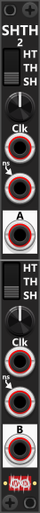
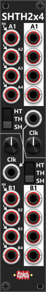

# Sample-and-hold / Track-and-hold / Hold-and-track
The Infinite-Noise plugin includes two SHTH modules capable of performing traditional Sample-and-Hold (**S&H**/**SH**) along with Track-and-Hold (**T&H**/**TH**), and Hold-and-Track (**H&T**/**HT**) operations. Sample-and-Hold typically responds to a trigger input *(short signal)*, determining when to sample a new input value. In contrast, Track-and-Hold and Hold-and-Track operate based on a gate signal *(typical "longer" signal)*, altering behavior depending on whether the clock-gate is high or low. The three modes function as follows:

+ **Sample-and-Hold (S&H)**: A high trigger samples the input value, which is then held until the next trigger occurs.
+ **Track-and-Hold (T&H)**: While the gate is high, the input is continuously tracked (passed through). When the gate goes low, the last value is held.
+ **Hold-and-Track (H&T)**: While the gate is high, the last input value is held. When the gate goes low, the input is tracked (passed through).

**TIP**: Since T&H and H&T typically rely on gate signals, they can also be controlled using trigger signals by passing the trigger through an [On/Off Switch](Switch.md#onoff-switch) module. This On/Off-Switch should be configured to toggle between "ON" (10V) and "OFF" (0V), which is equivalent to gate high-/low-levels. Routing this toggled output into the Hold input of an SHTH module allows the module to alternate between tracking and holding with each trigger received by the On/Off-Switch. Alternative a [Flip-Flop](FlipFlop.md#flip-flop) in T-mode (with the trigger input into the "T/D" port) can also be used (each trigger-input will toggle the Q output high/low).

If no external Clock input is connected, both SHTH modules features an internal LFO that can drive the Clock-rate. When active, the LFO frequency is adjustable via the knob next to the Clock input. Since T&H and H&T operate on gates rather than triggers, the internal LFOs generates a pulse wave where the high and low phases are equal by default (50% duty cycle). However, using the context menu, this ratio can be adjusted in 10% increments, from 10%/90% to 90%/10%. Additionally, in the SHTH2x4 module, if a Clock signal is plugged into the A-section, it will be normalized to the B-section, unless a separate Clock signal is supplied. This allows a single Clock input to control all 8 sample/hold pairs (4 in the A-section and 4 in the B-section).

The context menu also offers a **Rate Chaos** setting (per section) for the internal LFO, which randomizes the speed of each individual cycle so the sampling/holding happens slightly - or wildly - irregularly instead of at a perfectly steady rate. This option appears on several other modules too and is described in the [main manual](manual.md#rate-chaos). *The Rate Chaos is only used with the internal LFO, hence not in use when a Clock-input is connected.*

When generating a **polyphonic output**, there are three ways the module determines the number of channels. These are evaluated in priority order (top to bottom):
* **Polyphonic input**: If the **A input** is polyphonic, the A output will match its number of channels.
* **Polyphonic clock trigger**: If no A input is connected, the module uses its built-in noise generator, and the output channel count will match the number of channels in the clock trigger.
* **Context menu setting**: If neither an A input nor a clock-input is connected, the output channel count is determined by the context menu (default is a single channel).

By default, the built-in noise source generates bipolar random values (**white noise**) between −5V and +5V. You can change this to other ranges—such as 0V to 10V for unipolar signals—via the context menu. For "other kinds of noise" you can connect the output from a VCV Noise module (which can both do white-, pink-, red-, vilolet-, blue-, gray- and black-noise). If you need more control over the range or distribution of the random values, you may want to use a [Random-4](Random.md#random-4) module instead, which also supports trigger-based operation or its built-in LFO.

**TIP**: For probabilistic tracking or holding, route the Clock signal through a [Bernoulli Switch](Switch.md#bernoulli-switch) module. By connecting the signal to the Clock input of the Bernoulli Switch, and then routing either the "A" or "B" output (from the "→A/B" section) into the Clock input of the SHTH module, you can introduce randomness into whether the module tracks or holds (producing longer/shorter track/hold-times).

## S&H/T&H-2

 
The SHTH2 module operates in Sample-and-Hold (S&H), Track-and-Hold (T&H), or Hold-and-Track (H&T) mode, as selected via the three-way switch. If a Clock input is provided, the module will use it to determine when to sample or hold/track the input signal. Otherwise, the built-in LFO takes over, with its frequency adjustable via the knob near the Hold input. *Some general info regarding the S&H/T&H/H&T are listed in the top.*

The Clock inputs in both sections support polyphonic signals, **allowing you to sample/track/hold individual channels independently**. If you provide a monophonic Clock signal, all channels will follow that same Clock input. When using a polyphonic Clock signal, make sure it has at least as many channels as the signal input. Likewise, when using a polyphonic Clock together with the internal noise generator (i.e., no external input connected), the module will automatically match the number of output channels to the number of channels present in the Clock input.

If no external input signal is supplied, the module generates random values using its internal white noise generator, which by default produces values in the range of -5V to +5V. However, this range can be adjusted in the context menu. The noise generator initially outputs a monophonic random signal, but it can be configured to produce a polyphonic signal with up to 16 channels, where each channel generates a unique random value.

 

**TIP**: You can set different sample-and-hold frequencies in the **A** and **B** sections, then route the **A** and **B** outputs into a single [Bernoulli Switch](Switch.md#bernoulli-switch). In this setup, the Bernoulli Switch determines whether the output comes from the “fast” or the “slow” sample-and-hold path. This allows you to create a signal that "randomly" alternates between frequently changing and Infrequently changing values, with the probability controlled by the Bernoulli Switch.

## S&H/T&H-2x4

 
The SHTH2X4 module features 2 independent sections, each containing 4 input/output pairs for processing multiple signals simultaneously. Like the SHTH2, each section operates in S&H, T&H, or H&T mode and can be controlled via an external Clock input or the built-in LFO, which is adjustable using the associated knob. *Some general info regarding the S&H/T&H/H&T are listed in the top.*

While the A-, B- inputs/outputs supports polyphonic signals, the clock inputs do not. This means all channels are sampled- and held at the same time, hence **this module don't support S&H of individual channels** (but the S&H/T&H-2 described above does).

If a Clock input is supplied to the A-section, but not to the B-section, the A-section’s Clock signal will also control the B-section, ensuring synchronization. However, if no Clock input is provided for either section, each will default to its own independent LFO. If a Clock input is connected to the B-section, it will override the shared signal, allowing A and B to operate separately—one using the internal LFO and the other responding to an external Clock signal. *If you only supply the B-section with a Clock-signal, the B-section will use this Clock-signal, whereas the A-section will use its internal LFO*.

All input signals for both sections are normalized to an internal white noise generator, which by default produces random values from -5V to +5V. This range can be modified in the context menu. 

 

**TIP**: When using the SHTH2x4 with an external clock-source I suggest you begin using the lower section first. This allows you to in stead use the upper section with the internal LFO if needed. If you later decide that the external clock-source should affect both sections, you simpy move the cable from the lower clock-input to the upper clock-input *(since the lower is normalized to the upper)*.

## Sample and Update

 
The **Sample & Update (S&U)** module is not a traditional S&H/T&H/H&T module, although it can be configured to behave similarly. The module provides three sections — **Sample**, **Update**, and **Reset** — each with a manual button and a corresponding CV input. 

Between the large button and the CV input in each section, there is a small toggle button that controls how they behave. By default (**red**), each section operates in **Single mode**. In this mode, the button is momentary, and the CV input is treated as a **trigger**. Pressing the button—or receiving a trigger—causes the section to perform its action (e.g., sample) for a single processing cycle only, regardless of how long the button is held or the input signal remains high. Pressing the small toggle button switches the section to **Continuous mode** (**green**), where the large button becomes latched. In this mode, the section continues performing its action (e.g. sampling) for as long as the button is latched or the CV input remains high.

You can think of this module as a “delayed” sample-and-hold. When you press **Sample** or provide a Sample trigger, the input signal is captured and stored in memory—but the output does not necessarily update immediately. Instead, the output changes only when you press **Update** or provide an Update trigger. To emulate a traditional sample-and-hold, set the **Sample** section to **Single mode** (red), and set the **Update** section to **Continuous mode** (green) with the button latched. In this configuration, the module continuously outputs the last stored value, while new samples are written to memory only when triggered. To emulate a Track & Hold module, you set the sample section into continious mode, so it will continious update as long as the sample-input is high (or button is pressed/latched).

The **Reset** button or CV input clears the stored values (one per polyphonic channel) by setting them to 0V, and the output is updated accordingly. Through the context menu, you can choose a different reset value and optionally configure Reset to update memory only—meaning the output will not change until the next **Update** action is triggered.

**Action overview:**
* **Sample**: Input → Memory (stores one sampled value per channel)
* **Update**: Memory → Output (the output updates to the stored value; the last value is held while Update is inactive)
* **Reset**: Clears memory (sets it to 0V), then optionally updates the output

The input and output at the bottom of the module both support monophonic and polyphonic signals. For example, if you input a 4-channel polyphonic signal, the output will also be 4-channel polyphonic. However, the **Sample**, **Reset**, and **Update** inputs are monophonic. When a Sample gate or trigger is received, all channels are sampled simultaneously. *If a polyphonic signal is connected to any of these inputs, only the first channel is used to determine the gate/trigger state.*

 

The 3-way **Mode** switch lets you choose between three different operating modes:
* **Value mode (default)**: The module samples and stores the actual input signal values.
* **Gate mode**: Similar to Value mode, but the input is interpreted as a gate signal. By default, input values ≥ 1V are treated as a high gate. When the output is updated, high gates are output as 10V and low gates as 0V. These thresholds and output levels can be adjusted in the context menu—for example, allowing you to invert gates by outputting high gates as 0V and low gates as 10V.
* **Trigger mode**: Instead of storing signal values, the module detects whether any triggers occur during the sampling period (and count the number of detected triggers). When an update is requested (via the **Update** button or input), the module outputs a single trigger if any triggers were detected, or 0V if none were detected.

However using the context menu you can set the module to count the number of input-triggers it shold detect (1-16). No matter what you set the trigger-count to (e.g. 4), it will only output a sigle trigger once the specified count have been achieved (or more). By default the internal count of input triggers is automatic cleared when the module recieves a reset- (no matter internal count), or an update-input while the specified count have not yet been accomplished. Hence if requested count have not yet been achieved, it will not clear the count. 

You can customize this behavior in the context menu (Only on Reset):
* **Only on Reset**: Trigger count is only cleared on Reset.
* **Only on Update (count reached)**: Trigger count is only cleared on update, when desired count have been reached.
* **Reset and Update (count reached)**: Trigger count will both clear on Reset, and update, when desired count have been reached.

If the **Update** button is not pressed/latched, or you are not supplying a continuous high gate, the module can detect more triggers than the specified count. For example, if **Sample** is latched but **Update** is only triggered occasionally (e.g., by a clock signal), the module will only evaluate the trigger count when an update is requested. The configured count acts as a **minimum threshold**—so if it is set to 4, the module will output a trigger whenever the detected count is 4 or higher at the moment an update occurs.

**Warning**: If you in trigger mode set the trigger-count to only clear on reset, and you set the update-button/input to operate in continious mode, the output will keep generating a stream of output-triggeres as soon as the desired count have been reached. 

**TIP**: While in Gate mode the module can function as a Data Flip-Flop. Where you input the "data signal" into the sample-input, and press the sample button latched (so it samples all the time). You then input your trigger signal into the "Update" CV-input (in trigger mode). Whenever the the module receives an Update trigger it will update the output, and because we set the module Mode-switch to Gate-mode the sample Data-signal is output as a gate.

**TIP**: While in Trigger mode the module can function as a clock-divider (though outputting a trigger). Used as such you'll latch both Sample- and Update-buttons to on, connect your clock-input to the IN-port and set trigger-count to the desired division (e.g. 3). In this configuration the OUT-port will generate a trigger-signal each time the module have observed 3 clock signals ("read as triggers"). 

## Stack

 
The Stack module is documented alongside the Sample-and-hold modules, as it basically represet a Sample-and-update module which is able to store up to 16 Pushed (sampled) polyphonic values, which it can later pop (retreive). The top section of the module shares a lot with the Sample and Update module, while some of the sections have different names. Below these 3 sections you find a knob to set the size of the stack (1-16). By default it will be set to the maximal size of 16, meaning 16 values (all able to be polyphonic) can be pushed to the stack before it's full. However it do keep track of how many values have been pushed (e.g. you can have a stack with room for up to 16 items, while it might only hold 4 items). The Size knob is how many of the newest stored items you can push, pop, and cycle. Turning it down does not delete the older items; they stay stored and are not shown until you turn the knob back up. Reset clears every stored item, including those hidden ones. *There can be many reasons why you might want a smaller stack size (e.g. it can be used as a rolling stack, where you only want to keep the last `n` pushed items). However unless you have a special reason for a lower stack size, I suggest just leave it at 16.*

*Further down the Stack Bank Expander (StBk) module is described. Its **Retrieve** copies the entire into the active bank and leaves the Stack module unchanged. Its **Send** first clears all 16 slots in the Stack module, then copies only the slots that bank actually holds, even when that is fewer or more items than the Size knob. The knob is not changed. For example, a bank of 8 items sent while Size is 4 stores all 8, and only the newest 4 can be popped or cycled. Turning Size up to 8 then gives access to the older 4 as well. The Stack output stays at its last Pop or Reset value until the next Pop or Reset.*

The 2-way switch below is used to set the mode of the stack: **FIFO** (First-In-First-Out) or **LIFO** (Last-In-First-Out). Changing this setting does not rearrange the items already stored. Push always adds the new item as the newest. The switch only chooses which end **Pop** takes from: in **FIFO** the oldest item is popped, and in **LIFO** the newest item is popped.

At the bottom of the module you find the polyphonic input (which is sampled on Push), and output (which is updated on Pop and Reset). Quantize is set from the context menu and is off by default. Push stores the raw input. Quantize and clip are applied when a value is written to the Stack output. The Stack expander has its own Quantize menu for the Value output. *Saving and loading a patch, the full internal stack of the Stack module is saved/loaded along with the patch.*

In each of the 3 top sections you find a momentary button (for manual operation) and a trigger-input. Whenever the **Push-button** is pressed (or a Push-trigger is received) the input is sampled and pushed to the stack. Next to the "Push" label you find a small light, which will change it's color based on the status of the stack:
+ Fully green when the stack is empty.
+ Gradually transitioning to amper as the stack begins to fill (less "free space" in the stack).
+ Fully red when the stack is full (according to selected stack-size).

Between the Push button and the tigger-input you find a small mode toggle-button. This button toggles the Push-mode which basically determines how the modules behaves when a **Push request is received while the stack is currently full** - based on the stack-size set by the Stack knob (1-16 slots in the stack):
+ **Dim/Ignore**: Push is ignored when the stack is full.
+ **Red/Oldest** (rolling): The oldest accessible element is dropped and the new sample is pushed as newest, so the accessible window stays at the stack size. Rolling does not change direction with LIFO/FIFO — those modes only affect which end **Pop** takes from.

Likewise in the Pop section you also find a momentary button (for manual operation), a trigger-input, and a mode toggle-button between them. Whenever the **Pop-button** is pressed (or a Pop-trigger is received) an item is **popped from the stack** and the output is updated. Which item is popped, is based on the 2-way stack mode switch. When the 2-way switch is in **FIFO** mode the **first/oldest** element element is popped.  When in **LIFO** mode, the **last/newest** element added to the stack is popped. Next to the "Pop" label you find a small light, which will change it's color based on the status of the stack:
+ Fully green when the stack is full.
+ Gradually transitioning to amper as the stack begins to empty (fewer elements to pop).
+ Fully red when the stack is empty (nothing to pop).

The mode toggle-button between the momentary button and the trigger-input determines what is going to occur when **Pop request is received while the stack is empty**:
+ **Dim/Zero**: Update output to 0V.
+ **Red/Hold**: Hold current value(s).

In the reset setion you also find a momentary button (for manual operation), a trigger-input and a mode toggle-button between them. Whenever the **Reset-button** is pressed (or a Reset-trigger is received) the stack will be reset (emptied). The mode toggle-button between the momentary button and the trigger-input more or less works in the same manner as the Pop-modes:
+ **Dim/Zero**: Stack is cleared, and update output to 0V.
+ **Red/Hold**: Stack is cleared, but output will hold current value(s).

*Initializing the module will always clear the stack, and update all outputs to 0V*

Both the input- and output-ports at the bottom of the module supports **Polyphonic signals**. The polyphonic output will be determined primarily by the input, and secondary by the stack (when popping items). If a cable is connected to the input-port, the output port will always output as many channels as the input. However when no input-cable is connected the output channel-count will be based on the content of the stack. This allows you to connect an input cable, push one or more items to the stack. If you later disconnect this cable, and starts popping items, it will output as many channels as was pushed to the stack while the input was connected. You can, but **SHOULD NOT** push items with different channel counts, as modules downstream might not "behave nicely" when its input keeps changing channel count. If/when you insert a new cable with a different channel count than what you might have used previously, it's a **good idea to press the "Reset" button** to ensure the stack is empty.

*If the items in the stack have a lower channel count (e.g. 4) than the currently connected input (e.g. 6) the last channels of the output (2) will simply be set to 0V. On the other hand if the items in the stack have a higher channel count than a connected input, the additional channels will be ignored (the module will then only output as many channels as the connected input).*

While the input- and output ports are polyphonic the **Push-, Pop- and Reset-triggers are monophonic**, so each Push-, Pop- and Reset operation will always affect all (up to) 16 channels. E.g. with an 8-channel polyphonic input, all 8 channel-values will be pushed to/popped from the stack. Each of the (up to) 16 stack elements can hold 16 values (one for each channel). *Hence the internal stack have room for 256 values (16x16)*

## Stack expander

 
The Stack expander will (when placed next to a Stack module) expand the Stack module with additional features. At the top you find 16 lights in a 4×4 grid. The newest item is the top-left light, and older items follow left to right, then top to bottom. If the stack size is 8, the top two rows are used and the lights past Size stay off. Filled slots are **green** and empty slots inside the Size are **red**. For example, with Size 8 and only 2 items pushed, 2 lights are green and the other 6 in those two rows are red.

Below you find the **Cycle section** which enables you to loop through the items currently in the stack without popping (removing) them. At the top of this section you find the manual cycle button and its associated trigger-input. When the cycle button is pressed (or a cycle-trigger is received) the module steps to another item and copies it to the **Value** output. This enables you to push multiple values (e.g. 8 or 16 values forming a sequence of V/OCT notes) to the stack, and then while leaving this sequence in the stack, keep looping it multiple times. Via the context menu you can choose the direction of the cycle, which is indicated by the color of the light next to the "Cycle" label:
+ **Green/Next**: Walks from the oldest item toward the newest, then wraps.
+ **Red/Prev**: Walks the other way, from the newest item toward the oldest, then wraps.
+ **Yellow/Ping-pong**: Plays each end once, then reverses.
+ **Orange/Random**: A random item, which may be the current one.
+ **Blue/Random diff.**: A different random item. With only one item in the stack, it stays on that item.

Between the cycle button and the cycle trigger-input you find a button to toggle the cycle-mode. Basically this button determins what the module will do then you perform the cycle action while the stack is empty:
+ **Dim/Zero**: Update output to 0V.
+ **Red/Hold**: Hold current value(s).

Below the cycle-trigger you find the small **Reset button** and **Reset trigger**. When you press the small reset button (or input a reset-trigger), the module copies the **oldest** item in the stack to the Value output. If the stack is empty, the output follows the cycle-mode mentioned above, where the output will either be set to 0V or hold current value(s).

The Value output is a **frozen copy** of that slot, including its channel count. That held element (up to 16 channel values) is saved and loaded with the patch. Quantize for Value is set from this expander's context menu and is off by default. The saved copy stays raw, and the selected mode is applied when Value is written, including when you change the mode. The blue light is not restored until the next Cycle or Cycle Reset, because the stack itself is matched to that slot only while the module is running. Push, Pop, Reset, shrinking Size, and Send do not change it. Within the 16 lights, the light for the slot last copied by Cycle or Cycle Reset is shown in **blue** instead of green, and only while that slot is inside the Size window. If it is popped, dropped by a rolling push, cleared by Reset, replaced by Send, or only hidden because Size was turned down, the light is no longer blue. If a hidden slot becomes accessible again before the next Cycle, the blue light can return. The Value port keeps the last copy. The next Cycle then starts over: Next and ping-pong begin at the oldest item, and Prev begins at the newest.

At the bottom of the module you find 4 outputs, where the first 2 are trigger outputs, and the last are gate outputs:
+ **OvFlw** (overflow): Outputs a trigger when the stack is full (acording to the selected stack-size), and it have recieved a Push-request.
+ **UnFlw** (underlow): Outputs a trigger when the stack is empty, and it have recieved a Pop-request.
+ **Full**: Outputs a high gate when the stack is full (acording to the selected stack-size).
+ **Empty**: Outputs a high gate when the stack if empty.

**TIP**: If you you feed the Empty gate into the Cycle- and Send inputs of the Stack bank expander (described below), when you pop the last element from the stack, a previously banked stack will be selected- and send from the Stack bank expander, and the Stack module will have received a new stack to pop from. Doing so, the Empty gate will typical only be high for a few cycles, as the stack is quickly repopulated once it is empty. If you need to, you can run the empty gate through one of the [Slew modules](Slew.md#slew-2) (with no rise-time, but a "longer" fall-time and perhaps an exponential fall shape), to have a signal that will be detected as a high gate for a longer time. *For an expander to work it must be placed left/right of the module it should expand. Hence in this configuration the Stack module needs to be plance between a Stack expander and a Stack bank expander (no matter which is on the left/right side of the Stack module).*

## Stack bank expander

 
As the name implies, this module is bank-expander (StBk) for the Stack module. Internally it have 4 banks, where each of these banks can contain a full stack, with a stack-size of up to 16 (polyphonic) elements. Saving and loading a patch persists the content of all 4 banks, along with which bank is active. The Stack bank expander can be used to store- and switch between (banked) stacks, where each stack can be regarded as a sequence of CV-values (e.g. V/OCT notes). E.g. you can Push (up to 16) polyphonic elements into the the internal stack of the Stack module. Then you can retreive this entire stack, and store it into the active selected bank of the StBk. As the StBk have 4 banks, you are able to store 4 full stacks. Afterwards you can switch between these banks, and send the active bank back into the internal stack of the Stack module (e.g. to switch between previously "stored" sequence of notes). *Each Pop performed by the Stack module, will pop (remove) an item from its stack, however it will not affect the stored banks of the StBk. Hence the same/full stack can be send multiple times from the StBk to the Stack module.*

The 4 momentary buttons at the top can be used to select the active bank (indicated by the lit light above each button). Switching bank in the StBk will have no effect on the Stack module itself, as it always have- and uses it's internal stack. **Switching bank using these 4 buttons will not send the selected bank to the stack module**.

Below you find the cycle section, where you in the top have a a momentary button and trigger-input to trigger the cycle action. Between these two there is a small button which toggles the cycle mode:

+ **Green/Next**: Each cycle will switch to the next bank.
+ **Red/Prev**: Each cycle will switch to the previous bank.
+ **Yellow/Ping-pong**: First it will switch in one direction till the end is reached, then it will switch in the other directon.
+ **Orange/Random**: Each cycle will switch to a random bank (perhaps the same as the current).
+ **Blue/Random diff.**: Each cycle will switch to a different random bank (never the same as current).

At the bottom of the cycle section there is a **3-way switch**. Down (the default) cycles banks 1 and 2, the middle position cycles banks 1–3, and up cycles banks 1–4. The four buttons at the top can still select any bank. This switch only affects the **Cycle button/trigger**. Whenever the cycle button is pressed or the cycle-trigger is activated, the module switches among the banks included by the switch. E.g. with the switch down, it switches between bank 1 and bank 2.

By default a **Cycle will only select an active bank**, however it will not Send the newly selected bank to the Stack module. However using the context menu you can select that a cycle should **automatic send the newly selected bank to the Stack module**. When enabled, the small red light next to the Cycle label will illuminate. The reset button and its trigger-input will simply select bank 1 (basically it have the same effect as pressing the cycle button, until bank 1 is the active). Whether or not bank 1 will be automatic send to the Stack module depends on the previously menioned context menu.

Below you find the Send and Retrieve sections (each with a momentary button and a trigger input). Select the desired bank using the 1-4 buttons in the top of the module, then **Retrieve** to copy the Stack module's accessible items into that bank (the Stack module is left unchanged), or **Send** to clear all 16 slots of the Stack module and then copy only the slots that bank actually holds. Send does not change the Size knob. Items beyond the current Size stay stored until the knob is raised or the stack is reset. Send does not change the Stack output; it stays at its last Pop or Reset value. Likewise if a Stack expander is also connected with the Stack, its Value output in the cycle-section will not change when you send a bank.

[Go back to modules overview](manual.md#modules)