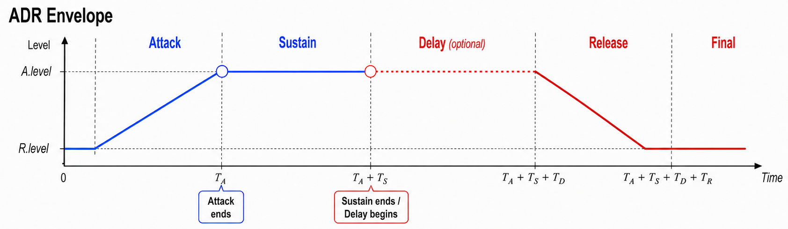
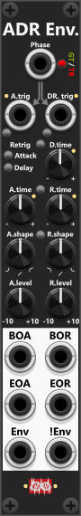
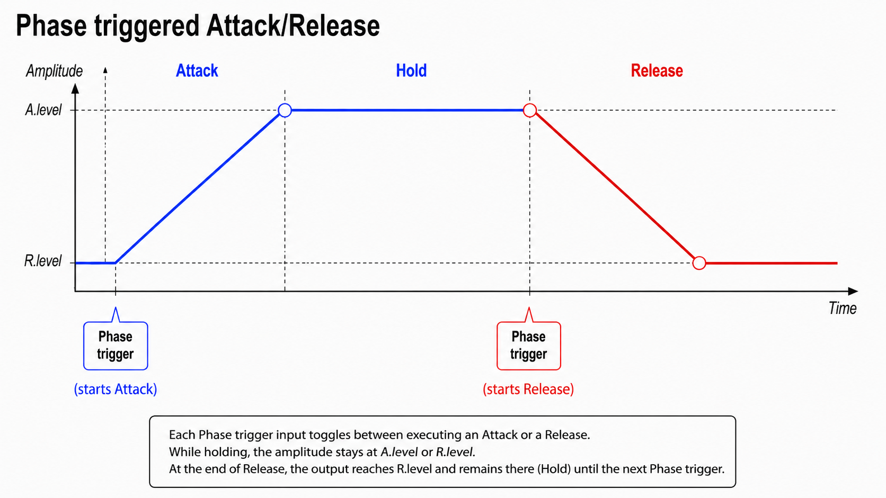
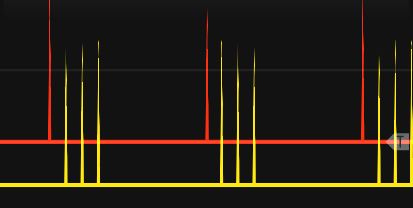

# ADR Envelope

 
The ADR Envelope is a three-phase **Attack/Delay/Release envelope generator** (or simply a two-phase Attack/Release envelope when the delay time is 0). It ramps the Envelope output between an attack end-level (**A.level**) and a release end-level (**R.level**), with independent time and shape for each phase. Defaults are A.level = 10V and R.level = 0V, which covers the usual unipolar envelope case, but you can set any levels you might need. At the bottom of the module you find 6 outputs: the first 4 fire a trigger when the attack/release phases begin/end, plus **Env** and **!Env** which outputs the envelope and an inverted envelope. *Some general info regarding the Envelopes are listed in [Common envelope features](commonEnvelope.md).*

*Technically the module is an **ASDR envelope generator (Attack, Sustain, Delay, Release)**, or an **ASR envelope** when no delay is dialed in. Attack, Delay, and Release are timed stages; Sustain is the held level (**A.level**) while waiting for Delay/Release to be triggered — so the **A.level knob effectively dails-in the sustain level**. However "ASDR" would probably confuse users into thinking it was an **ADSR** generator, so the "S" (Sustain) is deliberately left out of the name.*

Using an ADR envelope, there are three phases (only two if delay time is 0):
+ **Attack**: Envelope transitions toward **A.level** (over **A.time**, with **A.shape**), which is then held (**sustain**).
+ **Delay**: Holds current envelope output level till **D.time** has elapsed.
+ **Release**: Envelope transitions toward **R.level** (over **R.time**, with **R.shape**), which is then held.

After attack completes while the phase-gate is still high, the envelope output holds at A.level until delay/release begins *(basically sustaining)*.

A **DR.trig** starts **Delay → Release**. During Delay the Envelope holds its last output. If D.time is 0 it goes straight into Release. **BOR (Begin Of Release)** fires only after Delay ends (immediately if D.time is 0). With Delay retrig enabled and a non-zero delay time, the module can **fire multiple BOR triggers** (one after each delay), and the envelope output can generate a **"stepped release"** where level is hold at each delay-phase until the envelope reach R.level or a new attack is triggered.

The lights next to A.trig and DR.trig indicate the active phase, and the color indicates "the position within that phase" (only one light is illuminated at any one time).
+ **A.trig light is green** while the attack is running (Envelope output is transitioning to A.level).
+ **A.trig light is red** when A.level has been reached (Envelope output is held at A.level - **Sustain**).
+ **DR.trig light is yellow** while delay is active (previous Envelope output is held).
+ **DR.trig light is green** while release is active (Envelope is transitioning to R.level)
+ **DR.trig light is red** when R.level has been reached (Envelope output is held at R.level)

**TIP**: While we typically think of an envelope as a full cycle (at least an Attack and a Release phase), there is nothing preventing you from **using only the Attack phase** (the envelope transitions from R.level to A.level over A.time using A.shape, and is then held at A.level). When used this way, A.retrig should be enabled so that the full Attack phase begins each time A.trig is triggered. *If needed, you can use the DR.trig input to "reset" the envelope back to R.level (so the signal is not held at A.level). For example, you could connect EOA to DR.trig so the envelope "automatically" returns to R.level once A.level has been reached.*

Next to D.time, and between the A./R. time/shape-knobs, you find small latched **Link-buttons**. When pressed (green) the linked knob follows Attack: **D.time** or **R.time** takes its value from **A.time**. When linked, that knob is rendered inactive. The shape link-button have two modes, so pressed a 2nd time it turns **red where R.shape is linked to A.shape reversed** (the more counter clockwise you turn A.shape the more R.shape will turn clockwise - and vice versa). These link buttons makes it easy for you to dial-in the exact same values (e.g. D.time = A.time, or attack and release with the same time- and/or shape-setting).

For the attack/release phases you both find a begin-trigger output (e.g. **BOA=Begin Of Attack**) and an end-trigger output (e.g. **EOA=End Of Attack**). These will fire whenever a phase begins and ends. If Attack retrig is enabled, the BOA trigger will fire each time you trigger the A.trig input, whether that phase is currently active or not. If you have dialed in a non-zero delay, the **BOR (Begin Of Release)** won't fire till the delay has finished. The end-trigger outputs ("EOA" and "EOR") will only fire if the phase runs to the end. E.g. if you input a trigger into A.Trig before the previous release finishes, EOR will not fire. 

**TIP**: An ADR envelope has many uses. For example, you can patch the **Envelope** output into a crossfade module. Each time a trigger is received on the **Phase** input (in Trigger mode), the envelope can make a crossfade module smoothly transition between two of its inputs. The **A.time**, **R.time**, **A.shape**, and **R.shape** settings determine "how fast-" and "how" the fade is performed, while **A.level** and **R.level** define the output range of the fade-signal (basically "how wide/deep" the cross-fader should fade).

*If you want the fade (envelope transition) to be based on probability, you could run your trigger through a [Bernoulli Switch](BernoulliSwitch.md). In this case, you would input the trigger signal into the AB input of the Bernoulli Switch, and then route its B output into the Phase input (in Trigger mode) of the ADR Envelope. That way, the probability dialed in on the Bernoulli Switch will determine whether an envelope transition occurs.*

**TIP**: Although this is not the intended purpose of the module, it can be used as a **trigger delay**. Patch a trigger into **A.trig** and enable **Attack retrig** if each new trigger should restart the delay. Set **A.time** to the desired delay — for example, 1 second — and use the **EOA (End Of Attack)** trigger output as the delayed trigger. **EOA** fires when the attack stage completes, one "attack time" after an accepted trigger starts the attack. If you also connect EOA into DR.Trig, dial in a delay time, you can use the **BOR (Begin Of Release)** as a 2nd further delayed trigger output (BOR will fire once the delay have ellapsed). In this configuration the module will fire 2 delayed triggers for each A.trig input, where A.Time controls the 1st "delay" (before EOA fires), a D.time controls the 2nd/additional "delay" (before BOR fires). Actually a 3rd - futher delayed - trigger can be generated if you dial in R.Time and use the EOR (End Of Release) output. In the screenshot below the red trigger is the original, and the 3 yellow are each delayed 0.2s in relation to the previous one.

**TIP**: The module can also be used to **"delay gates"**, although the delay is less precisely controlled than a "delayed trigger". Infinite Noise modules normally detect signals of 1V or higher to be high gates. By adding an attack time, the output rises gradually and is not considered high until the envelope passes 1V. Selecting an exponential attack shape delays this crossing even further. Likewise, adding a release time delay, when the output falls below 1 V after the input gate goes low. An exponential release shape can extend this delay further. In addition you can pass the envelope output through a [Tweak-2 Mk I](Tweak2I.md) to offset the signal in the negaive direction, which will also delay when the signal crosses 1V where the Infinite-Noise modules will detect it as a high gate. *Beside delaying the gate, you can **"increase the gate-length"** by the time dialed in by the D.time knob.*

**TIP**: The module can also be used **transform triggers into fixed length gates**. Set both A.time and R.time to 0, however set D.time (Delay) to a non-zero value where it basically controls the length/duration of the output. Now connect the EOA (End Of Attack) output to the DR.Trig input, and finally connect your external trigger signal to the A.Trig input. When the module recieves an A.Trig from an external source, the "Attack phase will begin", however as A.Time is 0, the evenvelope will instantly jump to A.level (default 10V) and EOA will fire as the Attack phase have ended. Since EOA is connected to DR.Trig the delay will begin, while holding the envelope at the current value (A.level). Once the delay have ended, it will go into the Release phase, however as R.Time is 0, the Envelope will jump to R.level (default 0V), and the module will be ready to react to the next A.Trig (to again "convert a trigger into a fixed length gate"). *Since the external signal is passed into the A.Trig input, you can also use a gate-signal as input (the length of the gate is ignored, as only the rising edge will be detected). Hence this tip works as well for **changing gate-lengths**, where the output-envelope can be used as a gate that is shorter/longer than the input gate.*

Other envelope modules: [ADSDR Envelope](ADSDREnvelope.md), [Envelope Phase Expander](EnvelopePhaseExpander.md).

[Go back to modules overview](plugin.md#modules)
