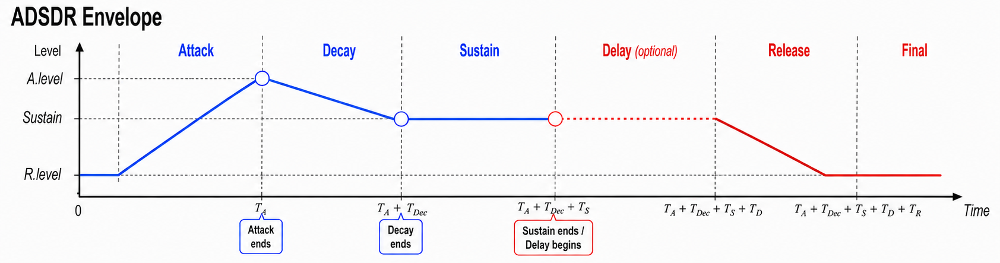
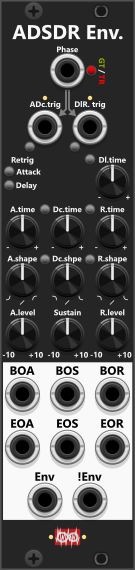
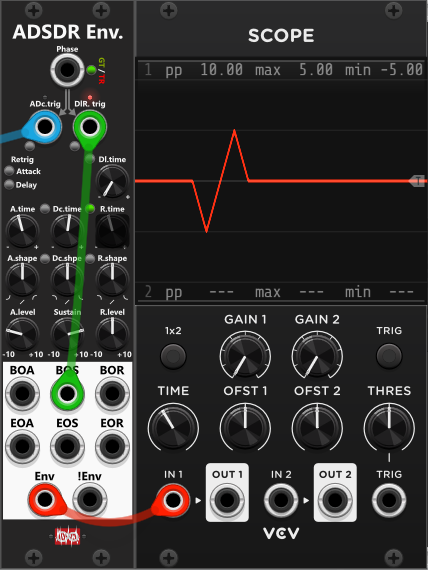
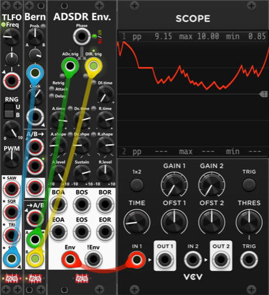

# ADSDR Envelope

 
The **ADSDR Envelope (Attack, Decay, Sustain, Delay, Release)** is very similar to the **[ADR Envelope](ADREnvelope.md)**, but as it can be used as a traditional **ADSR Envelope** (when Delay time is set to 0) it does include "S" (Sustain) in its name. Since there are two D's in the name, some of the inputs/knobs are labeled with 2 letters to distinguish them from each other ("Dc" = Decay, "Dl" = Delay) - however the tooltips will hold the full names ("Decay" or "Delay"). The trigger inputs are likewise named **ADc.trig** (starts Attack, then Decay) and **DlR.trig** (starts Delay, then Release), so the "D" is not mistaken for Decay when it means Delay. *Some general info regarding the Envelopes are listed in [Common envelope features](commonEnvelope.md).*

The top of the module is the same as the ADR Envelope except the dedicated inputs are labeled **ADc.trig** instead of **A.trig**, and **DlR.trig** instead of **DR.trig**. With Phase in gate mode this is a classic ADSR: gate high runs Attack → Decay → hold at Sustain; the falling edge starts Delay → Release (straight to Release if Dl.time is 0).

I've kept the same light-colors near the two labels as the ADR Envelope, but as it have an extra phase, the left-most light now also introduce a yellow light for the Decay-phase:
+ **ADc.trig light is green** while the attack is running (Envelope output is transitioning to A.level).
+ **ADc.trig light is yellow** while the decay is running (Envelope output is transitioning to Sustain).
+ **ADc.trig light is red** when sustain has been reached (Envelope output is held).
+ **DlR.trig light is yellow** while delay is active (previous Envelope output is held).
+ **DlR.trig light is green** while release is active (Envelope is transitioning to R.level)
+ **DlR.trig light is red** when R.level has been reached (Envelope output is held at R.level)

While a traditional ADSR envelope only needs you to specify the Sustain level, the ADSDR Envelope also lets you specify A.level and R.level (all 3 levels can be set in the range from -10 to +10). By default **A.level** is set as 10V, **Sustain** as 5V and **R.level** as 0V. 

The 4 time knobs let you specify a duration (0 to 1 s at 0.1× Time scale, 0 to 10 s at 1×, or up to 100 s at 10×). Each phase takes that time to reach its target if it is allowed to finish. Typical A.level and R.level will be your extremes, and their default span is 10V (default: A.level=10V, R.level=0V). With A.time = 1 second, Attack covers that 10V in one second. Decay only has to travel from A.level to Sustain, so with the defaults (10V → 5V) a Dc.time of 1 second covers 5V in one second. Likewise Release only has to travel from Sustain to R.level, so with the defaults (5V → 0V) a R.time of 1 second also covers 5V in one second.

*So with the default levels (A.level=10V, Sustain=5V and R.level=0V), if you want the slope of the envelope to be similar for Attack, Decay and Release, you would need to dial in an A.time that is double of Dc.time and R.time, since the attack has to transition 10V (0V to 10V), whereas decay and release only have to transition 5V (decay from 10V to 5V, and release from 5V to 0V). If you instead set the same time for A.time, Dc.time and R.time, each of these phases will have the same duration (if allowed to run uninterrupted), however the slope of attack will be steeper than the slope of decay and release.*

Triggering **ADc.trig** starts the Attack phase, and when finished it will automatically proceed to Decay and then Sustain. Likewise triggering **DlR.trig** starts the Delay phase and when finished it will automatically proceed to Release.

Among the outputs you'll find the same 4 triggers as the ADR Envelope: **BOA** (Begin Of Attack), **EOA** (End Of Attack), **BOR** (Begin Of Release) and **EOR** (End Of Release). The ADSDR Envelope also has trigger outputs for **BOS (Begin of Sustain)** and **EOS** (End Of Sustain), however you won't see trigger outputs for "Begin of Decay" or "End Of Decay". The EOA is basically the same as "Begin of Decay", and BOS is basically the same as "End Of Decay". Like the ADR Envelope you don't find named trigger-outputs for begin/end of Delay, but basically (if delay time is non-zero) EOS = Begin of Delay, and BOR = End of Delay.

To assist dialing in the same times/shapes you'll find **2 sets of link buttons**. The left-most 2 let you link Decay-time/shape to Attack-time/shape, and the right-most 2 let you link Release-time/shape to Attack-time/shape (including the same reverse-shape mode as on the ADR Envelope).

**TIP**: The illustration of the ADSDR Envelope further above illustrates **a traditional ADSR Envelope** *(with an optional Delay)*. However the fact that you beside **Sustain-** also is able to manually specify **A.level** and **R.level**, you can generate many different envelopes (both **unipolar** and **bipolar**). E.g. for an enveloped controlled "panning-wobble", you can set R.level to 0V (center of a bipolar range), set A.level to -5 and Sustain to +5. When the Envenlope is triggered, it will first transition from 0 (R.level) to -5 (A.level). Once A.level is reached the decay phase will transition from -5 (A.level) to +5 (Sustain), and finally from +5 (Sustain) back to 0 (R.level) during the release phase of the envelope. In  this configuration I would connect BOS (Begin Of Sustain) to DlR.trig, to ensure the release will be automatically triggered. Hence you only need to trigger ADc.trig from an external source to "initiate a wobble" (from center, then left/right, and back to center).

*Perhaps not the best example - In this particular case, you could acomplish a simiar output using the triangle waveform from a [LFO1](LFO1.md), where you provide a trigger-input to its Sync-input in n-shot mode. However that doesn't "take away from" the ADSDR Envelope being able to generate many different outputs due to both its different times, levels and shapes.*

**TIP**: For a random jagged signal (envelope basically switching between Attack and Release) you can use the A- and B-outputs of a [Bernoulli Switch](BernoulliSwitch.md) as inputs to ADc.trig and DlR.trig. Using the Clock knob of the Bernoully Switch you can set the rate at which Adc.Trig and DlR.trig can trigger a change. If you center the Probabillity switch of the Bernoully knob, and input a slow moving bipolar waveform (e.g. Sine) into it's Probabillity CV-input you can change the probablility of the Bernoulli Switch either triggering an Attack or a Release *(increase the chance the output will occupy the full range)*.

Other envelope modules: [ADR Envelope](ADREnvelope.md), [Envelope Phase Expander](EnvelopePhaseExpander.md).

[Go back to modules overview](plugin.md#modules)
