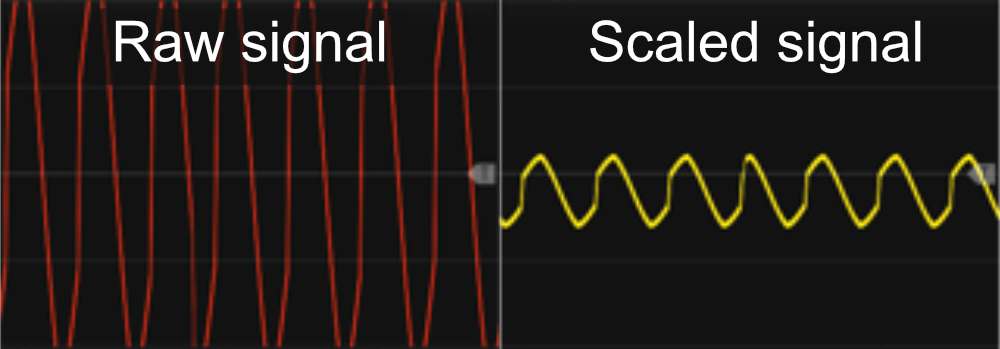

# Auto-Scale 4
The previous sections covered the Tweak modules first, followed by the VCA modules. This section introduces additional modules that, while not part of either the Tweak or VCA families, are still designed for amplification purpose.

 
The Auto-Scale 4 module closely resembles the Clamp 4 module, featuring Min and Max knobs, four inputs, and four outputs. However, instead of a three-way mode switch, it includes a Reset (both a CV input and a small push-button). Unlike the Clamp 4, which restricts signals within a defined range, the Auto-Scale 4 automatically scales and offsets input signals to fit within the range specified by the Min/Max knobs.

Between the **Min** and **Max** knobs, you’ll find a small **Link** button that lets you link the Max knob to the Min knob. When enabled, the Max knob mirrors the Min knob. For example, if you set the Min knob to **-3 V**, the Max knob will automatically be set to **+3 V**. This makes it very easy to dial in a symmetrical bipolar range.

This module is useful in situations where maintaining a specific voltage output-range is necessary. For example, when mixing two different LFO waveforms, even if both have a range of -5V to +5V, their combined (average mixed) output might not "fill this range". While a Tweak module could be used to manually scale and offset the mixed signal, it would require trial and error to find the exact values. The Auto-Scale 4 handles this adjustment automatically.

Like the Clamp 4 module, if the Min knob is set to a value greater than the Max knob, the module **inverts** the output, and a small red light next to the Min knob will illuminate. The default range for the Min/Max knobs is -5V to +5V, but commonly used ranges can be selected via the context menu. If a polyphonic signal is fed into one of the four inputs, all channels (up to 16) will be processed using the same automatically calculated scale and offset values. Each of the four sections has its own independent scaling and offset values, meaning they are adjusted separately. However, the context menu allows you to link all four sections to use the same scale and offset values if desired.

There may be times when you need to **reset** the internally calculated scale/offset values. For example, if previous input values had a larger dynamic range but the new input values have a smaller dynamic range, a reset ensures the module adjusts accordingly. You can reset the module by sending a trigger signal to the Reset input or pressing the small push-button next to the Reset input. Resetting will clear the stored scale/offset values for all four inputs, allowing them to be recalculated for new incoming signals. Additionally, disconnecting a cable from any input automatically resets that specific input's scale and offset values, preparing it for recalculations when a new signal is connected.

By default, the module continuously updates its internal scale/offset values in response to incoming signals. However, the context menu includes an option to lock the current values. When locked:
+ The scale and offset remain fixed at their last calculated values.
+ Any new input signals that would exceed the defined Min/Max range will be clamped/clipped instead of adjusting the scaling.
+ Changes to the Min/Max knobs will not affect the scaling.
+ Resetting the module (via a trigger or button press) will automatically disable the lock, allowing normal automatic scaling to resume.

The screenshots below shows an example of an auto scaled signal. The left side shows the **raw/red** (non-scaled signal) which in this case covered the range from -12.5V to +12.V (25V peak-to-peak). The right side shows the **scaled/yellow** signal. However as an asymetric scale-range from -2V to +1V (3V peak-to-peak) was selected the output of the Auto-Scale 4 module is both automatic scaled and offset to ensure the output fills the selected range:

Other amplification modules: [Clamp 4](Clamp4.md).

[Go back to modules overview](plugin.md#modules)
