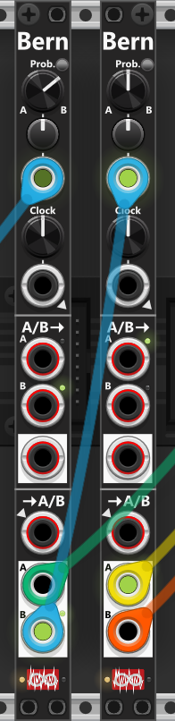

# Bernoulli Switch

 
This compact 2HP module provides a probability-based switching mechanism that determines whether the A or B input/output is selected upon receiving a clock signal *(described further down, it can also be used as a **Bernoully Gate**)*. At the top of the module, a probability knob (0% to 100%) and a CV input (with trim) is used to set the probability. By default the knob is at 50%, so there is an equal chance of selecting A or B. Turning the knob counterclockwise (below 50%) favors A, clockwise (above 50%) favors B. *Bascially you dail in a percentage-chance that B will be selected.* *Some general info regarding these modules are listed in [Common cross-fade switch features](commonSwitch.md).*

Next to the probability knob, there is a small toggle button that changes the **Probability mode**. By default, the module operates in **Probability(B)** mode, where the knob and its associated CV input set the probability percentage that **B** will be selected: P(B). Pressing the toggle switches the module to **Switch mode**. In this mode, the probability control instead determines the chance that the module will switch between A and B. For example, with no CV input and the knob fully counterclockwise (0%), no switching will occur and the current selection (A or B) remains unchanged. With the knob fully clockwise (100%), a switch WILL occur every time a trigger is received.

Below the probability control are a clock knob and trigger input. When no clock-input is connected, the built-in LFO runs at the frequency set by the knob. When an input is connected the frequency-knob is ignored. Each time a clock (or internal cycle) occurs, the module uses the probability settings. When using the internal clock, the context menu also offers a **Rate Chaos** setting that randomizes the speed of each individual cycle, so the "coin-flips" happen at slightly - or wildly - irregular intervals instead of at a perfectly steady rate. This option appears on several other modules too and is described in the [main manual](commonFeatures.md#rate-chaos).

The module has two switch-sections: the upper is a **2-in, 1-out switch** (A or B to one output); the lower is **1-in, 2-out switch** (one input to A or B). Green lights by the ports show the current selection (while a fade is in progress they blend with the mix). The context menu **"Sections: shared or independent A/B"** lets you use the same A/B choice for both sections (default) or let each section choose independently on each trigger.

Via the context menu each section has its own **Fade time** (same 0 / 1-2-5 series as other Infinite-Noise fixed times, up to 10 s). Default is **0**, which is the instant switch described above. A non-zero time cross-fades A↔B over that duration instead of jumping. **S-curve fade** (off by default) eases the mix (slow at the start and end, faster in the middle). Leave the lower section at 0 if you use it as a Bernoulli **gate**, so triggers keep hard edges.

In the top switch-section, the module routes either the A or B input to the single output below. If no input cables are not connected, the input-ports will be normalized to values selected in the context menu (default: 10V for the A-input, and 0V for the B-input). This allows you to configure the module to switch between static values without needing to connect any input-cables. This section supports polyphonic signals, with the output carrying as many channels as the input with the most channels. If necessary, the [Poly-Shuffle](PolyShuffle.md) module can be used to match the number of channels in both inputs.

The bottom switch-section routes a single input to either the A or B output. The selected output port is indicated by a small green light, while the unselected port outputs 0V by default (this can be changed in the context menu). In the context menu you can choose between a **fixed level** for the unselected output (for example 0V, 10V, etc.) or **“Last A/B-value”**, where the unselected port holds the last voltage that was sent from the input when that port was selected. This “last value” behaviour is tracked **per polyphonic channel**, so when the input is polyphonic, each channel of A and B remembers and restores its own last value independently. If no input cable is connected, the input will normalize to the clock input at the top of the module, meaning the clock signal itself will be routed to either output A or B based on the selected probability.

While this module is techically a Bernoulli Switch (switching between inputs/outputs) it can just as easily be used as **Bernoulli gate**. Thanks to normalization in the lower section, the input will **normalize to the clock-input** (or the internal clock if no clock-input is connected). As a result, when a "Clock occur" this clock (gate) will either be sent to the A- or the B-output. *Basically you are "splitting" the input-clock (based on probabillity-settings) into 2 parts, which can be routed to two different destinations.*

**TIP**: A Bernoulli Switch can serve various purposes. One simple application is to create probabilistic triggers or gates, such as randomly triggering a drum sound. To achieve this, set the desired probability, feed a trigger or gate signal into the Clock input, and take the output from the B output in the bottom section. The more clockwise the probability knob is turned, the greater the chance that the input trigger/gate will be passed to the B output. The module can also be used to randomly distribute clock pulses between two destinations. For example, feeding a clock signal into the Bernoulli Switch allows you to route alternating clock pulses to different modules via outputs A and B. This method can be extended by sending one of these outputs into another Bernoulli Switch to further subdivide and distribute clock pulses.

E.g. if you want to route a clock signal to one of **three** destinations with an equal probability, feed the clock into the first Bernoulli Switch and set its probability so that **B** is selected **66.7%** of the time. Then route the **B** output into a second Bernoulli Switch, configured with a **50%** probability. This results in an equal distribution: there is approximately a **33.3%** chance that the clock appears at the **A** output of the first Bernoulli Switch, a **33.3%** chance that it appears at the **A** output of the second switch, and a **33.3%** chance that it appears at the **B** output of the second switch. *In the screen-shot below there is a 33.3% chance that either the **green**, **yellow** or **orange** cable will output the clock that was feed into the leftmost Bernoulli switch.*

**TIP**: Since the A-input by default mormalize to 10V and the B-input to 0V, the upper switch-section can simply be used to output a high- or a low-gate based on the dialed in probability settings. Likewise when **Probability mode** is set to **Switch**, the probability knob sets the chance to switch on each trigger. At 0% the selection never changes; at 100% it toggles every time.

**TIP**: The Bernoulli Switch can also function as a **probability-driven mute module**. Simply route the signal you want to control into the **A input**, and use the AB output. Each time the module receives a trigger, it will either pass the A signal through or switch to the B input. Since the B input is left unconnected (and therefore outputs 0V), the result is that your signal is effectively “muted” at random, based on the selected probability. If in stead you set the mode to Switch, and dial in a probability of 100%, each clock input will simply switch between "muted/un-muted".

Other switch modules: [ON/OFF Switch](OnOffSwitch.md), [Combine](Combine.md).

[Go back to modules overview](plugin.md#modules)
