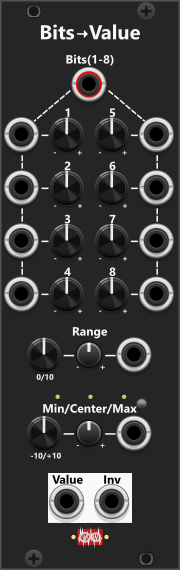

# Bits-to-Value
 
This module features individual gate inputs for 8 bits, which, combined with individually adjustable weights for each bit, generate a CV output within a specified range, along with an inverted output. The 8 bits can be supplied either as a single polyphonic input, where the first up to 8 channels represent the bit values, or through individual monophonic inputs for each bit. Each bit is processed as a gate signal, meaning a high gate (by default 1V or more) is interpreted as a bit value of "1", while a low gate (below 1V) is interpreted as "0". If needed, you can modify the high gate threshold via the context menu. If both a polyphonic signal and individual monophonic inputs are supplied, the individual inputs take priority. For example, if you provide a polyphonic input with 8 channels but also supply separate values for bits 3 and 5, those two bits will use the individually supplied values, while the remaining bits will derive their values from the polyphonic input. Inputs that are neither supplied via the individual inputs or the polyphonic input, will default to 0. All 8 bits are used to generate the output value.

Each of the 8 bits has a dedicated weight knob, allowing you to manually define the influence of that bit on the output value, within a range of 0 to 1. By default, these weights are pre-assigned as: 1/128, 1/64, 1/32, 1/16, 1/8, 1/4, 1/2, 1/1. Through the context menu, you can quickly set the weights to: Predefined weight sets, Randomized values or manually adjusted values dialed in by the knobs. 

The range in which the bit-generated values operate is determined by the Range and Min/Center/Max knobs and their associated CV inputs. For example, setting: Range = 10V, Center = 0V, will cause the bits to generate values within a -5V to +5V range.

**TIP**: You can use the polyphonic "Pulses" output from a [Turing Machine](TuringMachine.md#turing-machine) as an input for this module. The first 8 channels (corresponding to bits 1 through 8) will be utilized, while the remaining 8 channels from the Turing Machine's output are ignored. By default, this module assigns the same weights to each bit as the Turing Machine, meaning it will output identical values. To make it truly useful, you should assign different weights to the bits, either manually or via the context menu. This allows you to use a single Turing Machine to generate multiple distinct values from the same 8 lowest bits of its 32-bit pattern. 

**TIP**: The Turing Machine is not the only module that can generate a polyphonic signal suitable for this module. For example, in the context menu of the [Random-4](Random4.md) module, you can specify the polyphony (i.e., the number of output channels, each with its own random value). Setting the polyphony to 8 channels allows you to connect a single output from the Random-4 module directly to the polyphonic "Bits" input of this module. Additionally, keep in mind that this module also has individual monophonic inputs, which can be used on their own or in combination with a polyphonic input.

Other bit modules: [Value-to-Bits](ValueToBits.md).

[Go back to modules overview](plugin.md#modules)
