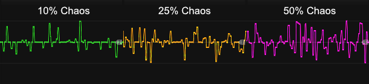
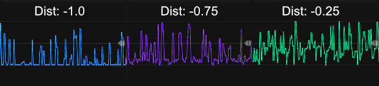
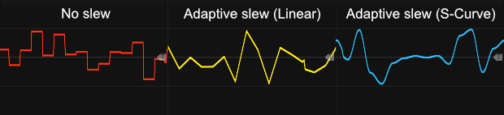

# Chaos

 
The central idea of the Chaos module is to bring the [**Rate Chaos**](commonFeatures.md#rate-chaos) (utilized by many Infinite-Noise modules, including Chaos itself) to modules outside this plugin, or perhaps even to inputs of modules within this plugin that don't natively support a Chaos rate. Basically, the Chaos module is a **random generator** that generates random values, where either the Trig input (if connected) or the internal LFO (with its frequency set by the Freq knob) determines when a new value is generated. As mentioned, the Chaos module has its own Chaos rate (set via the context menu), which can affect the dialed-in frequency when the internal LFO is in use. *Some general info regarding these modules are listed in [Common random features](commonRandom.md).*

*In essence, the Chaos module is similar to the Random Curve module. The key differences are how the distribution is handled and the fact that it has an input port, allowing the generated values to be "added" to the input without having to use an additional module. On the other hand, the Random Curve module has CV inputs for controlling Range and Distribution.*

Below the Trig input/Frequency knob, you find the **Chaos knob** and its CV-input. The previously mentioned Chaos rate (context menu) lets you specify chaos in 5% steps from 0% to 100%. However, the Chaos knob of the Chaos module lets you freely specify the Chaos setting anywhere in the range from 0% to 100%. The **Chaos CV-input** (0-10V) is added to the knob, and the result is then clamped to the 0%-100% range, allowing you to modulate the chaos. 

The Min/Max knobs define the range of the generated random values, while the small link button between them lets you link the Max knob inversely to the Min knob, making it easier to dial in a symmetrical bipolar range. *Internally the module will automatic swap the values dialed in by the min/max knobs if you dial in a minimum which is higher than the maximum.*

The **combination of Distribution and Chaos** is used differently by Chaos than for example Random 4 or Random Curve. In Random 4 and Random Curve you begin to collapse the range of generated values as the distribution knob is dialed beyond ±0.6. In the Chaos module it will tend to keep using the full range, however there will be fewer and fewer values near the extreems as you lower the Chaos. The distibution in stead controls the "anchor point" between the min/max settings. The distibution knob covers the range from -1 to +1, so if you dial it to -0.75 and the range is set to -5 to +5, the "anchor point" would be at -3.75.

Next to the Distibution knob you find the **Distribution mode** toggle button. When **dim (default)** it will be in **Knob** mode, and it will work as outlined above. However when **pressed/green** it will switch to **Frequency** mode where the distibution knob will be disabled/ignored. In this mode it will generate an CV output which you can use at a frequency CV signal (you can input to an LFO/VCO). Like with the [**Rate Chaos**](commonFeatures.md#rate-chaos) set by the context menu, when the **Chaos knob is dialed to 100%** this output can make an LFO/VCO run between **1/10** of the frequency dialed in by the LFO/VCO up to **10 times** the dialed in frequency. Dialing in a low chaos value, it will only "nudge" the dialed in frequency.

**One big difference between**: The Infinite-Noise modules which have a build in rate chaos context menu, will only generate a new chaos factor whenever one (waveform) cycle ends and a new begins. If you use the Chaos module to generate a chaos value that you will input as a frequency-CV it "does not know" when a cycle ends and a new begins, unless that module have a sync-output. E.g. [LFO1](LFO1.md) have a sync output, and if you feed this output into the Trig input of the Chaos module, it will only generate a new/changed chaos value whenever LFO1 begins a new cycle.

The Chaos value is added to the IN-input in each cycle. Hence when a new internal Chaos value is generated the output might "jump" due to the change of the internal Chaos value. However using the context menu you are able to select a fixed **slew-time**: 0 (default), then a 1-2-5 series from 0.0001 to 10 seconds (0.0001, 0.0002, 0.0005, 0.001, 0.002, 0.005, 0.01, 0.02, 0.05, 0.1, 0.2, 0.5, 1, 2, 5, 10), and "adaptive". The small light to the right of the "Freq" label shows the selected slew-time setting: **dim** when 0 is selected (no slew), gradually from **green** to **red** when 0.0001 to 10 is selected, and finally **blue** when adaptive is selected. By default this **slew is only applied to the generated Chaos value** (hence will not slew the input). However using the context menu you are able to change the slew target, so it will **instead slew the combined signal (input + Chaos value)**. 

The **adaptive** slew-time setting works best with a somewhat regular frequency. When enabled and a Trig input is connected, the module will try to determine the frequency of the incoming triggers and adjust the slew time accordingly. In this mode, the slew time adjusts by 75% on each cycle, allowing it to better handle small variations (`slewTime = (slewTime * 0.25) + (newSlewTime * 0.75)`). On the other hand, this means it takes a few cycles to catch up to a new significantly changed frequency. When enabled and the internal LFO is in use (the Trig input is not connected), the slew time adjusts 100% to match a full internal LFO cycle, even when the LFO frequency is affected by the internal Rate Chaos.

Besides being able to select the slew time, the context menu also lets you select the **slew shape**. By default, the slew shape is **linear**, but you can also select **S-curve**, **exponential**, or **logarithmic** (which is actually an inverted exponential curve). The selected slew shape is only used when the slew time is greater than 0.

The input is normalized to 0V, so if no signal is connected, the output will simply output the generated chaos value. When an input is connected, the generated chaos value is added to the input signal. In both cases, the output is clipped to a ±12V range by default, so if you need to exceed this range, you will have to use the context menu to change or disable the clipping range.

**TIP**: If you are unable to find a slew setting (time and/or shape) to your liking, you can instead use one of the [Slew modules](commonSlew.md). In this case, you should not input any signal into the IN port, so the OUT port of the Chaos module only outputs the Chaos value. You can then pass this output to a dedicated Slew module. The output of the Slew module (the slewed Chaos value) can be passed into a [Merge2x4](Merge2x4.md) along with the signal to which you want the slewed Chaos value added (a merger is basically just a precision adder that simply "adds the two inputs"). *Alternatively, you can skip the merger and simply pass both signals to the same input-port, as it will also just add the two signals.*

**TIP**: Even though the Chaos module is envisioned as an alternative to Chaos Rate (for modules without this feature), it can also be used as a simple random generator, producing either a "stepped" or "curved" output. Basically, you can use the slew-time/shape settings in the context menu to select the type of output you want. E.g., use no slew time for a "stepped" output or Adaptive Slew for a curved output (e.g., with the shape set to S-curve to generate an output similar to the "Curv" output of the Random Curve module). The combination of the Chaos knob/input and the Dist knob controls the distribution of the generated signal.

Other random modules: [Random-4](Random4.md), [Random Curve](RandomCurve.md).

[Go back to modules overview](plugin.md#modules)
