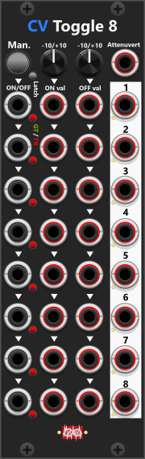

# CV-Toggle 8

 
Although the CV Toggle 8 module primarily functions as an 8-section switch, it shares similarities with the Manual-CV Mk.2 module, making it a useful addition to the manual control section. Each section is basically a switch which toggle between "ON" and "OFF" states, with ON/OFF signals derived from either CV inputs or the default ON/OFF values set using the knobs at the top. *Some general info regarding these manual-CV modules are listed in [Common manual-control features](commonManCV.md).*

Unlike Manual-CV modules, which rely on push buttons and knobs, CvToggle8 operates entirely via CV inputs. All inputs are normalized to the previous section, except for section 1 (in the top), which derives its default ON/OFF values from the knobs at the top. Similarly, section 1’s ON/OFF trigger input is normalized to the manual "All" button in the top section, while the remaining inputs are normalized to the previous section. If no ON/OFF gate/trigger inputs are connected, all sections respond to the "All" button.

Since the inputs normalize from top to bottom, you can have some sections use the default knob values while others rely on external ON/OFF signals. For example, if the top four sections have no ON/OFF cables connected, they will use the default ON/OFF knob values, while the bottom four sections will take values from any connected ON/OFF signals.

Via the context menu you can set a **Fade time** (0 / 1-2-5 series up to 10 s). Default is **0**, which is the instant ON/OFF switch. A non-zero time cross-fades between the live ON and OFF values over that duration. **S-curve fade** (off by default) eases the mix. The ON/OFF indicator lights stay binary when fade time is 0; while fading they blend with the mix.

Each of the eight ON/OFF inputs (leftmost column) can be configured to respond to gates or triggers. A small button next to the input toggles between gate mode (green) and trigger mode (red). *This can be set for all sections simultaneously via the context menu.* In trigger mode, each trigger pulse toggles between ON and OFF states. In gate mode, the ON signal is output only while the gate is high (1V or more); otherwise, the OFF signal is output.

At the top, the Attenuate CV input allows external control over the output level, scaling from +1x (when fed +5V) to -1x (when fed -5V). The context menu allows you to specify whether attenuation applies to ON values, OFF values, or both. When no attenuate signal is connected, the output defaults to 1x scaling.

*Among the Infinite-Noise switch modules, the [ON/OFF Switch](OnOffSwitch.md) can be considered a smaller version of this module, featuring only one ON/OFF section instead of eight.*

**TIP**: Leaving the OFF knob at 0V (default) and not connecting an OFF input allows you to use this module as an 8-section **CV-controlled mute**. When a section is ON, it outputs the ON-input; when OFF, it outputs 0V. This setup allows the module to function as a multi-section signal switch. *Important Note: Mutes apply to all signal types, including audio, clocks, triggers, gates and CV-modulation signals.*

**TIP**: This module can **invert multiple gate signals at once**. To do this, all ON/OFF inputs must be set to gate mode, the ON value knob must be set to 0V, and the OFF value knob must be set to 10V. This setup ensures that when a high gate is received, the module outputs 0V (low gate), and when a low gate is received, it outputs 10V (high gate)—effectively inverting the input gate signal. Using CV Toggle 8 to Convert Triggers into Alternating High/Low Gates If the ON/OFF inputs are set to trigger mode, the ON knob set to +10V, and the OFF knob set to 0V, each trigger will toggle the output between a high- and low-gate state. This setup allows the module to function as an 8-section trigger-driven gate toggle switch.

**TIP**: Combining CV Toggle 8 with Manual-CV 8 Mk.1 and a [Merge-4](MergeMult4.md) module allows you to perform gate/trigger-driven CV addition. Use Manual-CV 8 to manually set values for up to 8 sections, or use the ON knob in CV Toggle 8 to set a common value (e.g., 1V per octave step). Each section outputs either the ON value or 0V, and these outputs can be merged (summed) together, creating gate-controlled additive CV outputs.

### Polyphony
The ON/OFF gate/trigger inputs are monophonic (only the first channel is used when a polyphonic signal is connected). However, the ON and OFF CV-inputs support polyphonic signals, and the output will match the input with the most channels. For example, if an 8-channel polyphonic signal is fed into the ON input and a 4-channel signal into the OFF input, the output will be 8-channel polyphonic.

Other manual-control modules: [Manuel Trigger, Gate and CV](ManTrGtCv.md), [Manuel Push 2](ManPush2.md), [Manuel Trigger 8](ManTrigger8.md), [Manuel Gate 8](ManGate8.md), [Manuel CV 8 Mk I](ManCV8I.md), [Manuel CV 8 Mk II](ManCV8II.md), [Manuel Mute 8](ManMute8.md), [Mute 2](Mute2.md).

[Go back to modules overview](plugin.md#modules)
