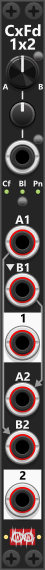

# Cross-fade 1x2
 
The CxFade1x2 module provides a single cross-fade knob and CV input, allowing you to blend between two separate mono signals or a stereo signal. The inputs, labeled A1/B1 and A2/B2, are cross-faded to their respective outputs: A1/B1 is routed to output "1", and A2/B2 is routed to output "2". If no cable is inserted into B1, it normalizes to A1; if no cable is inserted into A2, it normalizes to B1; if no cable is inserted into B2, it normalizes to A1. Patching A1 and B1 and leaving A2 and B2 unconnected therefore yields a flipped cross-fade on output "2" relative to output "1". *Some general info regarding the Cross-fade modules are listed in [Common cross-fade features](commonCrossFade.md).*

The cross-fade position is determined by the knob setting (A1/A2 at full counterclockwise, B1/B2 at full clockwise), combined with the CV input, which is scaled by a trim control. Knob/CV scaling defaults to linear; the context menu can switch that curve to logarithmic or exponential (independent of the Cf/Bl/Pn mode below). Via the context menu you can also set a **Fade time** (0 / 1-2-5 series up to 10 s). Default is **0**, which is the instant A/B switch. A non-zero time is used only in **Trigger mode**, when a pulse on the trigger input toggles A↔B: the knob still jumps to the opposite extreme, but the audio mix cross-fades over that duration. The **manual A/B-toggle stays instant**. **S-curve fade** (off by default) eases that trigger mix. CV-mode knob/CV blending is not delayed by Fade time. Since both sections (1 and 2) operate independently, they can have different channel counts, but when processing polyphonic signals, it’s best if both inputs in the same section have the same number of channels. If a monophonic signal is cross-faded with a polyphonic signal, the single monophonic channel is applied to all polyphonic channels during the fade.

Cross-fade 1x2 has a mode button that cycles its **Cross-fade mode**; one of three lights indicates which mode is active. These modes let you use the module for **stereo balance and panning**. For a **stereo** signal, patch the **left channel into A1** and the **right channel into B1**, and leave A2 and B2 unconnected so they use their default normalization. For a **mono** signal, patch **only A1** and leave B1, A2, and B2 unconnected: B1 copies A1, and A2 then copies B1, so both outputs carry that source. **Output 1 then carries the left** (balanced/panned) signal, and **output 2 carries the right** (balanced/panned) signal:

+ **Cf** = **Cross-fade**: Turning the cross-fade knob changes the blend ratio between the A and B signals.
+ **Bl** = **Balance**: Turning the cross-fade knob keeps one side at full level while reducing the other. For example, turning the knob towards A (left) keeps A at 100% while reducing B (right). In this mode the signals will never blend, only their levels will change. *E.g. the 1 output will only be the A1 signal - never blended wth B1, likewise the 2 output will only be the B1(A2) signal - never blended with A1(B2).*
+ **Pn** = **Pan**: This mode keeps a constant total level. With the knob centered, outputs 1 and 2 each carry about 70.7% (`1/sqrt(2)`) of the A/B inputs. Turning the knob towards one side raises that side to 100% while the other falls to 0%.

 

Other cross-fade modules: [Cross-fade 4x1](CxFade4x1.md).

[Go back to modules overview](plugin.md#modules)
