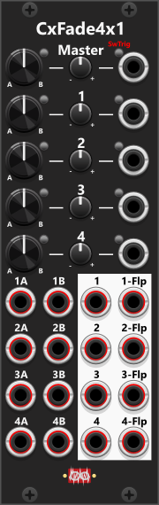

# Cross-fade 4x1
 
The CxFade4x1 module features four independent cross-fade sections (labeled 1, 2, 3, and 4), allowing for seamless blending between four mono signals (or two stereo pairs). Each section provides an individual cross-fade control, which can be adjusted using a knob (counterclockwise for "A" and clockwise for "B") and/or a CV input. A trim control scales the CV input between -1x and +1x, and the knob position and attenuated CV input are combined to determine the final fade amount. By default, the cross-fade operates in a linear mode, but you can switch to exponential mode via the context menu. Next to each CV input, there is a small button that enables Trigger mode (red when active). When engaged, the CV input behaves as a trigger, toggling the cross-fade between full A (left) and full B (right) with each incoming pulse. In this mode, the trim control is ignored (and covered by an overlay). Similarly, next to each cross-fade knob, there is a manual toggle button that functions the same way, allowing you to switch between A and B manually—but only when no CV input is connected. The context-menu **Fade time** / **S-curve fade** (see [Common cross-fade features](commonCrossFade.md)) is one shared setting for the whole module; master and each section still ramp independently when *that* control’s trigger input fires. *Some general info regarding the Cross-fade modules are listed in [Common cross-fade features](commonCrossFade.md).*

In addition to the individual controls, the CxFade4x1 features a Master cross-fade knob and CV input at the top of the module. This Master control is added to all four sections, allowing you to fade multiple sections simultaneously using a single knob or CV input. To use only the Master cross-fade, set the individual section knobs to their middle position and ensure no CV inputs are connected. This allows the Master control to fully control all four sections at once. If using Trigger mode, it is recommended to enable it either on the Master control OR the individual sections—not both at the same time.

Each section provides both a normal and flipped output:

+ Turning the cross-fade knob towards A increases the A-signal in the normal output, while decreasing the B-signal.
+ The flipped output, however, does the opposite—when A is dominant in the normal output, B is dominant in the flipped output.

This dual-output feature gives you flexibility when routing signals.

 

Like the CxFade1x2, the CxFade4x1 supports polyphonic inputs and outputs. The number of channels is determined by the input with the highest channel count. For example If you connect an 8-channel signal to "1A" and a 4-channel signal to "1B", the "1" and "1-Flp" outputs will carry 8 channels. Each section is fully independent, meaning you can mix different polyphony counts across sections—for example, section 1 could have 1 channel, section 2 could have 2 channels, section 3 could have 4 channels, and section 4 could have 8 channels. For best results, signals connected to the same section should ideally have the same number of channels. If you cross-fade between a monophonic and a polyphonic signal, the single monophonic channel will be applied to all channels of the polyphonic signal.

Other cross-fade modules: [Cross-fade 1x2](CxFade1x2.md).

[Go back to modules overview](plugin.md#modules)
