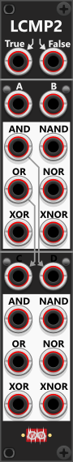

# Logic Comparator-2

 
Similar to the TinyLCMP2 module, the LCMP2 consists of two sections, but instead of having four inputs per section, each section has two inputs. Rather than selecting a single logic operation, each section features dedicated outputs for all six Boolean operations: AND, OR, XOR, NAND, NOR, and XNOR. Each of the four inputs (A, B, C, and D) can be individually inverted using the small push-buttons next to them. If no cable is inserted into the C-input (lower section), it normalizes to the OR output of the upper section. Likewise, if the D-input is left unconnected, it normalizes to the AND output of the upper section. *Some general info regarding the Compare-modules are listed in [Common compare features](commonCompare.md).*

Like the TinyLCMP2, the module outputs 10V when a logical operation evaluates as True and 0V when it evaluates as False. These default output levels can be customized via the context menu. However, the LCMP2 has an additional feature that significantly expands its functionality. At the top of the module, there are **two extra inputs labeled "True" and "False"**. If signals are supplied to these inputs, the logical outputs no longer produce fixed voltage levels (e.g., 10V for True and 0V for False). Instead, they output the corresponding True or False signal. Any logical output that evaluates as True will output the True-signal, while those evaluating as False will output the False-signal.

**TIP**: Because the LCMP2 allows you to assign custom signals for True and False, it can **function as a switching module**. For example, if you send a gate signal (by default, ≥ 1V) into input A, the OR output will pass the True signal while the gate is high. When the gate drops below 1V, the OR output will switch to the False signal. To apply this behavior to the lower section, make sure to pass the gate signal into input C. Otherwise, C will default to the OR output of the upper section (A OR B). If only supplying a True-input and leave the False-input un-connected, the OR-output in the top section will output the True signal while the A input is high, and 0V when it's low, basically functioning as a **mute-device**.

Other compare modules: [Tiny Logic Comparator-2](TinyLCMP2.md), [Logic Comparator-6x2](LCMP6x2.md), [Value Comparator-1](VCMP1.md), [Value Comparator-2 Mk I](VCMP2I.md), [Value Comparator-2 Mk II](VCMP2II.md).

[Go back to modules overview](plugin.md#modules)
