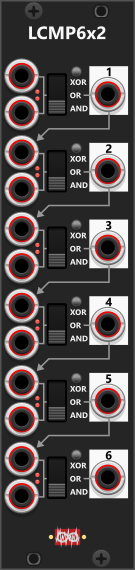

# Logic Comparator-6x2
 
The LCMP6x2 module consists of six independent compare sections, each with two inputs. Each section includes a three-way switch that allows you to choose between AND, OR, or XOR operations. Additionally, a toggle button lets you invert the operation, converting AND into NAND, OR into NOR, and XOR into XNOR. By default, the first input in each section is normalized to the output of the previous section, allowing for sequential logical operations without requiring additional patching. The module fully supports polyphonic signals and will output as many channels as the input with the highest number of channels. Through the context menu, all inputs can be individually inverted, flipping high values to low and vice versa. If an input is inverted, a small red light next to the corresponding input port will illuminate. *Some general info regarding the Compare-modules are listed in [Common compare features](commonCompare.md).*

**TIP**: If you need to perform a **NOT** operation (e.g. to invert a gate), you can simply attach your gate signal to the 1st input in any section (while leaving the 2nd input non-connected), set the 3-way switch in the "OR" position and via the context-menu you choose to invert the 1st input. This way, when you input a high-gate which is then inverted and then OR'ed with nothing, it outputs as a low-gate (basically converting a high-gate to a low -gate). Similarly, when you input a low-gate which is then inverted and then OR'ed with nothing, it outputs as a high-gate (basically converting a low-gate to a high-gate). 

*Alternatively without inverting any input via the context-menu, you can input your gate (to be NOT'ed) into the 1st input, leave the 2nd input non-connected and then set the operation to XNOR (inverted OR). This will give the same effect, where the gate will be NOT'ed, i.e a high input-gate will output as low gate, and a low input-gate will output as a high gate.*

**TIP**: If you need to perform the same logical operation on more than two signals at once, the TLC2 module may be a better option, as it provides two sections, each capable of processing up to four inputs. If you need to perform multiple different logical operations on the same two signals, the LCMP2 module might be a better fit, as it has dedicated outputs for all six Boolean operations (AND, OR, XOR, NAND, NOR, XNOR). However, if you need to apply different logical operations across multiple signals, where each operation involves only two signals, then LCMP6x2 is the ideal choice.

The **LCMP6x2** also pairs well with the [Turing Machine](TuringMachine.md#turing-machine) module. The Turing Machine provides 16 outputs: the first 8 represent the lower 8 bits of its internal sequence pattern, while the next 8 outputs combine pairs of those bits (for example, output 9 is **Bit 1 AND Bit 2**). If you want to combine bit outputs in other ways — such as **Bit 1 OR Bit 4** — the **LCMP6x2** is a great tool. It offers 6 sections with 2 inputs each, and thanks to its normalization (or by using patch cables), you can chain multiple sections together to create more complex combinations.

**Example**: Let’s say you have four signals (A, B, C, and D) and want to compute the logical operation: "**(A OR B) AND (C OR D)**". To achieve this, you would:

+ Feed A and B into section 1, setting the logic operation to OR.
+ Feed C and D into section 2, also setting the logic operation to OR.
+ Combine the results from sections 1 and 2 using an AND operation in section 3.

Since the first input of section 3 is normalized to the output of section 2 (as indicated by the arrows on the panel), you only need to manually patch the output of section 1 into the second input of section 3 and set its three-way toggle switch to AND. This effectively creates the desired logical chain: "(A OR B) AND (C OR D)".

Other compare modules: [Tiny Logic Comparator-2](TinyLCMP2.md), [Logic Comparator-2](LCMP2.md), [Value Comparator-1](VCMP1.md), [Value Comparator-2 Mk I](VCMP2I.md), [Value Comparator-2 Mk II](VCMP2II.md).

[Go back to modules overview](plugin.md#modules)
