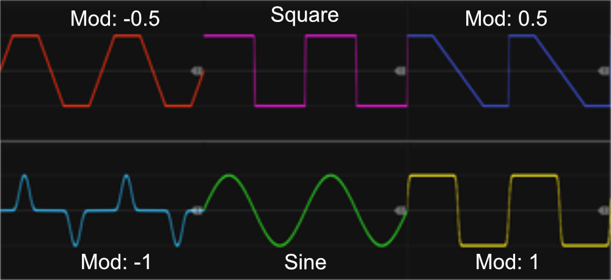
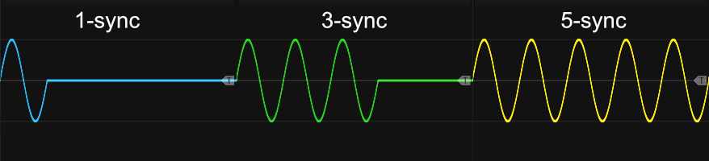
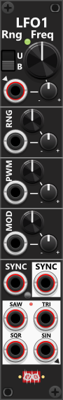

# LFO1

 
This 4HP single-LFO module generates four waveforms (Square, Triangle, Saw, and Sine) which can all be output simultaneously. When a polyphonic signal is fed into the frequency CV-input, the waveform-outputs will also be polyphonic, maintaining the same number of channels as the input (though the rate-indicator light will only reflect channel 1). The Bipolar/Unipolar switch works in conjunction with the range knob/input to define the output range of the waveforms. PWM can be adjusted via a knob and CV modulation (1% to 99%), and by default, it affects all four waveform types. However, the context menu allows PWM to be applied exclusively to the Square waveform, and it can decrease the PVM range in steps, down to 25%/75%. *Some general info regarding the LFOs are listed in [Common LFO features](commonLFO.md).*

Like TLFO, as indicated by the arrow-heads, the frequency CV-input is normalized to the Sine waveform-output, however as the trim-knob defaults to 0% it will have no effect until you start dialing in a none-zero trim-value.

A key feature of this module is the **MOD** knob/input, which alters the waveform shape (wave-shaping). When turned counterclockwise, waveforms become "sharper/thinner" at their "peaks", while turning it clockwise makes them "rounder/fatter". Since this type of modulation does not work directly on the Square waveform, the Square waveform in stead transitions into a Triangle (counterclockwise) or a Saw wave (clockwise). Essentially, this allows the Square waveform to morph into different shapes, behaving like a **wavetable transition** between Triangle, Square, and Saw. *Combining the MOD and PWM controls—especially with CV modulation—can create a wide variety of waveform variations*.

This module supports both **sync-in** and **sync-out**, allowing it to synchronize with- or control other external LFOs. Whether the module outputs monophonic or polyphonic waveforms is determined by the frequency input. If a polyphonic signal (e.g., 4 channels) is fed into the frequency input, all waveform outputs will also be polyphonic with the same number of channels. When polyphonic outputs are enabled, the sync-input can either be monophonic (in which case all channels sync simultaneously) or polyphonic (allowing sync to occur independently per channel). If the frequency input is monophonic, only the first channel of the sync-input is used, and additional channels will be ignored. The sync-output will always have as many channels as the frequency input, regardless of whether the sync-input is monophonic or polyphonic.

By default, the sync-out trigger fires both when the device receives a sync-in signal and when the LFO completes a full cycle. However, the context menu allows changing this behavior so that the sync-out trigger fires only when: a sync-in signal is received, or the LFO completes a full cycle. If the second option is selected, the **sync-out may never trigger** if the LFO continuously receives sync-in pulses before completing a cycle.

A small push-button near sync-in allows the LFO to be switched into **1-shot mode** (when the button is green). In this mode, upon receiving a sync signal, the module outputs only a single full waveform cycle. Actually this feature is more a **n-shot mode**, as you via the context menu can select the number of full cycles to perform: **1-16, 17, 19, 23, 24, 29 or 32**. Each time a new sync-in signal is received, the count resets, even if the previous waveform sequence is still running. Once the preset number of cycles is completed, all phases reset, and the waveform outputs hold at 0V (though this default value can be modified via the context menu).

The n-shot mode can be used to generate a **burst of multiple clocks/triggers**. E.g. using the square-output where frequency is determening the speed/duration of each generated square, the module will generate the selected number of square-waveforms each time the module receives a sync-in signal. By default these will have 50% high-phase followed by a 50% low-phase. However if you want these to appear more like triggers ("short" high-phase/"long" low-phase) you can dial the PWM knob counter-clockwise. If you at the same time have dialed in a non-zero rate chaos (using the context menu) each of the generated waveform output will run at different rates, which will generate a more "chaotic" output.

 

**TIP**: To generate **polyphonic waveform outputs**, you need to provide a **polyphonic frequency CV**. This allows each waveform channel to run at a different frequency, since the frequency CV (after being attenuverted by the trim knob) is added to the frequency set by the main frequency knob. In this aspect you can use the **Poly** output of a [Manuel CV 8 Mk I](ManCV8I.md) to generate such a polyphonic signal. By default, the Poly output provides 8 channels, but you can reduce the polyphony (for example, to 4 channels) via the context menu. Using the top four knobs of the Manual CV 8 Mk I, you can dial in four different voltage levels, which are then added to the base frequency set on the **LFO-1**, allowing each polyphonic channel of the waveform outputs to run at a different frequency. *Basically with a 4-channel input, you are turning the LFO1 into a **Quad-LFO** where the first 4 knobs of the Manuel CV 8 Mk I determines the "interval" between the different frequencies of the 4 LFO output (each in their own output channel).*

Other LFO modules: [Simple LFO4-ss](SLFO4ss.md), [Simple LFO4-st](SLFO4st.md), [Tiny LFO](TLFO.md), [Phase-Driven LFO](PhaseDrivenLFO.md).

[Go back to modules overview](plugin.md#modules)
