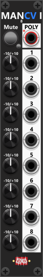

# Manuel CV 8 Mk I

 
This 4HP module features 8 sections, each with a dedicated knob for adjusting a CV level between -10V and +10V. Each section has an output port that transmits the voltage dialed in by its corresponding knob. The "Poly" output will (by default) output all 8 CV-outputs compound in the same polyphonic signal (1 channel for each of the 8 sections). However using the context menu, the polyphony count can be reduced (e.g. only output the first 4 sections, as a 4 channel polyphonic signal). *Some general info regarding these manual-CV modules are listed in [Common manual-control features](commonManCV.md).*

*At one point, I considered creating a module with multiple outputs, each generating a different fixed voltage (for example: −10V, −5V, −2V, -1V, 1V, 2V, 5V, and 10V). However, there is really no need for a dedicated module like that. Each of the 8 knobs can already be used to dial in any output voltage you need manually. In addition, the module’s context menu includes several predefined value sets—for example, a negative/positive set containing: −10V, −5V, −2V, -1V, 1V, 2V, 5V, and 10V.*

Next to the poly-ouput you'll find a latchable Mute-button. When the mute-button is pressed/latched, all channel outputs will by default switch to 0V no matter the volt-setting dialed in by the knobs. However using the context menu, this mute-level can be changed using the context menu (one mute-level affecting all 8 sections).

**TIP**: If you need precise voltage steps, you can use the context menu to enable quantization. This feature ensures that when you dial in a value (e.g., 3.3V), it rounds to the nearest predefined step—for example, 3V if quantization is set to 1V. The voltage only needs to be within half of the quantization value (e.g., within ±0.5V when rounding to 1V steps). Quantization options include: 1/12V (notes), 1/6V (2/12V), 1/4V (3/12V), 1/3V (4/12V), 1/2V (6/12V), 1V, 2V, 2.5V, 3.33V, and 5V.

**TIP**: Since the full range of the CV knobs is -10V to +10V, if you need a smaller range (e.g., 0V to 5V), you can route the output through one of the [Tweak modules](commonTweak.md). Applying a 0.25x scale with a +2.5V offset effectively converts the range to 0V to 5V, allowing for more precise control.

Other manual-control modules: [Manuel Trigger, Gate and CV](ManTrGtCv.md), [Manuel Push 2](ManPush2.md), [Manuel Trigger 8](ManTrigger8.md), [Manuel Gate 8](ManGate8.md), [Manuel CV 8 Mk II](ManCV8II.md), [Manuel Mute 8](ManMute8.md), [Mute 2](Mute2.md), [CV-Toggle 8](CvToggle8.md).

[Go back to modules overview](plugin.md#modules)
