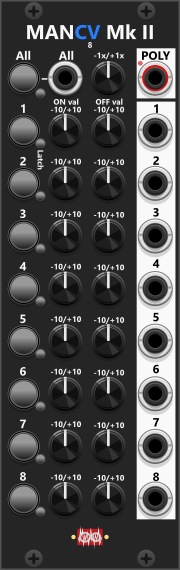

# Manuel CV 8 Mk II

 
Similar to the Mk.I, the Mk.II version is featuring 8 sections in a 8HP module. However, unlike its predecessor, each section includes two CV knobs—one for setting an "On" level and another for an "Off" level"—along with a toggle button that switches between these two states. By default, all Off-values are set to 0V (as this is the most logical default for an "off" state), but these can be adjusted to any desired value. Essentially, each section functions as a two-state switch, where the toggle button allows switching between the "On" and "Off" values. At the top of the module, there is an "All" button. When pressed, it toggles all 8 sections between their On and Off states. However, the context menu provides additional control over its behavior, allowing it to be set to either "On", "Off", or "Toggle" mode. The "Poly" output will (by default) output all 8 CV-outputs compound in the same polyphonic signal (1 channel for each of the 8 sections). However using the context menu, the polyphony count can be reduced (e.g. only output the first 4 sections, as a 4 channel polyphonic signal). *Some general info regarding these manual-CV modules are listed in [Common manual-control features](commonManCV.md).*

The Mk.II features an Attenuate knob at the top. The knob allows attenuation from -1x to +1x (-100% to +100%), though it defaults to 1x, meaning the signal remains unaltered unless adjusted. A context menu setting allows you to specify whether the attenuation should affect only the On values, only the Off values, or both (default). 

**TIP**: The knobs cover a full range of -10V to +10V, but if you require a more restricted range (e.g., 0V to 5V), you can process the output through a [Tweak modules](commonTweak.md). By applying a 0.25x scale and a +2.5V offset, you can effectively remap the output to the 0V–5V range for finer control over modulation signals.

Other manual-control modules: [Manuel Trigger, Gate and CV](ManTrGtCv.md), [Manuel Push 2](ManPush2.md), [Manuel Trigger 8](ManTrigger8.md), [Manuel Gate 8](ManGate8.md), [Manuel CV 8 Mk I](ManCV8I.md), [Manuel Mute 8](ManMute8.md), [Mute 2](Mute2.md), [CV-Toggle 8](CvToggle8.md).

[Go back to modules overview](plugin.md#modules)
