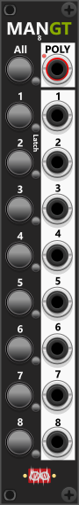

# Manuel Gate 8
 
Similar in design to the Manual-Trigger 8 module, this 4HP module also contains 8 sections, but instead of 1ms triggers, it outputs gates. Each section features a push-button, a small latch-button, and an output port. While the button is held (or latched ON), the output sends a 10V gate (high) and returns to 0V (low) when released. At the top, the "All" button enables all 8 gates simultaneously, and the "Poly" output. By default, pressing the "All" button toggles the state of all 8 sections, but its functionality can be adjusted via the context menu (for example, to ensure all sections fire regardless of their current state). The "Poly" output will (by default) output all 8 gates compound in the same polyphonic signal (1 channel for each of the 8 sections). However using the context menu, the polyphony count can be reduced (e.g. only output the first 4 sections, as a 4 channel polyphonic signal). *Some general info regarding these manual-CV modules are listed in [Common manual-control features](commonManCV.md).*

Keep in mind that **a trigger is simply "a short gate"** (default: 1 ms). This means gate outputs from this module can in moste cases substitute for triggers when needed. For example, in the Toggle-CV module, each of its 8 sections can be configured to respond to either gates or triggers. If some sections are set to detect gates, while others detect triggers, you don't necessarily need separate Manual-Trigger and Manual-Gate modules—a single Manual-Gate module can be used to control both types of inputs simultaneously.

Other manual-control modules: [Manuel Trigger, Gate and CV](ManTrGtCv.md), [Manuel Push 2](ManPush2.md), [Manuel Trigger 8](ManTrigger8.md), [Manuel CV 8 Mk I](ManCV8I.md), [Manuel CV 8 Mk II](ManCV8II.md), [Manuel Mute 8](ManMute8.md), [Mute 2](Mute2.md), [CV-Toggle 8](CvToggle8.md).

[Go back to modules overview](plugin.md#modules)
