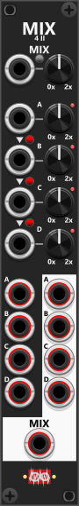

# Manuel Mix 4 Mk II

 
The 4HP Manual Mix 4 Mk II is similar to the Mk I, but adds amplification CV inputs and a separate output for each of the four sections (A–D) in addition to the mix output at the bottom. Mix CV inputs are normalized to the previous section (A normalizes to 0V; B to A; C to B; D to C). Because there are no trim knobs, red/green toggle buttons beside the normalization arrows control whether each downstream input follows the previous one—green means enabled (default), red means disabled. *Some general info regarding the Mix modules are listed in [Common Mixer features](commonMixer.md).*

Since the amplification CV is without trim, it should be applied with the exact input range. The amplification knobs default to the center position (100%), so with the knob at that position a +5V input would be equivalent to the knob being set to 200%, or a −5V input would be equivalent to setting the knob to 0%. If you instead turn the knob fully counter-clockwise to 0%, a 5V amplification input would be the same as setting the knob to 100%, and a 10V amplification input would be the same as setting the knob to 200% (10V input range = full knob range).

The **individual section outputs** (A–D) carry each input multiplied by its own knob/CV gain only—they are not scaled by the master knob or mix-mode unity/averaging logic. The **mix output** sums all connected inputs (with per-section gain), applies unity or averaging scaling, then applies the master knob/CV gain.

Like Mk I, the module supports **unity** and **averaging** mix modes (mix-mode button: unpressed/black = Unity, pressed/blue = Averaging—see [Manuel Mix 4 Mk I](ManMix4I.md)). Each mix knob can also be **inverted** via the context menu.

Other mixer modules: [Manuel Mix 4 Mk I](ManMix4I.md), [Manuel Mix 4 Stereo](ManMix4st.md), [Matrix Mix 5x5](MatrixMix5x5.md), [Matrix Mix 4x4 Stereo](MatrixMix4x4Stereo.md).

[Go back to modules overview](plugin.md#modules)
