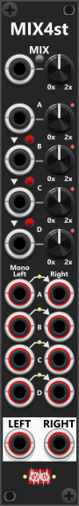

# Manuel Mix 4 Stereo

 
The Manual-Mix4st is the stereo variant: four stereo input sections (A through D), each with left and right polyphonic inputs, and mixed left/right outputs at the bottom (no per-section outputs). It shares the Mk II amplification CV inputs and normalization buttons (B→A, C→B, D→C; see [Manuel Mix 4 Mk II](ManMix4II.md) for CV range and behavior). *Some general info regarding the Mix modules are listed in [Common Mixer features](commonMixer.md).*

By default—indicated by green lights between the left and right input columns—if you supply only a left input (e.g. a mono signal) and leave the right input unplugged, the right channel is normalized to the left. This **mono-to-stereo** behavior can be disabled in the context menu (lights turn red). *If you need to apply any balance/pan before/after the mix, the [Stereo Balance/Pan](StereoBalancePan.md#stereo-balance-pan) module can be used.*

The module supports **unity** and **averaging** mix modes (mix-mode button: unpressed/black = Unity, pressed/blue = Averaging—see [Manuel Mix 4 Mk I](ManMix4I.md)) and per-section **inverted** amplification via the context menu.

Other mixer modules: [Manuel Mix 4 Mk I](ManMix4I.md), [Manuel Mix 4 Mk II](ManMix4II.md), [Matrix Mix 5x5](MatrixMix5x5.md), [Matrix Mix 4x4 Stereo](MatrixMix4x4Stereo.md).

[Go back to modules overview](plugin.md#modules)
