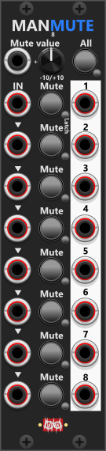

# Manuel Mute 8

 
The Manual-Mute 8 is a 6HP module designed for muting up to eight separate signals, each with its own CV input, mute button, and output. Each CV input is normalized to the previous one, allowing a single input into multiple sections if needed. You can mute individual sections by pressing their dedicated mute button, or you can mute all eight sections simultaneously using the "All" button at the top. By default, both the individual mute buttons and the "All" button function as momentary switches, but they each have a latch button that allows them to toggle instead of momentarily holding the mute state. When a section is unmuted, the output simply passes through the corresponding input signal. However, when a section is muted, it outputs the voltage set by the "Mute Value" knob, which defaults to 0V. Additionally, there is a "Mute Value" CV input, allowing an external signal to define the mute-output value dynamically. If both a CV input and the Mute Value knob are used, the knob value acts as an offset, and the final mute-output will be a sum of the two values. *Some general info regarding these manual-CV modules are listed in [Common manual-control features](commonManCV.md).*

Via the context menu you can set a **Fade time** (0 / 1-2-5 series up to 10 s). Default is **0**, which is the instant mute. A non-zero time cross-fades between the live input and the mute level over that duration. **S-curve fade** (off by default) eases the mix.

**TIP**: If you need to mute signals based on an external CV input (trigger or gate), consider using the [CV-Toggle 8](CvToggle8.md) module, which can function as a CV-controlled mute. Alternatively, the [Mute 2](Mute2.md) module provides both manual and CV-controlled muting for two signals, allowing individual or collective muting through button presses or CV inputs.

Other manual-control modules: [Manuel Trigger, Gate and CV](ManTrGtCv.md), [Manuel Push 2](ManPush2.md), [Manuel Trigger 8](ManTrigger8.md), [Manuel Gate 8](ManGate8.md), [Manuel CV 8 Mk I](ManCV8I.md), [Manuel CV 8 Mk II](ManCV8II.md), [Mute 2](Mute2.md), [CV-Toggle 8](CvToggle8.md).

[Go back to modules overview](plugin.md#modules)
