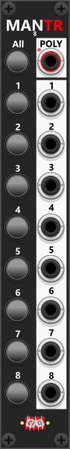

# Manuel Trigger 8
 
This compact 4HP module consists of 8 sections, each equipped with a momentary push-button and a corresponding output port. Pressing a button triggers a 10V pulse for 1 ms at the associated output. At the top of the module, you'll find an "All" button and an "Poly" output. Pressing the "All" button fires all 8 triggers simultaneously. The "Poly" output will (by default) output all 8 triggers compound in the same polyphonic signal (1 channel for each of the 8 sections). However using the context menu, the polyphony count can be reduced (e.g. only output the first 4 sections, as a 4 channel polyphonic signal). *Some general info regarding these manual-CV modules are listed in [Common manual-control features](commonManCV.md).*

*To be perfectly honest, I don't use the **Manual Trigger 8** very often, simply because it can only generate trigger outputs—that's exactly what it's designed to do. By default, each trigger is a 10V pulse that remains high for 1 ms before returning to 0V, regardless of how long you hold the button. However, most modules that respond to triggers work just as well with a gate signal that remains high for longer than 1 ms. In most cases, the duration of the high signal is not important; what matters is **when** the signal goes high—that is, detecting its rising edge. Because of this, these modules work equally well with the outputs from the [Manuel Gate 8](ManGate8.md) module. In other words, the same Manuel Gate 8 module can often be used to generate signals that function as both gates and triggers. There are, however, situations where you specifically need a short pulse, regardless of how long the button is held. In those cases, I would choose the **Manual Trigger 8** instead.*

Other manual-control modules: [Manuel Trigger, Gate and CV](ManTrGtCv.md), [Manuel Push 2](ManPush2.md), [Manuel Gate 8](ManGate8.md), [Manuel CV 8 Mk I](ManCV8I.md), [Manuel CV 8 Mk II](ManCV8II.md), [Manuel Mute 8](ManMute8.md), [Mute 2](Mute2.md), [CV-Toggle 8](CvToggle8.md).

[Go back to modules overview](plugin.md#modules)
