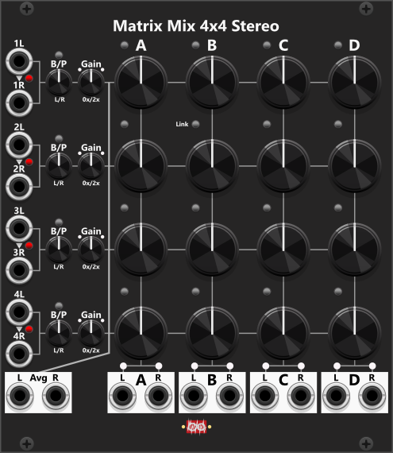

# Matrix Mix 4x4 Stereo

 
As the name implies, the Matrix Mix 4x4 Stereo is intended for mixing audio/stereo signals. Hence, all 16 level knobs only cover the positive range from 0x to 1x (0% to 100%), and there is no way to invert the inputs. *Some general info regarding the Mix modules are listed in [Common Mixer features](commonMixer.md).*

Each of the **4 input rows** consists of a Left/Right input pair, where the Right input is by default normalized to the Left input if you don't connect a Right signal. The small toggle button next to the arrowhead, however, lets you disable this normalization. *Perhaps you want to connect two left signal in row 1 and 2, and two right signals in row 3 and 4, and then use the send knobs to choose the amount of left signal (from row 1 and 2) and amount of right signal (from row 3 and 4) to mix together.*

Next, you find the Balance/Pan knob, which lets you adjust the balance/pan of the stereo input. By default, it is in **Balance mode**, where one of the signals (Left or Right) remains at 100% while you lower the level of the other as you turn the knob. When switched to **Pan mode**, it instead tries to maintain a constant signal level across the Left/Right outputs. With the knob centered, the levels of the Left and Right signals are reduced to 70.7% (`1/sqrt(2)`). As you turn the B/P knob, one of the signals is gradually increased to 100%, while the other is gradually reduced to 0%.

Next to the Balance/Pan knob, you find the Gain knob. This knob has a range from 0x to 2x (0% to 200%). However, it defaults to 100%, so it does not affect the input level. To the left and right of this knob, you find two level lights (one for the Left and one for the Right input). The colors of these level lights indicate the levels of the Left/Right signals **after the Gain stage** (see [Matrix Mix 5x5](MatrixMix5x5.md)).

Each of the **4 output columns** has a 0x to 1x (0% to 100%) attenuation knob for each of the 4 inputs. At the top of each column, just left of the column letter, a small **mix-mode button** sets **Unity mix** (**unpressed/black**, default) or **Averaging mix** (**pressed/blue**) for that column only. Between each of the 4 knobs in the same column, you find a Link button. By default, this **Link button** is dim (not enabled), but when pressed once, it turns green. When **green**, the knob below is linked to the knob above. So, when the knob above is changed, the knob below is set to the same value. Pressing the Link button a second time turns it red. When **red**, the knob below is linked inversely to the knob above. This reversed link makes it very easy to cross-fade between two adjacent row inputs. 

The context menu can set all 16 matrix knobs, the four diagonal knobs (1→A, 2→B, 3→C, 4→D), or all four knobs in a chosen column (A–D), to 0%, 20%, 25%, 33.3%, 50%, 66.7%, 75% or 100%. Diagonal presets leave the other knobs unchanged, so you can set all knobs to 0% first and then the diagonal to 100% for a 1:1 route. *Holding CTRL (CMD on Mac) you can perform several menu-actions without closing/re-opening the context menu.*

The **mix-mode buttons** (at the top of each mix column) and the **link buttons** in the matrix sit close to the send knobs. If you operate those knobs during a performance, it is easy to accidentally change a column’s mix-mode or a previously configured link. For that reason the context menu has independent items to **lock/unlock** the mix-mode buttons and the link buttons. When locked, an overlay is placed on each of those buttons so you can see they are locked and cannot press them from the panel.

+ **Unity mix** (default): Each column sums the row inputs scaled by their send knobs.
+ **Averaging mix**: The same sum is divided by the number of rows that currently contribute to that column. A row counts only if Left and/or Right has a cable, its Gain is not 0, and that column's send is not 0. 

At the bottom of each of the 4 output columns, you find the Left/Right outputs, which output the column mix. Above each output port, you find a level light whose color indicates the output level (see [Matrix Mix 5x5](MatrixMix5x5.md)). In the lower-left corner, you find the Avg (Average) Left/Right outputs. These output an average mix of all connected inputs, taken after the Gain stage.

**TIP**: To change the overall level of a column mix you must adjust the (up to) 4 level knobs in relation to each other, to ensure the combined output level is within your desired range. This means if you have dialed in the desired mix of the (up to) 4 input signals in relation to each other, but if you would like the mix to be a little lauder, you would have to increase the level of all (up to) 4 level knobs (while trying to maintain the same relation between them). As an alternative you can route the stereo output to a [Stereo Balance/Pan](StereoBalancePan.md#stereo-balance-pan) module instead. This module both lets you change the balance/pan of a single column output and change the gain (0% to 200%). Both the balance/pan and the gain can be set using both knobs and CV input. Alternatively you could pass all 8 outputs (4 mixes, each with separate left/right signals) into a [Tweak-8](Tweak8.md), and use it change the scale of all signals (via knobs and/or CV).

TIP: Using a [Cross-fade switch 4to1](CrossFadeSwitch4to1.md), you can quickly (manually or via CV) switch or cross-fade between these (up to) 4 differently mixed outputs. However, the Cross-fade switch 4to1 does not have dedicated stereo inputs/outputs (separate left/right pairs), but it does support switching/cross-fading polyphonic signals. Hence, you could use a couple of [Poly-Stereo](PolyStereo.md) modules to encode/decode stereo signals (converting between separate left/right monophonic signals and polyphonic stereo signals). Each Poly-Stereo can encode/decode 2 separate stereo signals, so you would need 2 of them to handle all 4 outputs. *When in switch-mode the Cross-fade switch 4to1 have an internal cross-fade time which can be set via the context menu, hence when you switch between two inputs, it can do a fixed-time cross-fade between the two signals.*

Other mixer modules: [Manuel Mix 4 Mk I](ManMix4I.md), [Manuel Mix 4 Mk II](ManMix4II.md), [Manuel Mix 4 Stereo](ManMix4st.md), [Matrix Mix 5x5](MatrixMix5x5.md).

[Go back to modules overview](plugin.md#modules)
