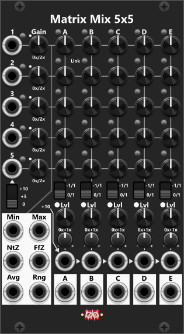

# Matrix Mix 5x5

 
The Matrix Mix 5x5 basically has 5 rows of inputs (with the input ports on the left) and 5 columns of mixed outputs (with the output ports at the bottom). The matrix itself consists of 25 (5x5) knobs, which allow you to set how much of each row's input is included in each column's output. *Some general info regarding the Mix modules are listed in [Common Mixer features](commonMixer.md).*

Each of the **5 input rows** (1 to 5) are (almost) identical. From the left, you first find an input port. In the upper-right "corner" of the input port, there is a small **invert button**. When pressed, the input is multiplied by −1 to invert a bipolar signal. To the right of the port/invert button, there is a Gain knob that lets you set the **gain** in the **range 0x to 2x (0% to 200%)**. The rest of the row contains the knobs that let you set how much of this particular row's input is included in each of the 5 column outputs.

The reason I said that these 5 rows are "almost" identical is because of the 5th row. By default, all row inputs are normalized to 0V, and while the first 4 rows can only be normalized to 0V, a 3-way switch below the 5th input lets you set its normalization value. Besides 0V, it can also be normalized to +5V or +10V. If you enable the Invert button, those last two normalization values become −5V or −10V. So, if you need to mix in a fixed voltage value for some reason, you can easily do so using the 5th row without connecting an input signal.

In the same manner, the **5 mix/output columns** (A to E) are identical. At the top of each column, just left of the column letter, a small **mix-mode button** sets Unity mix (unpressed/black, default) or Averaging mix (pressed/blue) for that column only. 
+ **Unity mix** (default): Each column sums the row inputs scaled by their send knobs (then the column Level/CV).
+ **Averaging mix**: The same sum is divided by the number of rows that currently contribute to that column. A row counts only if its input has a cable, its Gain is not 0, and that column's send is not 0 (in bipolar range, the center of the knob is 0). Unpatched row 5 (including +5V/+10V normalize) does not count.

In each column (from the top), you then find the 5 knobs (one for each input row), where you can dial in how much of that input should be mixed into this particular column output. Between each knob in an output column, you find a Link button. By default, this **Link button** is dim (not enabled), but when pressed once, it turns green. When **green**, the knob below is linked to the knob above (and covered by an overlay). So, when the knob above is changed, the knob below is set to the same value. Pressing the Link button a second time turns it red. When **red**, the knob below is linked inversely to the knob above (also covered by an overlay). This reversed link makes it very easy to cross-fade between two adjacent row inputs.

Below the 5 column knobs, you find a 2-way switch for setting the range of all 5 knobs in the same column. By default, all 5 knobs use the range 0x to 1x (0% to 100%). However, when toggled to the second range, −1x to 1x (−100% to 100%), you can attenuvert each row input. When you toggle the knob range, the knobs do not change their positions. However, since their range changes, so do the values dialed in by the knobs. Hence, it's a good idea to set the range switch to the range you want before you start setting the knob values. 

**TIP**: As explained above, changing the knob range of a column between "0/1" and "-1/1" will not affect the knob positions, but it will change the values dialed in by the knobs. This can be used as a creative effect during a performance, as simply toggling the knob range will instantly change the mixed output.

The context menu can set all 25 matrix knobs, the five diagonal knobs (1→A, 2→B, 3→C, 4→D, 5→E), or all five knobs in a chosen column (A–E), to 0%, 20%, 25%, 33.3%, 50%, 66.7%, 75% or 100%. Diagonal presets leave the other knobs unchanged, so you can set all knobs to 0% first and then the diagonal to 100% for a 1:1 route. *Holding CTRL (CMD on Mac) you can perform several menu-actions without closing/re-opening the context menu.*

The **mix-mode buttons** (at the top of each mix column) and the **link buttons** in the matrix sit close to the send knobs. If you operate those knobs during a performance, it is easy to accidentally change a column’s mix-mode or a previously configured link. For that reason the context menu has independent items to **lock/unlock** the mix-mode buttons and the link buttons. When locked, an overlay is placed on each of those buttons so you can see they are locked and cannot press them from the panel.

Below the Range switch, you find the Level knob and its CV input. The Level knob lets you set the output level of the column mix and covers the range from 0x to 1x (0% to 100%). So, by itself, it cannot increase the level above 100%. However, each CV input is normalized to the CV input of the previous column, while the CV input in column A is normalized to +10V. So, if you don't connect any cables to these CV inputs, they will **all be normalized to +10V**. Since the Trim knob defaults to 0% (center position), this +10V has no effect. However, if you turn the Trim knob to its +100% position, the CV will increase the dialed-in level by 100%, allowing a level of up to 200% to be achieved. Finally, the column mix is sent through the output port (see description of lighs below).

In the lower-left corner, you find a **cluster of 4 outputs (Min, Max, Avg, and Rng)**. These 4 outputs take their input from each row after the Gain stage, as indicated by the thicker line. However, they **only use inputs with a connected cable**. So, if you only connect cables to rows 1, 2, and 4, only those 3 inputs will be included when generating these outputs. The 5th input is also only included if a cable is connected, regardless of the normalization switch:

+ **Min**: The lowest value among all connected inputs.
+ **Max**: The highest value among all connected inputs.
+ **NtZ**: The value "Nearest to Zero" among all connected inputs.
+ **FfZ**: The value "Furthest to Zero" among all connected inputs.
+ **Avg**: The average of all connected inputs.
+ **Rng**: The absolute "range" of the connected inputs (`Max - Min`).

To make it easier to dial in the Gain you want for each row and the mixed output Level for each column, you find **Level lights**. The level light for each row is placed near the Gain knob, and its color (see below) is based on the **level after Gain** has been applied. Likewise, for each of the 5 columns, you find a level light next to the "Lvl" label. The color of this light is based on the **level after the Level knob + CV** have been applied (hence, the actual output level). *The column level lights only updates when outputs are connected*.

The colors described below are based on the absolute value of the signal (hence, negative values are treated as positive):

+ 0V to 5V: The light remains **green**, but its brightness increases from 0% (at 0V) to 100% at 5V.
+ \>5V to 10V: The light is **amber**.
+ \>10V: The light turns **red** as soon as the signal goes above 10V.

The colors have been chosen to make it easy to see when a signal goes beyond 5V (e.g., a bipolar signal) or beyond 10V (e.g., a unipolar signal). If you are mixing bipolar inputs and want your mixed output to remain within a **bipolar range**, you should try to keep the level light in the **green range**. As soon as you see amber, you know the signal has gone above ±5V. Likewise, if you are mixing unipolar signals and want to keep the output within a **unipolar range**, as soon as you see red, you know the signal has gone above 10V. *These colors are not affected by selected clipping mode (by default the modules will clip at -12 and +12).*

**TIP**: Pairing 4 of the column outputs with a [Cross-fade switch 4to1](CrossFadeSwitch4to1.md) you can quikly (manually- or via CV) switch or cross-fade between these (up to) 4 differntly mixed outputs. *When in switch-mode the Cross-fade switch 4to1 have an internal cross-fade time which can be set via the context menu, hence when you switch between two inputs, it can do a fixed-time cross-fade between the two signals.*

Other mixer modules: [Manuel Mix 4 Mk I](ManMix4I.md), [Manuel Mix 4 Mk II](ManMix4II.md), [Manuel Mix 4 Stereo](ManMix4st.md), [Matrix Mix 4x4 Stereo](MatrixMix4x4Stereo.md).

[Go back to modules overview](plugin.md#modules)
