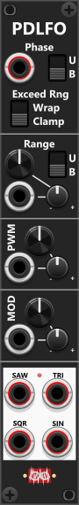
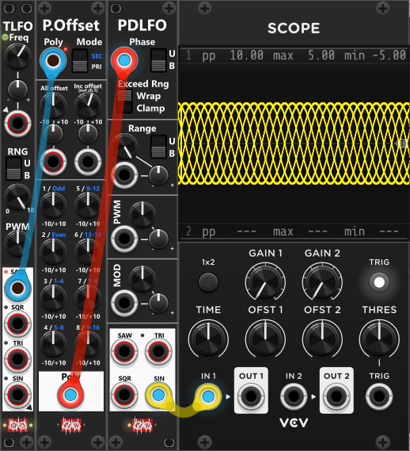

# Phase-Driven LFO
 
Technically, this module is not a traditional LFO since it does not contain an oscillator or use a frequency parameter. Instead, it directly takes a phase input within a 10V range (either bipolar or unipolar) to determine the waveform-phase, and thereby its output. However, due to its similarities with the LFO1 module, it is still categorized as an LFO. Due to the fact that the Phase-input accepts polyphonic input, **it's easy to generate multiple phase-shifted waveforms** (described as a TIP further down). *Some general info regarding the LFOs are listed in [Common LFO features](commonLFO.md).*

At the top of the module, there is a phase input, which supports polyphonic signals (the four waveform outputs will match the number of channels in the phase input). A two-way switch next to the input determines whether the phase range is bipolar (-5V to +5V) or unipolar (0V to 10V). To cover the full waveform cycle, the input signal must span the entire selected range. This input signal will by default be clamped to the selected phase-range, but setting the "Exceed Rng" switch to the "Wrap" position, the incomming signal will be "wrapped" if exceeding the phase-range.

*Since the phase can be "set" directly via the phase-input the waveform-outputs are not limited to typical LFO-range. Hence even though not intended for that purpose, the module can generate waveform-output in the entire audioable range*.

Below the phase input, there are knobs and CV inputs to control the output range of the four waveforms generated by the module. As with the LFO1 module, the PWM and MOD controls function similarly and are described in more detail in [LFO1](LFO1.md). At the bottom of the module, there are four waveform outputs (Saw, Square, Triangle, and Sine). Using the context menu the waveform-outputs can be inverted, in which case the small light near the outputs will illuminate.

**TIP**: If you use an inverted saw-waveform (e.g., from another LFO module) as the phase input, the PDLFO will output "standard waveforms" (e.g. a simple sine wave), where the phase will follow the phase of the inverted saw-input. However, the true power of this module comes from feeding the phase input with more complex or dynamic signals. Since the phase input can be set to bipolar (-5V to +5V) or unipolar (0V to 10V), you may need to scale or offset external signals to match the required range. If the signal you want to use as phase is in a different range (e.g., 0V to 1V), you can use a [Tweak](commonTweak.md) module to scale and offset it accordingly. For instance, if the signal is 0V to 1V, you can scale it by 10x and set the PDLFO to unipolar mode. Alternatively you can let the phase-signal go through an [Auto-scale 4](AutoScale4.md), where you scale its output to the range -5 to +5 for a bipolar phase, or 0V to 10V for a unipolar phase.

**TIP**: Inputting a polyphonic signal into the phase-input, the module will output as many waveforms (channels for each waveform), as the input-signal have channels. If you feed a monoponic signal into a [Poly-Offset](PolyOffset.md) module where you force it to output a fixed number of channels (via its context menu) and use its "increment"-knob, each of those channel-output will have the same incrementing (phase) interval between them. E.g. setting the Poly-Offset module to output a fixed number of 8 channels and set the inc. offset to 1.25V (1/8 of 10V), and feed this signal into the PDLFO, each waveform-output of the PDLFO will output 8 waveforms, each phase shifted exactly 45° (1/8 of 360°) of eachother. However to achive this, you **should disable the default output clipping** of the Poly-offset module to allow it to output values exceeding the default clipping-range from -12V to +12V, and the Exeed Range setting of the PDLFO must be set to **Wrap**, as it will otherwise clamp the input-phase.

Other LFO modules: [Simple LFO4-ss](SLFO4ss.md), [Simple LFO4-st](SLFO4st.md), [Tiny LFO](TLFO.md), [LFO1](LFO1.md).

[Go back to modules overview](plugin.md#modules)
