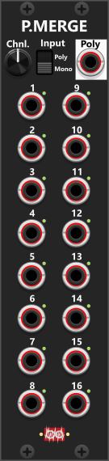

# Poly-Merge
 
The Poly-Merge module is designed to be flexible enough to merge both monophonic and polyphonic signals into a single polyphonic output. It can merge up to 16 monophonic signals. The lights next to the ports will illumuniate to indicate the number of channels that have been selected using the channels-knob (1-16). These lights will be **green** when an input-signal for that port is available, and **red** when its not (meaning the output will be set as 0V). *Some general info regarding the Poly-tools are listed in [Common poly-tool features](commonPoly.md).*

The module defaults to **Mono** input-mode, where all inputs are treated as single-channel monophonic signals (if a polyphonic signal is connected, only its first channel is used). Input ports without a connected cable will normalize to 0V. Hence dialing in a channel count of 4, and only inputting a signal into port 1 and 3, port 2 and 4 will normalize to 0V.

Switching to **Poly** input-mode, will allow multiple polyphonic signals to be merged into a new polyphonic signal. If you in poly-mode connect a 4-channel polyphonic signal to input port 1, and another-4 channel polyphonic signal to port 5, then port 1-4 of the 1st signal will populate port 1-4 of the output, and port 1-4 of the 2nd signal will populate port 5-8 of the output. Had you in stead connected the 2nd signal to input 3, then only port 1-2 of the first signal would be used to populate port 1-2 of the output, and port 1-4 of the 2nd signal would populate output ports 3-6 (ports 3-4 of the 1st signal would be replaced by ports 1-2 from the 2nd signal). In either case the channel knob is used to determine the number of channels to output.

 

Other poly-tool modules: [Poly-Split](PolySplit.md), [Poly-Stereo](PolyStereo.md), [Poly-Quad](PolyQuad.md), [Poly-Shuffle](PolyShuffle.md), [Poly-Tweak Mk I](PolyTweakI.md), [Poly-Tweak Mk II](PolyTweakII.md), [Poly-Logical Compare](PolyLCMP.md), [Poly-Value Compare](PolyVCMP.md), [Poly-Offset](PolyOffset.md), [Poly-Scale](PolyScale.md).

[Go back to modules overview](plugin.md#modules)
