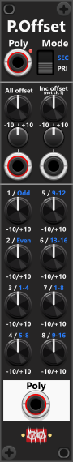
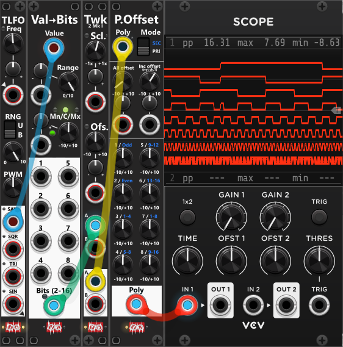
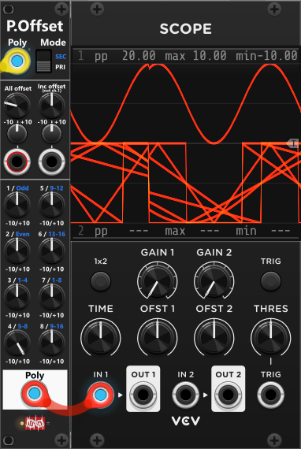

# Poly-Offset
 
This module lets you offset individual channels (in **PRImary mode**) or groups of channels (in **SECondary mode**). It is primarily aimed at polyphonic signals with up to 8 channels, as it provides individual knobs for offsetting those first 8 channels. However, it supports polyphonic signals with up to 16 channels and will, by default, output the same number of channels as it receives at the input. *Some general info regarding the Poly-tools are listed in [Common poly-tool features](commonPoly.md).*

At the top of the module (below the Poly-input and mode-selector), you’ll find a knob and CV-input for applying a global offset to all channels of the input signal. For example, if you input a 3–5 channel polyphonic signal where each channel containing individual note values for a chord, you can transpose the entire chord by one octave simply by setting the "All offset" knob to −1 or +1. If this offset is static, you set it using the knob (−10 V to +10 V). If the offset needs to be dynamic, you can instead (or additionally) apply a CV-input, which is added to the value set by the knob. This CV both accepts monophonic and polyphonic signals. When fed a monophonic signal, the same (CV)-offset is added to all channels, however if fed a Polyphonic signal you can apply a different (CV)-offset for each channel. *If you do supply a polyphonic CV-offset, it should ideally have as many channel as the the Poly-input in the top of the module*.

Beside the knob/CV-input for the All offset, you find a knob/CV-input for setting an incremental offset. This incremental offset is not added to the 1st channel, however is added to the following using an offset that is incremented for each succesive channel. For example, if you input a 4-channel polyphonic signal, and set the incremental offset to 0.5V, then 0V is added to the 1st channel, 0.5V is added to the 2nd, 1.0V is added to the 3rd, and 1.5V is added to the 4th. The incremental offset also acccept a (monophonic) CV-input for applying a dynamic incremental offset if needed.

Further down are the 8 individual offset knobs, which behave differently depending on whether the module is set to PRImary (default) or SECondary mode. In **PRImary mode**, the 8 knobs (channels 1–4 on the left, channels 5–8 on the right) allow you to offset channels 1–8 individually by values from −10V to +10V. If the input signal has more than 8 channels, channels 9–16 are not affected by these individual knobs. However, all input channels (including channels 9–16) are still affected by the global all offset and incremental offset set above.

When switching to **SECondary mode**, the same 8 knobs instead affect groups of channels, with groups also applying to channels 9–16:
+ The 1st knob affects all odd-numbered channels (1, 3, 5, …, 15).
+ The 2nd knob affects all even-numbered channels (2, 4, 6, …, 16).
+ The 3rd knob affects channels 1-4 (groups of 4).
+ The 4th knob affects channels 5-8.
+ The 5th knob affects channels 9-12.
+ The 6th knob affects channels 13-16.
+ The 7th knob affects channels 1-8 (groups of 8).
+ The 8th knob affects channels 9-16.

 

By default, the module outputs the same number of channels as it receives at the input. However, the context menu includes an option that allows you to set a fixed polyphony count (number of output channels). This option is primarily intended for removing channels. For example, if you input a 16-channel signal, you can configure the module to output only 8 channels, effectively discarding channels 9–16.

However, you can also input a monophonic (single-channel) signal and use the context menu to generate a polyphonic signal. For example, you can input a monophonic base note (1V/Oct), set the output channel count to 3, and then use offset knobs 2 and 3 to dial in intervals. In this way, the module effectively outputs a 3-channel chord (such as a minor or major chord) based on the single input base note. *As described previously you can use the "All offset" to transpose this chord up/down*.

**TIP**: If you only plan to use the "All offset" you could as well be using a [Tweak-2I](Tweak2I.md) module. It both have knob and CV-input for both scale and offset, and both inputs accepts polyphonic input, so individual scale and offset can be abllied to each channels if needed.

**TIP**: If you need to, you can generate a polyphonic signal from nothing (no input). E.g. to generate a 3 note chord from nothing (no input), using the context-menu you set a fixed polyphony of 3 channels. Using the offset-knobs 2 and -3, you can set the interval of the 2nd, and 3rd note of the chord in relation to the 1st note. Finally you can use the All offset to offset the entire chord (basically dialing in the base-note of the chord). If you at the same time supply a (monophonic) CV-input to the All offset, the chord can be dynamically transposed up/down (e.g. from a single/monophonic CV-signal from a sequencer). In this context you could have multiple PolyOffset modules (each generating different chords), and then use a [Cross-fade/Switch 4to1](CrossFadeSwitch4to1.md) to switch between these chords.

**TIP**: The default VCV scope module lets you monitor two separate signals at any one time (where each graph take its color of the input cable). The Scope module can also "graph" a polyphonic signal, but as all channels are graphed on top of each other its more or less impossible to see what goes on. However Poly-offset can **separate the channel graphs** by offsetting them individually or incrementally. In this screen-shot a saw-waveform is fed into a [Value-to-Bits](ValueToBits.md) which generates a polyphonic 8-channels signal (1 channel for each bit). This signal is then passed through a [Tweak-2I](Tweak2I.md) which attenuate the signal. Finally the signals are passed through a Poly-offset, using both its all- and incremental (channel) offset, before finally being passed into the VCV scope, where we can clearly see all 8 channels at once:

 

*In the screenshot above, the channels are displayed in reverse order, meaning channel 1 is shown at the bottom, with each successive channel displayed above it. As a result, the top trace represents channel 8. If you prefer the channels to be displayed in the opposite order (with channel 1 at the top), simply set a **positive "All Offset"** and a **negative "Inc Offset"**.*

Above you see all 8 channels (all 8 bits). However in stead you might want to see only a single channel. In that case you dial the "Inc. Offset" knob back to 0, and instead use for the 1-8 knobs to only offset that specific channel. Here in the next screen-shot you will see another 8 channel polyphonic signal, where only channel 4 (sine) have been offset from the other 7 channels. As we only need to see 2 graphs at the same time (one with only the sine, and one with all the other 7 signals), we don't need to attenuate the signals as much as we did in the previous example:

 

*If you find you often have to monitor a single/few channel(s) of a polyphonic signal like this. You could wire up a preconfigured Tweak-2I, Poly-offset and Scope somewhere in your rack. When you need to monitor a single/few channel(s), you simply pass your polyphonic signal into the Tweak-2I (for scaling), and then use the offset-knobs of the poly-offset as needed to offset individual channels. Alternatively you could also pass the signal through a Poly-Tweak (in exclude mode), where you can disabled individual channels, so there will be less channels to monitor. In this configuration I would place the Poly-tweak before the Tweak-2I/Poly-offset, as it will potentially exclude (remove) channels, so the modules "after" will have less channels to process (less data to process). As these modules are only used to monitor signals, you could further reduce CPU-workload by reducing the "Process-Quality" (e.g. at "Balanced/every 16th cycle" you shouldn't see any changes in the visualized graphs).*

**TIP**: If you need to individually offset more than 8 channels from the same polyphonic signal, you can use a Poly-Split (in Poly-mode) to split the first 8 channels (1-8) of 16-channel signal, and the remaining channels (9-16) into another 8-channel signal. You can then route these two 8-channel polyphonic signals into two separate PolyOffset modules to offset individual channels independently. Once offset the two 8-channel signals can be merged into a 16-channel polyphonic signal using a Poly-Merge module (also in "Poly"-mode).

Especially in **SECondary** mode, multiple offsets can be applied to the same channel(s), which may result in relatively high output values. Like most other Infinite-Noise modules, the outputs are clipped by default to the range −12 V to +12 V. Depending on how much offset you apply, and on what the downstream modules are capable of handling, you may want to change/disable this clipping. This can be done via the module’s context menu.

Other poly-tool modules: [Poly-Merge](PolyMerge.md), [Poly-Split](PolySplit.md), [Poly-Stereo](PolyStereo.md), [Poly-Quad](PolyQuad.md), [Poly-Shuffle](PolyShuffle.md), [Poly-Tweak Mk I](PolyTweakI.md), [Poly-Tweak Mk II](PolyTweakII.md), [Poly-Logical Compare](PolyLCMP.md), [Poly-Value Compare](PolyVCMP.md), [Poly-Scale](PolyScale.md).

[Go back to modules overview](plugin.md#modules)
