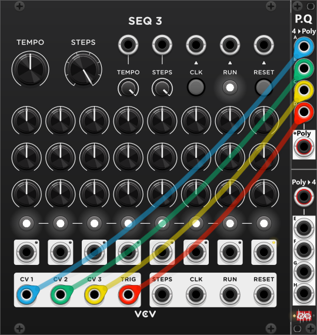

# Poly-Quad
 
Similar to the [Poly-Stereo](PolyStereo.md) the purpose of the Poly-Quad (in the top) is to "encode" (merge) up to 4 separate/monophonic signal into a single/compound polyphonic signal, and to (in the bottom) "decode" (split) a single/compound polyphonic signal into (up to) 4 separate/monophonic signals. So basically it is an (up to) **4 channel merger/splitter**. *Some general info regarding these modules are listed in [Common poly-tool features](commonPoly.md).*

As mentioned in [Common poly-tool features](commonPoly.md), many modules (like switch modules) are not build to process (e.g. switch) multiple signals at once, however if they can switch polyphonic signals they can. The Poly-Stereo is build explicitly to handle stereo audio-signals (with special handling of solo signals), whereas the Poly-Quad can encode/decode (merge/split) up to 4 signals. E.g. the output of a sequencer typically have at least 2 signals (trig and V/Oct), but often you have more CV-signals used for things like: amplification, panning, filter-control, and various other modulation. This is where the Poly-quad enters the equation, as it can encode/decode up to 4 monophonic signals which can then be switched at the same time (when merged into a single 4-channel polyphonic signal). *E.g. VCV's own **SEQ 3** sequencer have 3 CV outputs (CV 1, CV 2 and CV 3) which along with the TRIG-output can be "encoded" into a combined 4-channel polyphonic signal using the Poly-Quad*.

By default, the **4>Poly** output uses **Auto** channel mode (set via the context menu): it compounds as many channels as you have connected to inputs A–D, packing only connected ports in order (gaps are skipped). So if you only connect inputs to ports A, B, and D, the "4>Poly" output will generate a 3-channel signal. With no inputs connected it will simply output a monophonic 0V signal. 

Using the context menu **4>Poly output channels**, you can instead select a fixed count of 1–4 channels. When a fixed count is selected, the **red light** next to the Poly output illuminates. Inputs are mapped positionally: A→channel 1, B→channel 2, C→channel 3, D→channel 4. Disconnected inputs output 0V on their channel. For example, with a fixed 4-channel output and only A and C connected, the result is channel 1 = A, channel 2 = 0V, channel 3 = C, channel 4 = 0V. 

The 4 outputs in the bottom section (E, F, G and H) will output the first 4 channels of the polyphonoic input you provide in the "Poly>4" input. Hence if the input have more than 4 channels, only channel 1-4 are used, and if the input have fewer than 4 channels the corresponding output will simply output 0V (e.g. inputting a 3-channel signal, channel E-G will output these 3 channels as monophonic signals, while H will simply output 0V).

**TIP**: If you need to encode/decore more than 4 monophonic signals you should consider using [Poly-Merge](PolyMerge.md) and [Poly-Split](PolySplit.md) which both can handle up to 16 channels, and thanks to their Mono/Poly-mode switchs they can merge/split both monophonic and polyphonic signals.

Other poly-tool modules: [Poly-Merge](PolyMerge.md), [Poly-Split](PolySplit.md), [Poly-Stereo](PolyStereo.md), [Poly-Shuffle](PolyShuffle.md), [Poly-Tweak Mk I](PolyTweakI.md), [Poly-Tweak Mk II](PolyTweakII.md), [Poly-Logical Compare](PolyLCMP.md), [Poly-Value Compare](PolyVCMP.md), [Poly-Offset](PolyOffset.md), [Poly-Scale](PolyScale.md).

[Go back to modules overview](plugin.md#modules)
