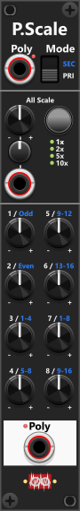
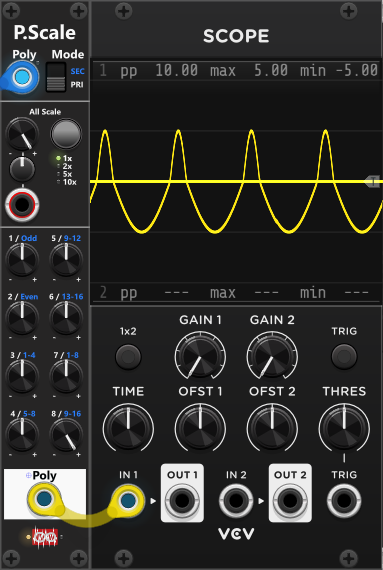

# Poly-Scale
 
PolyScale is very similar to [Poly-Offset](PolyOffset.md), but instead of offsetting signals, it scales (attenuverts) individual channels or groups of channels. The most noticeable visual difference is that PolyScale does not include an incremental section. Instead, it features a scale-mode button that cycles through different scaling ranges. By default, all knobs scale (attenuvert) within the range −1x to +1x. Each press of the scale-mode button cycles through the available ranges: 1×, 2×, 5×, and 10×, with an indicator light showing the active mode. The All-scale CV-input supports a polyphonic signal, hence it can be used to apply individual/different scaling to each channel. If supplied a monophonic input, all channels will be scaled according to this input. *Some general info regarding the Poly-tools are listed in [Common poly-tool features](commonPoly.md).*

In most cases, you would not want to apply multiple scaling factors to the same channel (for example, using both the All scale and an individual channel scale at the same time). To help with this, there is a red warning light next to the Poly label at the bottom of the module. This light illuminates if a channel is affected by multiple scaling controls. For example, if you set an All-scale of 0.75 and a channel-1 scale of 0.65, then channel-1 will be scaled by 0.4875 (0.75 × 0.65). The module will still apply both scalings, but the warning light alerts you that this may not be intentional.

For more details about the Primary and Secondary modes, as well as the individual knobs, refer to the [Poly-Offset](PolyOffset.md) description.

 

**TIP**: If you only plan to use the "All scale" you could as well be using a [Tweak-2I](Tweak2I.md) module. It both have knob and CV-input for both scale and offset, and both inputs accepts polyphonic input, so individual scale and offset can be abllied to the channels if needed.

**TIP**: As explained earlier, you can pass a polyphonic signal through a Tweak-2I and a PolyOffset module before feeding it into a VCV Scope to view multiple channels simultaneously. As an alternative, you can route a polyphonic signal (up to 8 channels) through a *PolyScale* module before sending it to the scope. In this setup, you would turn all individual scale knobs (channels 1–8) down to 0 (can be done in one go via the context menu). While this approach does not let you view multiple channels at the same time, it allows you to isolate a single channel by turning up its scale (for example, setting channel 8 to 1× while keeping all others at 0×).

 

Other poly-tool modules: [Poly-Merge](PolyMerge.md), [Poly-Split](PolySplit.md), [Poly-Stereo](PolyStereo.md), [Poly-Quad](PolyQuad.md), [Poly-Shuffle](PolyShuffle.md), [Poly-Tweak Mk I](PolyTweakI.md), [Poly-Tweak Mk II](PolyTweakII.md), [Poly-Logical Compare](PolyLCMP.md), [Poly-Value Compare](PolyVCMP.md), [Poly-Offset](PolyOffset.md).

[Go back to modules overview](plugin.md#modules)
