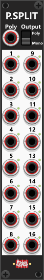

# Poly-Split
 
Like the Poly-Merge module, the Poly-Split module will default to **Mono** output mode, where you can split a polyphonic signal into (up to) 16 monophonic outputs. In Mono output mode, each output port always produces a monophonic signal, regardless of which ports have cables connected. For example, output port 5 will output a monophonic signal containing the value of channel 5 of the input signal (or 0V if no input cable is connected, or if the input signal has fewer than 5 channels). The lights next to the ports show channel status: **green** if that channel exists in the poly input, **red** if it is beyond the input but still in use (a cable on that port in Mono mode, or included in a connected poly slice in Poly mode—those channels output 0V), and **dim** otherwise. *Some general info regarding the Poly-tools are listed in [Common poly-tool features](commonPoly.md).*

If you instead switch the module to **Poly** output mode, the module will output monophonic or polyphonic signals depending on which output ports have cables connected. For example, suppose you feed a 16-channel polyphonic signal into the input “Poly” port. All 16 indicator lights (one next to each output port) will illuminate, indicating that the input signal contains 16 channels. Now, if you connect cables only to output ports 8 and 16, port 8 will output an 8-channel polyphonic signal containing channels 1–8 of the input signal, while port 16 will output another 8-channel polyphonic signal containing channels 9–16 of the input signal. This allows you to easily split a single polyphonic signal into multiple subsets of monophonic or polyphonic signals, simply by how you connect the output cables.

 

Other poly-tool modules: [Poly-Merge](PolyMerge.md), [Poly-Stereo](PolyStereo.md), [Poly-Quad](PolyQuad.md), [Poly-Shuffle](PolyShuffle.md), [Poly-Tweak Mk I](PolyTweakI.md), [Poly-Tweak Mk II](PolyTweakII.md), [Poly-Logical Compare](PolyLCMP.md), [Poly-Value Compare](PolyVCMP.md), [Poly-Offset](PolyOffset.md), [Poly-Scale](PolyScale.md).

[Go back to modules overview](plugin.md#modules)
