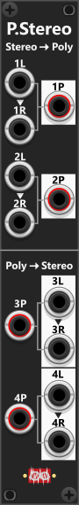
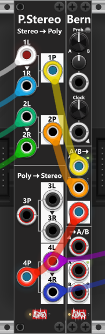

# Poly-Stereo
 
PolyStereo is a highly specialized module designed for a single purpose: **encoding** (merging) separate monophonic left/right signals into 2-channel polyphonic stereo signals, and **decoding** (splitting) 2-channel polyphonic stereo signals back into separate monophonic left/right signals. When encoding or decoding, **channel-1** is used for the **left** signal and **channel-2** for the **right** signal. *Some general info regarding the Poly-tools are listed in [Common poly-tool features](commonPoly.md).*

At the top of the module, two separate left/right signal pairs can be encoded into two independent 2-channel polyphonic stereo signals. As indicated by the arrowheads, if only a left input is connected (i.e. a mono signal), the right input is normalized to the left input, resulting in a centered stereo signal.

At the bottom of the module, two polyphonic stereo inputs can be decoded into separate left and right monophonic outputs. If an input contains more than two channels, only channels 1 and 2 are used; all additional channels are ignored. If an input is monophonic (only a single channel), the signal is duplicated so that both the left and right outputs carry the same signal. *As a result, while not its intended purpose, the lower two sections can also be used as two independent monophonic mults, each providing two identical monophonic outputs.*

 

**TIP**: Suppose you have two separate stereo signals and want to switch between them using a [Bernoulli Switch](BernoulliSwitch.md). While the Bernoulli Switch does not directly support stereo signals, it does support polyphonic signals. In this case, connect the first stereo signal to 1L and 1R, then route the resulting 1P output to the A input of the Bernoulli Switch. Likewise, connect the second stereo signal to 2L and 2R, and route the 2P output to the B input. Next, connect the output of the Bernoulli Switch to the 4P (or 3P) input of the PolyStereo module. This will decode the selected stereo signal back into separate 4L and 4R outputs. *Using a single PolyStereo module, this setup accomplishes what would otherwise require two Poly-Merge modules and one Poly-Split module.*

Linkewise a Bernoulli Switch can also be used to route a single signal to one of two destinations. In this configuration, use one of the upper sections of the PolyStereo module (for example, **1L/1R**) to encode the stereo signal into a 2-channel polyphonic signal, and feed the resulting **1P** output into the lower section of the Bernoulli Switch. Then connect the **A** output of the Bernoulli Switch to the **3P** input of the PolyStereo module, which will decode it back into separate **3L** and **3R** outputs. Similarly, connect the **B** output of the Bernoulli Switch to the **4P** input, which will decode it into **4L** and **4R** outputs. This effectively allows the Bernoulli Switch to route a stereo signal to either of two stereo destinations while preserving the left/right channel information.

Other poly-tool modules: [Poly-Merge](PolyMerge.md), [Poly-Split](PolySplit.md), [Poly-Quad](PolyQuad.md), [Poly-Shuffle](PolyShuffle.md), [Poly-Tweak Mk I](PolyTweakI.md), [Poly-Tweak Mk II](PolyTweakII.md), [Poly-Logical Compare](PolyLCMP.md), [Poly-Value Compare](PolyVCMP.md), [Poly-Offset](PolyOffset.md), [Poly-Scale](PolyScale.md).

[Go back to modules overview](plugin.md#modules)
