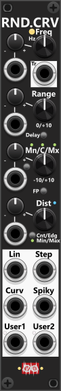
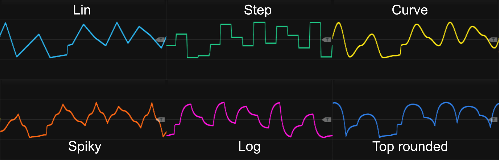

# Random Curve

 
This 4 HP module generates random values and outputs them as six distinct curve shapes. At its core, the module features an internal LFO that determines how often a new random value is generated. Each time the LFO selects a new random value, the module smoothly transitions from the previous value to the next, creating continuously evolving curves. By adjusting the frequency knob or applying a CV signal, you can control whether the module produces fast-changing or gradually shifting curves. Via the context-menu a "chaos rate" can be enabled. Below the frequency control, there is a trigger output that fires whenever the internal LFO picks a new random value to transition to. *Some general info regarding the Random-modules are listed in [Common random features](commonRandom.md).*

*When it comes to the frequency you dial-in, the output of the Random Curve outputs might appear "slower" than forexample the Sine output from an LFO running at the same frequency. However when you think about it, a single cycle of a sine can be regarded as 4 curve-segments: first 25% a convex curve from 0 to 1, next 25% a convex curve from 1 to 0, then the next 25% a convex curve from 0 to -1, and for the final 25%, a convex curve from -1 to 0. So the Random Curve output can be regarded as running "4 times as slow", as it only produces a single curve-segment at the same rate.*

The module allows precise control over the range and distribution of the generated values. The Range and Mn/Cn/Mx settings define the span within which random values are generated and their offset point (Minimum, Center, or Maximum). A small push button next to the Mn/Cn/Mx knob toggles between these three modes, illuminating to indicate the active setting. Similarly, the Distribution knob controls how values are weighted, either favoring the center or the edges of the range. A small button below the Distribution knob allows you to toggle between Center/Edge or Min/Max distribution modes. Above the Distribution control, an FP (Forced Polarity) button enables an alternating pattern where successive values toggle between the upper and lower halves of the defined range (Center/Edge-mode only). When Min/Max distribution is selected, the FP button is covered by an overlay.

Between the Range and Mn/Cn/Mx controls, there is a Delay button. By default, this feature is disabled, meaning that any changes to the range settings take effect immediately, scaling the currently generated curves accordingly. However, when **Delay** is enabled, modifications to the range do not affect curves that are already in progress, instead applying only to the next generated random value. Enabling Delay, ensures the generated curves stays smooth, even when range-inputs might change abruptly/often.

 

At the bottom of the module, six outputs each generate a different type of "curve", all based on the same generted random values but with unique transition characteristics. The last two outputs ("User1" and "User2") each support the same four curve types selectable via the context menu (Log, Exp, Top rounded/bottom sharp, Bottom rounded/top sharp). User1 defaults to Log; User2 defaults to Top rounded/bottom sharp. An RGB indicator next to each user output is always lit to show the active mode: green = Log, red = Exp, blue = Top, orange = Bottom. Here a short description of the outputs:

+ **Lin**: Linear transitions between random values.
+ **Step**: Abrupt switches at the midpoint between values, mimicking a Sample & Hold signal.
+ **Curv**: Smooth S-curve transitions for a fluid motion.
+ **Spiky**: Reversed S-curves with sharp, spiky peaks and dips.
+ **User1**: User-configurable curve (default: **Log**).
+ **User2**: User-configurable curve (default: **Top rounded/bottom sharp**).

By default, the "Step" output will "step" (change between the previous/next random value) mid-phase (marked by a **dim light** next to the "Step" output). However, via the context menu, you can change the **step mode** so that it instead steps at the beginning of the phase (marked by a **red light** next to the "Step" output). This mode can be beneficial if you need the waveform to "step" at the same time as the Trigger outputs fire a trigger.

The screenshot belows shows the exact same progression of random values, displayed using 6 different curve-outputs. All curves begins and ends at exactly the same value (at exactly the same time), however the transition between those "points" is different for each curve-type. In the example a uniform distribution was used:

 

**TIP**: While adjusting the range of generated values via knobs or CV is straightforward, don’t overlook the ability to manipulate the time domain just as easily. The rate at which new random values are generated can be dynamically controlled using the Rate knob, Chaos rate (context menu) or its CV input, allowing modulation from an LFO, another Random-Curve module, or any other external source. Essentially, the Rate input functions as frequency modulation for the module’s internal LFO. *Keep in mind that the **Delay feature** only affect changes made to the range, so to keep the outputs smooth without abrupt changes, it best to use a slow changing/smooth frequency CV-input*.

**TIP**: To create more evolving and complex curves, consider cross-fading between different outputs. A [Cross-fade module](commonCrossFade.md) allows smooth transitions between two signals, while a [Switch module](commonSwitch.md) enables switching between multiple outputs—either from the same module or from different sources. For example, the [Cross-fade switch 4to1](CrossFadeSwitch4to1.md) can seamlessly transition between up to four different random curves, blending them in real-time. You could choose to feed the Trigger output from the Random Curve into the Cross-fade 4x1 (in random mode), so it will pick a random curve-output each time a new curve-segment begins. To keep it even **more simple**, route the curve-outputs you want to "mix" into a [Manuel Mix 4 Mk I](ManMix4I.md) and dial-in your desired mix-settings, and if you want a "stair-stepped" output route the signal through a [S&H/T&H-2](SHTH2.md).

**TIP**: Another technique involves layering smooth random curves with subtle noise or jitter for added movement and variation. A [Merge module](commonMergeMult.md) can combine multiple signals by summing them together, allowing you to overlay a gentle evolving curve with a lower-amplitude noise/jitter source. Various modules can generate this noise or jitter, including LFOs, S&H circuits, and other random generators. You can further refine the noise by passing it through a [Tweak module](commonTweak.md) to dynamically adjust its scale/offset over time using CV input. For an additional layer of unpredictability, routing the noise signal through a [Bernoulli Switch](BernoulliSwitch.md) allows probabilistic control, randomly determining when the noise/jitter is present or absent in the final output or switch between two different noise/jitter sources.

Other random modules: [Random-4](Random4.md), [Chaos](Chaos.md).

[Go back to modules overview](plugin.md#modules)
