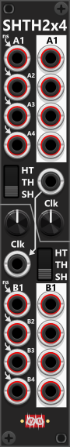

# S&H/T&H-2x4

 
The SHTH2X4 module features 2 independent sections, each containing 4 input/output pairs for processing multiple signals simultaneously. Like the SHTH2, each section operates in S&H, T&H, or H&T mode and can be controlled via an external Clock input or the built-in LFO, which is adjustable using the associated knob. *Some general info regarding the S&H/T&H/H&T are listed in [Common S&H features](commonShth.md).*

While the A-, B- inputs/outputs supports polyphonic signals, the clock inputs do not. This means all channels are sampled- and held at the same time, hence **this module don't support S&H of individual channels** (but [S&H/T&H-2](SHTH2.md) does).

If a Clock input is supplied to the A-section, but not to the B-section, the A-section’s Clock signal will also control the B-section, ensuring synchronization. However, if no Clock input is provided for either section, each will default to its own independent LFO. If a Clock input is connected to the B-section, it will override the shared signal, allowing A and B to operate separately—one using the internal LFO and the other responding to an external Clock signal. *If you only supply the B-section with a Clock-signal, the B-section will use this Clock-signal, whereas the A-section will use its internal LFO*.

All input signals for both sections are normalized to an internal white noise generator, which by default produces random values from -5V to +5V. This range can be modified in the context menu. 

 

**TIP**: When using the SHTH2x4 with an external clock-source I suggest you begin using the lower section first. This allows you to in stead use the upper section with the internal LFO if needed. If you later decide that the external clock-source should affect both sections, you simpy move the cable from the lower clock-input to the upper clock-input *(since the lower is normalized to the upper)*.

Other S&H modules: [S&H/T&H-2](SHTH2.md), [Sample and Update](SampleAndUpdate.md), [Stack](Stack.md), [Stack expander](StackExpander.md), [Stack bank expander](StackBankExpander.md).

[Go back to modules overview](plugin.md#modules)
