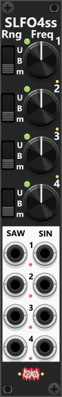

# Simple LFO4-ss

 
This 4HP quad-LFO generates both Saw and Sine waveforms for each of its four independent LFOs. The frequency knobs allow precise rate control, while the three-way toggles determine the output range. The context menu provides additional output range options (defaulting to Bipolar: -5V to +5V) and lets you configure sync modes (disabled by default, but indicated by small red/green lights when active). Likewise the waveforms can be inverted using the context menu, and indicated by small lights near the output ports. *Some general info regarding the LFOs are listed in [Common LFO features](commonLFO.md).*

 

Other LFO modules: [Simple LFO4-st](SLFO4st.md), [Tiny LFO](TLFO.md), [LFO1](LFO1.md), [Phase-Driven LFO](PhaseDrivenLFO.md).

[Go back to modules overview](plugin.md#modules)
