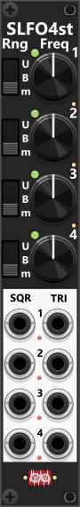

# Simple LFO4-st

 
This 4HP quad-LFO generates both Square and Triangle waveforms for each of its four independent LFOs. The frequency knobs set the LFO rates, while the three-way toggles determine the output range. The context menu offers additional output range options (defaulting to Bipolar: -5V to +5V) and lets you configure sync modes (off by default, but indicated via red/green lights when enabled). Likewise the waveforms can be inverted using the context menu, and indicated by small lights near the output ports. *Some general info regarding the LFOs are listed in [Common LFO features](commonLFO.md).*

 

*When I need multiple LFOs with fixed frequencies (not affected by CV), the SLFO4st is my go-to quad-LFO. Each of its four LFOs operates at an independently set rate, and internal sync can be enabled via the context menu if/when needed. The combination of Square and Triangle waveforms makes it a highly versatile modulation source as Square waves can function as clocks, gates, or triggers, while Triangle waves provide smooth modulation curves for various parameters. If you need a little "chaos", the context-menu enables you to dial in chaos-rate individually for all 4 LFOs.*

Other LFO modules: [Simple LFO4-ss](SLFO4ss.md), [Tiny LFO](TLFO.md), [LFO1](LFO1.md), [Phase-Driven LFO](PhaseDrivenLFO.md).

[Go back to modules overview](plugin.md#modules)
