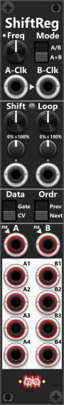
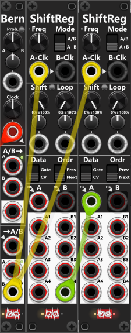

# ShiftReg

 
The 4HP ShiftReg module can operate either (by default) as a combined **8-section (A+B)** shift register (where the B input is ignored and all 8 outputs are processed sequentially), or as two separate **4-section (A/B)** shift registers (where the A input/output and B input/output are processed separately). In the top-right corner, you'll find the mode switch, which allows you to switch between **combined A+B mode** (default) or **separate A/B mode**. *In A+B mode, overlays cover the B-Clock and B-input to indicate that these inputs are ignored.*

If you don't provide an **A-Clock input**, the module will instead use its internal LFO, where the **Frequency knob** lets you adjust the LFO's frequency. Via the context menu, you can enable [Rate-Chaos](commonFeatures.md#rate-chaos) to make the internal LFO slightly or wildly chaotic. If the **B-Clock input** is not connected, it will be normalized to the A-Clock (or the internal LFO if the A-Clock input is not connected). **When the module operates in A+B mode, the B-Clock input is ignored.**

Next, you'll find the **Shift and Loop knobs, trim- and CV inputs**. These are used to dial in the **probability (0% to 100%)** that a shift and/or loop will occur. The **Shift knob** is set to **100%** by default to ensure that a shift will always occur when the section receives a clock input. When a shift occurs in A/B mode, all outputs in the corresponding section will shift (e.g., the current A input will be moved to A1, what was in A1 will be shifted to A2, what was in A2 will shift to A3 ... and so on). In A/B mode, when a shift occurs, the value that was in A4 will be discarded, whereas in A+B mode, the value that was in A4 will be shifted to B1.

The **Loop knob** is set to **0%** by default, meaning that no looping will occur. By default, looping is only possible when a shift occurs, but this behavior can be changed using the small, colored toggle button located between the **Shift** and **Loop** labels. Pressing this button cycles through three different **Shift/Loop modes**, indicated by the color of the button. These modes determine how shifting and looping interact whenever a clock signal is received (or the internal LFO triggers, if no external clock is connected). **Whenever a clock is detected, the module ALWAYS performs a random "coin toss" based on the Shift probability to determine whether a shift should occur.** Depending on the selected mode, a second, independent coin toss based on the Loop probability determines whether looping should occur and how it interacts with shifting.

+ **Only loop on Shift (dim)**: In this (default) mode, the Loop probability is only evaluated if the Shift coin toss determines that a shift should occur. If the subsequent Loop coin toss determines that a loop should occur, the input(s) are ignored, and the registers shift while recycling the oldest value(s) back to the beginning instead of discarding them. For example, if the A registers in A/B mode contain the values `1, 2, 3, 4`, they will become `4, 1, 2, 3` after looping. If the Loop coin toss determines that no loop should occur, a normal shift is performed instead, discarding the oldest register value(s) and inserting new value(s) from the input(s). If the initial Shift coin toss determines that no shift should occur, nothing happens, regardless of the Loop probability.
+ **Loop takes priority (green)**: In this mode, the Loop probability is evaluated independently of the Shift probability. If the Loop coin toss determines that a loop should occur, the registers will rotate, recycling the oldest value(s) back to the beginning, regardless of the Shift coin toss result. If no loop occurs, the result of the Shift coin toss is used to determine whether a normal shift should occur, inserting new value(s) from the input(s). This means that **looping takes priority over shifting**, and only one of the two operations can occur per clock.
+ **Independent loop/shift (red)**: In this mode, the Shift and Loop probabilities are evaluated and processed completely independently. If the Loop coin toss determines that a loop should occur, the registers will rotate, recycling the oldest value(s). Afterward, if the Shift coin toss determines that a shift should occur, a normal shift is performed, inserting new value(s) from the input(s). This means that **both operations can occur on the same clock**, resulting in two consecutive shifts (loop first, then shift). For example, if the A registers contain `1, 2, 3, 4` and the A input is `5`, performing both operations will first rotate the values to `4, 1, 2, 3` and then shift them to `5, 4, 1, 2`. If only one coin toss succeeds, only that operation is performed. If neither succeeds, the registers remain unchanged.

**TIP**: Both the Shift and Loop inputs are designed for CV signals, where the corresponding knob, trim knob, and CV input work together to determine the probability of a Shift or Loop occurring. However, since a standard gate signal ranges from 0V (low gate) to 10V (high gate), **you can also use gate signals to control Shift and Loop**. For example, if you set the Shift knob fully counterclockwise (to 0%) and its trim knob to 100%, a high gate (10V) will set the Shift probability to 100%, ensuring that a shift occurs whenever the module receives a clock signal. Likewise, setting the Loop knob to 0% and its trim knob to 100% will ensure that a loop occurs when a high gate (10V) is received, provided the selected Shift/Loop mode allows it. *For both Shift and Loop, you can reverse this behavior by setting their knobs to 100% and their trim knobs to -100%. This way, a low gate (0V) will set the probability to 100%, ensuring that a Shift/Loop occurs, whereas a high gate (10V) will reduce the probability to 0%, preventing it from occurring.*

**TIP**: In relation to the previous tip (using gates as probabillity-input to shift and loop), you could choose to use a [Bernoulli Switch](BernoulliSwitch.md) to either send a high gate into the shift- or the loop-inputs. This way the probability dialed in by the Bernoulli switch will control whether a shift or a loop will occur when the ShiftReg module receives a clock-input. *In this configuration the mode should be set to "Independent loop/shift", since the Bernoulli switch will either input a high gate into the shift- or the loop-inputs, only one of those operations will be performed at each clock.*

In the next section of the module, you can configure the Data-mode and Order-mode. The **Data-mode** determines how the outputs are generated. By default, it is set to **CV-mode**, where the outputs (A1-A4, B1-B4) simply output the values stored in the registers, without any modification (Except clipping, and quantize if enabled). If you change the Data-mode to **Gate-mode**, the values stored in the registers will instead be interpreted as gates. By default, values of 1V or higher will produce a high gate, while values below 1V will produce a low gate. *The gate-detection threshold can be adjusted via the context menu.*

The **Order-mode** switch lets you set the **Shift-direction** when a shift occurs. By default, Order-mode is set to **Next**, where A1 shifts to A2, A2 shifts to A3 ... and B3 shifts to B4. Setting Order-mode to **Prev** reverses the shift direction, where B4 shifts to B3, B3 shifts to B2 ... and A2 shifts to A1.

Below you find A- and B-inputs. If left unpatched these inputs will normalized to random-values/white noise (as indicated by the small "ns" label, and arrowhead). By default this "noise" is a uniform bipolar range from −5V to +5V. Via the **Noise range** context menu you can choose any of the usual bipolar or unipolar spans (the same list as clipping/LFO range). When **Data-mode is set to Gate**, each noise sample is a low or high gate. The chance of a high gate is **50% by default**; via the **Noise high-gate chance** context menu you can set it from 5% to 95% in 5% steps. *Gate-high and gate-low output levels (context menu) can still write different voltages to the outputs.* When in **A+B** mode, an "overlay" will cover the B-input to indicate it is not in use.

Last but not least, at the bottom you find the the 8 register outputs (A1-A4 and B1-B1). Both the A1/B2 inputs and the A1-4/B1-4 outputs supports **polyphonic** signals, hence you are able to shift polyphoinc signals. However the clock-inputs and the CV inputs for Shift and Loop are all **monophonic**, hence shifts- and loops- will occur across all (up to) 16 polyphonic channels at the same time.

**TIP**: When operating in A+B mode, the module functions as an 8-section shift register using only the A input. If you need a 16-, 24-, or 32-section shift register, you can daisy-chain multiple ShiftReg modules. E.g. to combine two ShiftReg modules into a 16 section shift register, connect the **B4 output from the 1st ShiftReg** into the **A-input of the 2nd ShiftReg** (simply repeat, when combining more than two modules). However **timing is important here**. The same clock must be inserted into all of the shift-reg modules. If the 1st ShiftReg performs it's shift before the 2nd, it's B4 output might change before the 2nd ShiftReg "samples" this output as it performs its shift operation. 

*Due to the fact that each VCV cable normally introduces a 1 cycle delay, the 2nd ShiftReg module should be able to sample "the old B4" output of the 1st ShiftReg before it discards this value, hence there shouldn't be any issues here. However either a [Delay 3](Delay3.md#delay-3) module or the build-in input trigger delay of the Infinite Noise modules, can be used to ensure the 1st ShiftReg "delays" its reaction to incomming trigger signals by a single/few cycles.*

When daisy-chaining multiple ShiftReg modules this way (to create a combined 16-, 24-, or 32-section shift register), you should not rely on the individual modules' Shift/Loop probabilities. As long as you keep the Shift probability at 100% (so a shift always occurs), there are no issues. However, if you want a lower probability (e.g., 50%), you cannot guarantee that all modules will shift on the same clock signal, since each module evaluates its Shift probability independently. 

If you want to combine multiple ShiftReg modules with a Shift probability below 100%, you should consider using a [Bernoulli Switch](BernoulliSwitch.md). Set the Shift probability of all ShiftReg modules to 100%, but instead of feeding the clock signal directly into the ShiftReg modules, connect it to the "Clock" input of the Bernoulli Switch. On the Bernoulli Switch, you can then dial in the desired probability (e.g. 50%), which ensures that the clock signal is passed to its B output approximately 50% of the time. Connect this B output to the A-Clock inputs of all ShiftReg modules. This way, all ShiftReg modules will shift together, but only when the Bernoulli Switch passes the clock signal through. The result is a combined shift register with a shared Shift probability, ensuring that all sections remain synchronized.

*In the screen-shot above the original clock (red) is fed into the Bernoulli switch, and from there (yellow) into the A-clock input of both ShiftReg modules to ensure they will both shift at the same time. As mentioned previously, when you daisy-chain multiple ShiftReg modules this way, the B4 output (green) of the previous module, is fed into the A-input of the next.*

[Go back to modules overview](plugin.md#modules)
