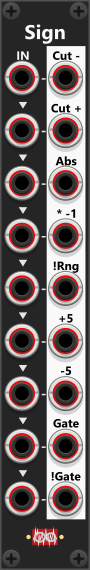

# Sign

 
The Sign module is designed to manipulate the "sign" (polarity) of incoming signals, providing nine different output variations based on a single or multiple input signals. Each of the nine inputs has a corresponding output, with all inputs being normalized to the previous one, meaning a single input signal can be used across all outputs if no additional inputs are provided. The module fully supports polyphonic signals, ensuring that each output maintains the same number of channels as its respective input. *As I recall Sign was the very first module I created for this plugin, as it was easy (didn't have to learn about triggers nor buttons/knobs - only input/ouput). The first implementation was monophonic only, so support for polyphonic signals were added later along with a context menu.*

 

Like other Infinite-Noise modules, the output is hard-clipped to -12V to +12V by default. However, this clipping range can be modified or disabled via the context menu, which also provides settings for inversion range, voltage detection threshold (defaulting to ≥1V for gate detection), and custom gate output levels (default 0V for low, 10V for high). Each of the nine outputs applies a different transformation to the input signal:

+ **Cut-**: Sets all negative values to 0V, effectively removing the negative range.
+ **Cut+**: Sets all positive values to 0V, removing the positive range.
+ **Abs**: Converts all negative values to positive, providing the absolute value of the signal.
+ **×-1**: Inverts the signal by multiplying it by -1, flipping positive and negative values (useful for bipolar signals).
+ **!R**: Inverts values according to a user-defined inversion range (defaulting to 0V to 10V for unipolar signals).
+ **+5**: Adds 5V to the signal, shifting a bipolar signal (-5V to +5V) into a unipolar range (0V to 10V).
+ **-5**: Subtracts 5V from the signal, shifting a unipolar signal into a bipolar range.
+ **Gate**: Outputs 10V when the incoming signal meets or exceeds 1V (threshold can be adjusted in the context menu).
+ **!Gate**: Outputs 10V when the incoming signal is below 1V (threshold adjustable via context menu).

## Types of Inversion (Bipolar vs. Unipolar Signals)
There are two main methods for inverting a signal. The "standard approach" is multiplying by -1, which works well for bipolar signals (e.g., -5V to +5V). However, this approach may not be suitable for unipolar signals (e.g., 0V to 10V). For example, if an envelope signal ranges from 0V to 10V, a simple -1 multiplication would shift it to -10V to 0V, which may not be desirable. Instead, a vertical flip is often preferred, where a value of 8V becomes 2V, a value of 6V becomes 4V, and so on. This mirrored inversion requires knowledge of the expected signal range, which can be adjusted in the context menu using the inversion range setting.

## Gate-outputs.
The last two outputs convert the input into gate signals. By default, the module detects signals ≥1V as "on/high" and outputs 10V (both threshold and output levels can be customized via the context menu).

+ Gate Output: Outputs 10V when the input signal is ≥1V; otherwise, it outputs 0V.
+ !Gate Output: Outputs 10V when the input signal is <1V, effectively inverting the gate signal.

**TIP**: The !Gate output can be used to invert a gate signal. If a high gate is fed into the !Gate input, the !Gate output will produce a low gate, and vice versa. If multiple gate signals need to be inverted simultaneously, [Sign4 Mk I](Sign4I.md) offers a more efficient way to handle up to four gate signals at once.

Other Sign modules: [Sign4 Mk I](Sign4I.md), [Sign4 Mk II](Sign4II.md).

[Go back to modules overview](plugin.md#modules)
