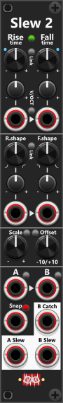

# Slew 2
 
**Slew 2** is a 4HP lag processor with two independent polyphonic sections (**A** and **B**). Shared **Rise** and **Fall** time and shape drive both sections. Each of those four controls has a knob, trim, and CV port. *Some general info regarding the slew modules are listed in [Common Slew features](commonSlew.md).*

The small button between the Rise and Fall labels sets **Time scale** (0.1× / 1× / 10×): **green** = 0.1× (0 to 1 s), **black** = 1× (0 to 10 s, default), **red** = 10× (0 to 100 s). That is the same scale as Slew 4’s context menu, on the panel instead of in a menu. The small button below it **links Fall time to Rise time**. While linked (green), the Fall time knob, and trim knob will follow the rise knobs. The module defaults to **constant rate**, however using the context menu this can be changed to **constant time**.

Between the Rise and Fall time input-ports is a **V/Oct button**. **Black** (default) keeps normal time CV. **Green** makes those ports scale the time dialed in by the knobs exponentially: **at trim +100%, +1 V halves the time and −1 V doubles it**. This means you must have dialed in a non-zero time using the knobs (as doubling/halving 0 has no effect). Trims still apply, and they default to 0%, so tracking does nothing until you open them. Fall input is normalized to Rise input, so one cable into Rise tracks both times if both trims are at +100%. Set the Fall trim to 0% if Rise should not affect Fall. *Different Rise/Fall trims require that Time-link is not enabled*.

**TIP**: If you for some reason needs **extreme long rise/fall** times you should consider using **Time scale 10x** and/or **enabling V/OCT mode**. If you enable Time scale 10x, and dial the time knob to its fully counter clockwise position, the time will be set to 100 seconds. If you at the same time (with V/OCT enabled) input a negative signal with the trim knob set to 100% - or input a positive signal with the trim knob set to -100% - each 1 volt will double the time. With an input of -2V, trim 100% (or 2V, trim -100%) a time of 100 seconds will in fact be 400 seconds (first -1V doubles 100 to 200, and second -1V doubles 200 to 400). *Since this scaling is based on CV-input, you can easily switch between long/short rise/fall times by changing the level of the input. Just remember that with V/OCT enabled each 1V with either half or double the time set by the knobs. So you might consider dialing in a low trim-setting to not go too crazy. If you do input a changing signal, you might want to pass this signal through another slew module, to ensure changes don't occur too quickly.*

The small button between R.shape and F.shape **links Fall shape to Rise shape**: **black** (default) is independent; **green** sets F.shape = R.shape; **red** sets F.shape = −R.shape. While linked, the Fall shape knob and trim are inactive.

Shared **Scale** and **Offset** knobs apply to both A- and B-input. **Scale** attenuverts −1× to +1× (e.g. setting scale to -1x you can invert a bipolar signal). **Offset** range is −10V to +10V (e.g. offseting +5V you can "convert a bipolar signal to a unipolar signal"). The small button next to the "Scale" label toggles the **Scale-range mode**: **off** = 1× **green** = 2×, **yellow** = 5×, and **red** = 10×. The small button next to the "Offset" label in stead toggles **order-mode**: **black** (default) is Scale then Offset (`in × scale + offset`); **blue** is Offset then Scale (`(in + offset) × scale`). Both scale and offset are applied to the A/B-input **before** slew is performed.

Next to each A/B input is an **Envelope follower** button. **Black** (default) leaves the input as-is. **Green** takes the **absolute value** (`|in|`) before the slew. **Red** sets negative values to **0 V**. When enabled, the slew outputs will generate a positive envelope which enables the module to double as an Envelope follower, where **Rise is attack**, and **Fall is decay**. Typical with an envelope followever you might prefer a short attack (rise), and a slower release (fall) *The scale/offset knobs mentioned above can be used to increase/decrease the amplitude of the generated envelope output, when using this module as an envelope follower.* 

The small button next to the **Snap-input** cycles the input-mode between gate (default) and trigger. This Snap feature both affect the A and the B input. In **gate-mode** (**Green**), while the gate is high the slew output will track the input (output = scaled/offset input), whereas when the gate is low the output will slew towards the input. In **trigger-mode** (**Red**), a high trigger will snap the slew output to the scaled/offset input, and then "slewing from there". *If one of the envelope follower modes are enabled, snap will still only produce non-negative outputs, even if the input is negative.*

To the left of the Snap input, you find the **B Catch** output. This output will generate a **high gate** when the slewed B output has "caught up" with the B input (basically when "it is no longer slewing"). Since this is the only gate output in the module, you can use the context menu to invert it. Simply configure the module to use 0V for a high gate and 10V for a low gate.

**All inputs/outputs supports polyphonic signals**, which means it is possible to have individual time/shape settings for each channel. Likewise the Snap input also supports a polyphonic signals, which enables individual "snap" for each channel. When monophonic inputs are supplied the same/monophonic signal is used for all channels. If you do supply polyphonic inputs, make sure they at least have as many channels as the A/B-inputs. The B Catch output is able to generate a polyphonic output, so if your B-input is polyphonic so will the B Catch output be - hence you will get a gate for each channel. *If you need to monitor all channels (to detect when they have all "caught up" or some of them have "caught up") you can process this output with a [Poly-Logical Compare](PolyLCMP.md).*

Other Slew modules: [Slew 4](Slew4.md).

[Go back to modules overview](plugin.md#modules)
