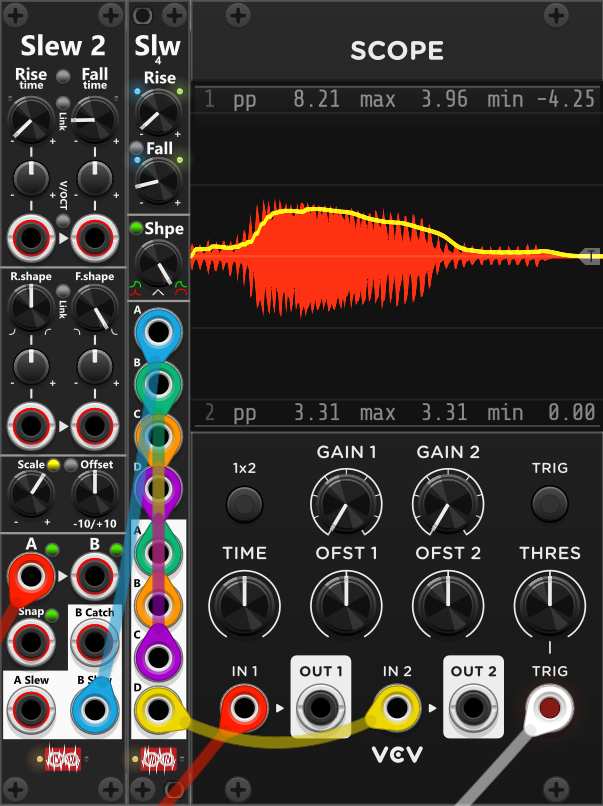

# Slew 4
 
**Slew 4** is a 2HP lag processor with four independent sections (**A–D**). Hence compared to [Slew 2](Slew2.md) it supports 2 more sections (4 in total), however have less features. Each section is a polyphonic input/output pair. **Rise-** and **Fall-time** can be set directly by knobs, however a single **Shape knob** set both the Rise- and Fall-shape at the same time. The small button between the Rise- and Fall-knobs **links Fall time to Rise time**. While linked (green), the Fall knob is inactive and follows Rise. By default the time knobs covers a range from 0 to 10 seconds, however using the context menu, Time scale can be changed between 0.1×, 1× and 10× (**green** = 0.1×, **off** = 1×, **red** = 10×). *Some general info regarding the slew modules are listed in [Common Slew features](commonSlew.md).*

Compared to a Slew 4 the Slew 2 module only have a **single knob to control shape**. The small "Fall shape" button above the shape knob controls how the fall shape is linked to the rise shape. In its default **green** state the fall shape will be identical to the rise shape (e.g. if the rise shape is exponential the fall shape will also be exponential). When the fall shape button is **red** the fall shape will be the reversed of the rise shape (e.g. if the rise shape is exponential, the fall shape will be logarithmic). Using the context menu, the (middle knob position) linear shape, can be changed to an s-curve or reversed s-curve shape.

*As the Slew 4 is less complex than the Slew 2, it is slightly more efficient (uses a bit less CPU bandwidth), so for your bread-and-butter slew requirements it might be "a better choise" than the Slew 2 (even when you only need to slew a single or 2 signals). Having said this, it's still not a bad slew, and via the context menu it can either be configured for **Constant rate** (default) or **Constant time**. Likewise the context menu also lets you change the linear-shape to **S-Curve** or **Reversed S-Curve** (defaults to linear).*

**TIP**: Thanks to its 4 input/output pairs, Slew 4 can be used to smooth the same signal multiple times for an even "smoother" signal. In the screenshot below, the Slew 2 module is used as an envelope follower (the red signal is audio from a sampler). Due to its fast attack (rise time) and slow release (fall time), the blue signal (envelope follower) can be a bit "jagged". To smooth the signal further, I passed it through a Slew 4 multiple times. The blue signal (envelope follower) goes into input A, then from output A to input B (green), from output B to input C (orange), and from output C to input D (magenta). Finally, the "smoothed" signal is patched from output D into the scope (yellow). *If your patch is running out of CPU bandwidth, you can most likely reduce the process quality of both Slew modules to High (run every 4th cycle) or even Balanced (run every 16th cycle) without any noticeable issues.*

Other Slew modules: [Slew 2](Slew2.md).

[Go back to modules overview](plugin.md#modules)
