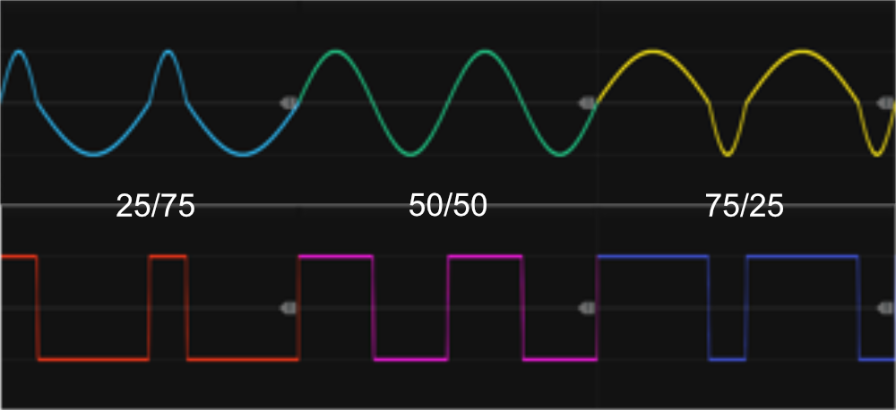

# Tiny LFO

 
This compact 2HP module is the smallest LFO in the plugin. It allows frequency adjustments via knob and CV modulation (chaos-rate can be enabled/set via the context menu). Due to its small size, both range and PWM settings can only be adjusted using knobs, whereas the LFO1 supports both knob and CV control for PWM and modulation. Additionally, the TLFO does not support external synchronization with other LFOs. The module generates four waveforms — Saw, Square, Triangle, and Sine — which can be output simultaneously, all running at the same frequency and phase, though each waveform can be individually inverted via the context menu. When fed a polyphonic frequency CV-input, the output waveforms will also be polyphonic, where each channel can be running at a different rate. *Some general info regarding the LFOs are listed in [Common LFO features](commonLFO.md).*

 

By default, **PWM (Pulse Width Modulation)** affects the phase of all waveforms, but through the context menu, you can configure it to apply only to the Square waveform. This allows for more controlled modulation when using multiple waveform outputs simultaneously. The context menu also provides an option to limit the PWM range, which by default spans from 1% to 99%, but can be reduced to cover the range from 25% to 75% for finer control over modulation depth.

As indicated by the arrow-heads, the frequency CV-input is normalized to the Sine waveform-output, however as the frequency trim-knob defaults to 0% it will have no effect until you start dialing in a none-zero trim-value.

*Among the Infinite-Noise LFOs, TLFO is a personal favorite. Despite its compact 2HP size, it offers great versatility. It supports CV frequency input, enabling polyphonic outputs, and allows manual PWM adjustments. The ability to manually set the output range ensures it can be directly connected to other modules, even if they lack a trim knob. If offset adjustments are needed, the output can be processed through one of the Tweak modules for further refinement.*

Other LFO modules: [Simple LFO4-ss](SLFO4ss.md), [Simple LFO4-st](SLFO4st.md), [LFO1](LFO1.md), [Phase-Driven LFO](PhaseDrivenLFO.md).

[Go back to modules overview](plugin.md#modules)
