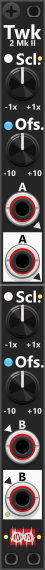

# Tweak-2 Mk II

 
The Tweak-2 Mk II module is a 2HP utility featuring two independent sections, labeled "A" and "B", each with its own input and output. However, if no cable is connected to the "A" output, the "B" output will carry a **averaging mix** of both sections, effectively summing the A and B signals and dividing the result by two (mixing can be disabled in the context-menu). When processing polyphonic signals, the mix feature will adjust the B-output to match the higest number of channels found in the A/B inputs. *Some general info regarding the Tweak-modules are listed in [Common Tweak features](commonTweak.md).*

Unlike Tweak-2I, Tweak-2II does not support CV modulation for scaling or offset. Instead, both sections have dedicated manual scale and offset knobs, allowing fine-tuned control over each signal. When no input is connected, the offset knobs can be used to generate fixed voltage outputs in the range of -10V to +10V. If no cable is inserted into the "B" input, it is normalized to the "A" input, meaning a single signal can be processed in two different ways simultaneously. For example, inserting a signal into "A", setting its scale knob to +100% (default), and setting the "B" scale knob to -1x, will result in the "A" output providing an unchanged copy of the input, while the "B" output produces an inverted version of the same signal.

By default, Tweak-2 II allows independent scaling and offset settings for each section. However, using the context menu, you can link the B-section to the A-section, ensuring both use identical scaling and offset values. This is particularly useful when processing stereo signals, as it ensures that left and right channels remain consistent. When the B-section is linked to the A-section, a small red indicator near the B-input port will illuminate.

Other Tweak modules: [Tweak-2 Mk I](Tweak2I.md), [Tweak-4 Mk I](Tweak4I.md), [Tweak-4 Mk II](Tweak4II.md), [Tweak-8](Tweak8.md).

[Go back to modules overview](plugin.md#modules)
