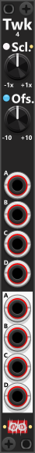

# Tweak-4 Mk I

 
The Tweak-4 Mk I module is a 2HP utility designed for applying uniform scaling and offset to up to four separate signals. Unlike the Tweak-4 Mk II, which allows individual control over each section, Tweak-4 uses a single pair of scale and offset knobs that affect all four input/output pairs equally. This makes it particularly useful when you need to apply the same scaling or offset across multiple signals simultaneously, such as converting multiple bipolar signals to unipolar or vice versa (offset +5V or -5V). *Some general info regarding the Tweak-modules are listed in [Common Tweak features](commonTweak.md).*

Each section (A through D) is processed independently, meaning they will output as many polyphonic channels as they receive. However, unlike some other Tweak modules, Tweak-4 Mk I does not support mixing (for that, the Tweak-4 Mk II is a better choice, as it allows individual scaling for each channel and mixing of inputs). The Tweak-4 Mk I does **not support mixing** of input. 

**TIP**: The Tweak-4 Mk I is an excellent tool for converting multiple bipolar signals to unipolar, or vice versa. By applying a +5V offset, a bipolar signal (-5V to +5V) can be shifted to a unipolar range (0V to 10V). Similarly, applying a -5V offset can convert a unipolar signal (0V to 10V) into a bipolar range (-5V to +5V). 

**TIP**: Since Tweak-4 Mk I only provides knob-based scaling, you can pair it with a VCA-4 for CV-controlled scaling (amplification) while using Tweak-4 primarily for offset control. Depending on your setup, you might want to process the signal through the VCA-4 first, then offset it with the Tweak-4, or apply scaling first using Tweak-4 before routing it to VCA-4 for further modulation via CV. 

Other Tweak modules: [Tweak-2 Mk I](Tweak2I.md), [Tweak-2 Mk II](Tweak2II.md), [Tweak-4 Mk II](Tweak4II.md), [Tweak-8](Tweak8.md).

[Go back to modules overview](plugin.md#modules)
