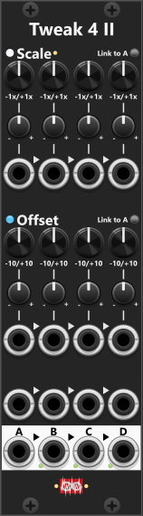

# Tweak-4 Mk II

 
Compared to Mk I, Tweak-4 Mk II offers individual scaling/offset for each section, and it can be regarded as "half a Tweak-8". If works exactly like the Tweak-8, where the only difference is it only have 4 sections (A through D), whereas the the Tweak-8 have 8 sections (A through H). See [Tweak-8](Tweak8.md) for the full description. Unlike the Tweak Mk I, the Mk II **do support mixing**, hence it will work perfectly for mixing up to 4 signals (or mix 2x2 signales - e.g. 2 stereo signals). *Some general info regarding the Tweak-modules are listed in [Common Tweak features](commonTweak.md).*

In both the Scale- and Offset parts of the panel you find a latchable "Link to A" button. When enabled the knobs for section B-D will be "grayed out" and they will automatically adjust to the changes made to the A-section. This way you can easily dial in the same Scale- and/or Offset- settings for all 4 sections.

**TIP**: Since all inputs are normalized to the previous one, you can use **Tweak-4** to build a chord from a single base note (1V/Oct). Simply feed your base note into input A, then use the offset knob on each output (up to four) to create the additional chord notes. In this configuration each output will represent one note of the chord, with the offset defining the interval (you can use the context menu to select specific musical intervals). *The [Poly-Offset](PolyOffset.md) module can achieve a similar result, but outputs the chord as a single polyphonic signal instead.*

**TIP**: Similar to the tip above, you can also use a Tweak-4II to transpose notes by octaves, simply by offsetting by whole volts (e.g. offset by +1V to transpose notes by 1 octave). This way you can feed 1V/Oct notes from a sequencer into input-A, and then dial in up to 4 differents transpose (offsets) to your melodi/note-sequence. You will however need another module to pick "which transposed version" (outputs A-D) to use. E.g. a [Cross-fade switch 4to1](CrossFadeSwitch4to1.md) do exactly this.

Other Tweak modules: [Tweak-2 Mk I](Tweak2I.md), [Tweak-2 Mk II](Tweak2II.md), [Tweak-4 Mk I](Tweak4I.md), [Tweak-8](Tweak8.md).

[Go back to modules overview](plugin.md#modules)
