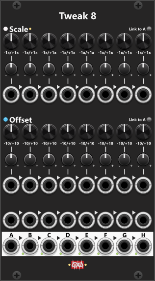

# Tweak-8

 
The Tweak-8 module is the largest of the Tweak-series, featuring eight fully independent sections, each with their own scale and offset knobs as well as CV inputs. Like the other Tweak modules, you can use each of the eight individual outputs, or simply take the final "H" output to get a fully mixed signal from all eight sections. *Some general info regarding the Tweak-modules are listed in [Common Tweak features](commonTweak.md).*

If you frequently find yourself using multiple Tweak-2I modules or need submixing of multiple signals, the Tweak-8 is an ideal solution. For cases where you need to adjust the amplitude of the full mix at the "H" output, you can simply route it through a Tweak-2I module and use its scale knob to control the overall mix level. If you only need to mix six signals instead of eight, you can manually route the "F" output into the "G" input (cable from F-out to G-in), and then use the scale knob of section "G" to attenuate the mix. The "G" output will then carry the adjusted mix of six signals.

Both in the Scale- and Offset-sections you find a "Link to A" button. When pressed (green) knobs B through H will be linked to the A-knob, hence all knobs will follow the A-knob while being linked. When you enable link, linked knobs will be "covered" by an opaque square to illustrate they can no longer be manipulated (only the A-knobs remain active).

Other Tweak modules: [Tweak-2 Mk I](Tweak2I.md), [Tweak-2 Mk II](Tweak2II.md), [Tweak-4 Mk I](Tweak4I.md), [Tweak-4 Mk II](Tweak4II.md).

[Go back to modules overview](plugin.md#modules)
