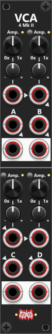

# VCA-4 Mk II

 
Like the Mk I version, this module can amplify four independent input/output pairs. However, it adds knobs and CV inputs that allow you to apply different amplification levels to each of the four sections. Thanks to the link controls and input normalization, it’s easy to apply consistent—but different—amplification across multiple sections (for example, when processing the left and right channels of a stereo signal). All four sections support polyphonic signals, and each output will produce the same number of channels as its corresponding input. *Some general info regarding the VCA-modules are listed in [Common VCA features](commonVca.md).*

In the top half of the module, you’ll find sections **A** and **B** side by side. In the lower half, sections **C** and **D** are arranged in the same way. As indicated by the arrowheads, the CV input for amplification is normalized from one section to the next. This means that if you connect a CV signal only to **CV-A**, the same signal can be used by all four sections. If you do not want to use this normalization, simply leave the trim knob at its default **0** position, in which case the CV input is effectively ignored.

The **C input** is normalized to the **A input**, and the **D input** is normalized to the **B input**. This allows you to connect a stereo signal (left/right) to inputs **A** and **B**, link **B to A** to apply the same amplification to the stereo pair in the top section, and at the same time link **D to C** to apply a different amplification (independent of A/B) to the lower section to the same stereo signal. But then again, it can process 2 different stereo signals (A/B anc C/D), or 4 totally different signals (A, B, C and D).

Other VCA modules: [VCA-2](VCA2.md), [VCA-4 Mk I](VCA4I.md).

[Go back to modules overview](plugin.md#modules)
