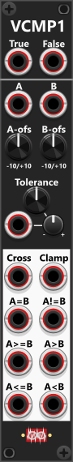

# Value Comparator-1

 
The Value Comparator 1 module (VCMP1) features a single comparison section with two inputs labeled "A" and "B". Below each input, an offset knob allows you to apply a manual offset to the incoming signal. If no input signal is connected, the inputs default to 0V, allowing the offset knobs to set a fixed manual value instead (e.g. to compare A to a fixed value of 3V, simply set the B-offset knob to 3V). *Some general info regarding the Compare-modules are listed in [Common compare features](commonCompare.md).*

Beneath the offset knobs, a tolerance adjustment knob, CV-input and trim determines the comparison sensitivity. This tolerance defines the range within which two values are considered equal. By default, the knob is set to **1/24** of a volt (~0.0416V), but it can be adjusted anywhere from 0V to 10V for broader tolerance. The tolerance-input both accepts monophonic- and polyphonic signals, hence both allow a single- and individual tolerance for each channel.

The lower section of the module provides 8 outputs, including an A/B-cross trigger output, a Clamp output and six comparison outputs. These comparison outputs produce a high gate signal (default 10V) whenever the selected comparison condition is met. The A/B-cross output is the only output that produces a trigger signal rather than a gate. Like the other comparisons, it respects the tolerance setting, meaning that the A/B-cross trigger will only fire when signal A crosses signal B and moves beyond the tolerance range. The Clamp-output will Clamp the A signal within +/- tolerance of B. E.g. if you set the tolerance to 1V, then A will be clamped between B-1V and B+1V. Like the other outputs this output also supports polyphonic signals.

Similar to the LCMP2 module, the VCMP1 includes **True/False inputs** at the top of the module, which enables you to use it as a **switch module**. When cables are connected to these inputs, the 6 lower comparison outputs will no longer output fixed voltage values (e.g., 10V for True and 0V for False). Instead, any output that evaluates as True will pass the True input signal, while those that evaluate as False will output the False input signal. 

**Example**: of the A/B-cross trigger firing. Consider a scenario where:

+ Input A is connected to an LFO output.
+ Input B is unconnected, meaning it defaults to 0V, and the B offset-knob is manually set to 0V.
+ Tolerance is set to 0.5V.

If the A signal is currently at 2V, it is detected as being greater than B. As a result, the "A > B" output will produce a high gate. For the A/B-cross trigger to activate, the A signal must drop below -0.5V (A must cross B, and be "outside" of the tolerance). At this point, it crosses the B value (0V) while exceeding the tolerance, triggering the A/B-cross output (a 10V pulse lasting 1ms). Now, since A is below B and outside the tolerance, the "A < B" output will activate instead. The next A/B-cross trigger will only fire when the A signal rises above 0.5V, crossing B and "outside" of the tolerance again in the opposite direction.

Other compare modules: [Tiny Logic Comparator-2](TinyLCMP2.md), [Logic Comparator-2](LCMP2.md), [Logic Comparator-6x2](LCMP6x2.md), [Value Comparator-2 Mk I](VCMP2I.md), [Value Comparator-2 Mk II](VCMP2II.md).

[Go back to modules overview](plugin.md#modules)
