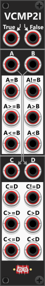

# Value Comparator-2 Mk I

 
This module is very similar to the Value Comparator 1 (VCMP1) module, with a few key differences. Instead of a single section, this module features two independent sections, each containing all six comparison outputs. However, it does not include an A/B-cross trigger output nor the clamp-output. Additionally, there are no offset knobs for setting manual input values when inputs are unconnected, and the **comparison tolerance** must be adjusted via the context menu, though it still defaults to 1/24 of a volt (~0.0416V). *Some general info regarding the Compare-modules are listed in [Common compare features](commonCompare.md).*

As indicated by the arrows on the panel, if no cables are connected to the C and D inputs in the lower section, these inputs will automatically normalize to the signals fed into the A and B inputs in the upper section. E.g. if you only connects cables to the A-, B- and D-inputs (so C will normalize to the A-input) you can use the module to both compare A with B, and A(C) with D.

Like the VCMP1, this module also includes True/False inputs at the top. If these inputs are connected, their signals will be passed to the comparison outputs—meaning that when a comparison evaluates as True, the corresponding output will pass the True input signal, and when it evaluates as False, it will pass the False input signal. If no cables are connected to the True/False inputs, the module defaults to outputting 10V for "True" and 0V for "False", though these values can be modified via the context menu.

Other compare modules: [Tiny Logic Comparator-2](TinyLCMP2.md), [Logic Comparator-2](LCMP2.md), [Logic Comparator-6x2](LCMP6x2.md), [Value Comparator-1](VCMP1.md), [Value Comparator-2 Mk II](VCMP2II.md).

[Go back to modules overview](plugin.md#modules)
