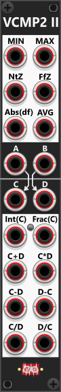

# Value Comparator-2 Mk II
 
The VCMP2II module consists of two sections, with distinct functionalities. The top section performs comparisons, while the bottom section carries out mathematical operations on the input signals. *Some general info regarding the Compare-modules are listed in [Common compare features](commonCompare.md).* In the top section, the module provides the following outputs based on the comparison of input signals A and B:

+ MIN: Outputs the lower of the two values.
+ MAX: Outputs the higher of the two values.
+ NtZ (Nearest to Zero): Outputs the value "Nearest to Zero", regardless of whether it's positive or negative.
+ FfZ (Farthest from Zero): Outputs the value "Farthest from Zero", whether positive or negative.
+ Abs(df) (Absolute Difference): Outputs the absolute difference between A and B.
+ AVG (Average): Outputs the average of A and B (an average mix of the two values).

The bottom section performs basic arithmetic operations on input signals C and D, outputting the results of addition, subtraction, multiplication, and division. The first 2 outputs in this section outputs the integer- and fraction-parts of the C-input. By default these two outputs are signed (if C is negative so will these outputs). However if you click the small button between the output ports, these will toggle to output these as absolute values instead. Since addition (C + D) and multiplication (C × D) are order-independent, each has a single output. However, for subtraction and division, the module provides two separate outputs, one for each order of operation (C - D and D - C, as well as C ÷ D and D ÷ C). 

Multiplication and especially division **can result in extremely large values**, even simple addition or subtraction can push signals beyond an expected voltage range. Like most Infinite-Noise modules, this module clips output values by default to the range -12V to +12V. However, this clipping can be disabled via the context menu. Additionally, division operations may encounter **division-by-zero errors**. By default, when this occurs, the module holds the last valid output value rather than producing an undefined result. However, you can change this behavior in the context menu, allowing the module to output 0V instead when division by zero is detected.

**TIP**: If you simply need to add 2 (or up to 7) signals, you can use the [Merge2x4](Merge2x4.md) module instead, as it simply works like a precision adder (adding the signals you input). This module will also by default clip outputs to the range -12V to +12V, so if you expect/need outputs exceeding this range, you need to change/disable the clipping-range using the context-menu.

**TIP**: The NtZ (Nearest to Zero) output can be useful in quantization scenarios where you want to favor notes closer to a defined reference point (e.g., a specific root note). For example, if you feed random values between -1V and +1V into A and B, the NtZ output will tend to produce values closer to 0V more frequently than those further away. By passing this output through a Tweak module, you can scale and offset it to align with your desired root note and range. Once processed, the signal can be sent into a quantizer, ensuring that only musical notes within the defined range are selected. The result is a randomized note selection, but with a higher probability of picking notes near the central reference point.

A similar effect can be achieved by using the C + D (addition) output and reducing its scale to 0.5x (which can also be done using a Tweak module). This approach ensures the output follows a triangular distribution, increasing the likelihood of values clustering around 0V, rather than equally distributing them across the full range of -1V to +1V.

**TIP**: If you need to perform any of the 6 compare operations in the top (Min, Max, NtZ, FfZ, Abs(Df) or AVG) on more than two signals at the same time, I suggest you take a look at [Poly-Value Compare](PolyVCMP.md). First you need to combine all of your signals into a single polyphonic signal (e.g. using a [Poly-Merge](PolyMerge.md)). This combined/polyphonic signal should then be fed into the "Poly" input of the Poly-Value Compare module (where it can compare up to 16 values at the same time). It has outputs for: Min, Max, NtZ, FfZ, AVG and R/S. The R/S output can be configured via its context menu, to either output **Range** or **Sum**, where "Range" is the same as the "Abs(Df)" (basically the difference/range between Min and Max). *The Poly-Value Compare module can also monitor channels over time (e.g. monitor min/max since last reset, across all channels or per channel).*

Other compare modules: [Tiny Logic Comparator-2](TinyLCMP2.md), [Logic Comparator-2](LCMP2.md), [Logic Comparator-6x2](LCMP6x2.md), [Value Comparator-1](VCMP1.md), [Value Comparator-2 Mk I](VCMP2I.md).

[Go back to modules overview](plugin.md#modules)
