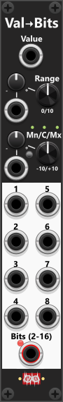
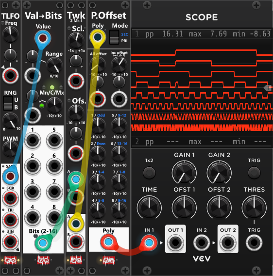

# Value-to-Bits
 
This module functions as the inverse of the Bits-To-Value module, taking a single CV input and converting it into 8 separate bit outputs. These bits are then output as individual monophonic gates. Beside the the 8 individual bit outputs, the device also have a single combined polyphonic output. This output defaults to 8 channels, where each channel corresponding to one of the 8 monophonic bit outputs. However, through the context menu, you can adjust the number of output channels anywhere between 2 and 16. If this setting is changed from the default 8 channels, a small red indicator light next to the polyphonic output will turn on. The monophonic outputs always represent the CV value as an 8-bit signal, regardless of the polyphonic setting.

Below the Value input in the top, you’ll find controls for setting the input range, which by default is a bipolar range of -5V to +5V. The incoming CV signal is clamped to the defined range, then converted into binary, and output as individual bits. The lower half of the module contains the 8 monophonic bit outputs alongside the polyphonic "Bits" output, which includes a channel for each active bit (2–16 channels). A bit value of "1" is output as a high gate (default 10V), while a bit value of "0" is output as a low gate (default 0V). These output levels can be customized via the context menu.

**TIP**: The 8 monophonic bit outputs always represent the input value using 8-bit resolution (essentially "sampling" the input to 8 bits). The polyphonic Bits output, however, defaults to 8 channels, but you can change this to anywhere between 2 and 16 bits via the context menu. For example, if you set the polyphonic bit depth to 12 bits, the module will effectively "sample" the input at 12-bit resolution. You can use a [Sample-and-Hold module](commonShth.md) before this module to control "when" the input changes, and thereby "when" the bit output might change. If you need to access individual bits, you can route the polyphonic Bits output into a [Poly-Split](PolySplit.md) module, which will separate the polyphonic signal into individual monophonic outputs, each representing a single bit.

**TIP**: Typically bit outputs do not toggle at the same frequency — lower-order bits change state far more frequently than higher-order bits. Statistically, bit-1 will toggle between high and low much more often than bit-8, though the exact behavior depends on the input signal. For example, if you feed in a rising saw wave within the specified input range, the bit outputs will behave similarly to a clock divider: Bit-1 toggles twice as often as Bit-2, and Bit-2 toggles twice as often as Bit-3, and so on. This means you can route these bit outputs to various modules to trigger different actions at different time intervals, and different frequency (some bits toggle more than others). As mentioned above, passing the input-signal through a S&H module you can effect how often/when outputs will update.

The screenshot below shows an inverted saw waveform routed into a **Value-to-Bits** module. Its 8-bit output is then sent via the **Polyphonic Bits** output through a **Tweak** module (to reduce the amplitude) and a **Poly-Offset** module (to offset the channels), allowing all eight channels of the same polyphonic signal to be displayed simultaneously on a **VCV Scope** module. As explained above, the eight channels behave as clock dividers: **channel 1** toggles between high and low twice as fast as **channel 2**, **channel 2** twice as fast as **channel 3**, and so on. In this configuration, **channel 1** can be regarded as the **base clock**, with its frequency determined by the frequency of the inverted saw wave generated by the LFO. *Bit 1 toggles high **128 times** during one complete cycle of the saw wave, so its frequency is **128 times** the frequency of the saw. Each successive bit divides that frequency by two, meaning **bit 8** toggles high once per saw cycle and therefore has the **same frequency** as the original saw wave.*

 

Other bit modules: [Bits-to-Value](BitsToValue.md).

[Go back to modules overview](plugin.md#modules)
