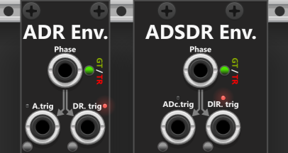
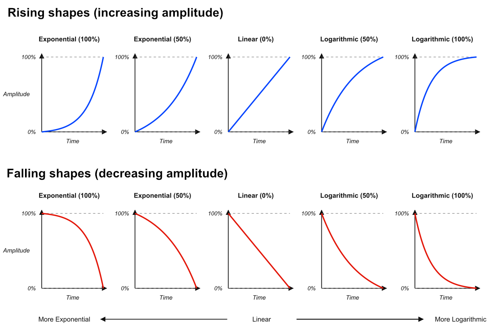

# Envelopes
The Infinite-Noise plugin includes two envelope generators: **ADR Envelope** (Attack / Delay / Release) and **ADSDR Envelope** (Attack / Decay / Sustain / Delay / Release). They share the same unusual stage order: a **Delay phase sits after Sustain and before Release**. That is not where a delay is normally placed — if an envelope has a delay at all, it typically comes before Attack. The placement is deliberate. It lets you generate a full envelope even when the input is not sustained: **a "missing" sustain phase can be "replaced" by the Delay**, which holds the current level for a fixed length before Release begins. Because of this setup you only need an **A.trig** / **ADc.trig** input to start the envelope. Pass **EOA** / **BOS** into **DR.trig** / **DlR.trig** and the module generates a full envelope, with Delay functioning as Sustain. Patch **EOR** into **A.trig** / **ADc.trig** as well and it keeps cycling until you disconnect that loop.

Both modules are driven by a shared **Phase input** (gate or trigger mode) or **dedicated A.trig / ADc.trig and DR.trig / DlR.trig inputs**, plus small buttons beside those ports to fire them by hand. As indicated by the grey arrows at the top of each panel, the dedicated trigs are normalized to Phase. In **gate mode**, the rising edge is routed to A.trig / ADc.trig and the falling edge to DR.trig / DlR.trig. In **trigger mode**, odd triggers go to A.trig / ADc.trig and even triggers to DR.trig / DlR.trig. *You should EITHER use the Phase input or the dedicated trig inputs. If you use both, the dedicated inputs take priority over Phase.*

**TIP**: Neither the ADR nor the ADSDR Envelope module offers a **delay phase at the beginning** (before the Attack phase). The tips for the ADR Envelope describe how an ADR Envelope can be used to delay trigger and, although less precisely, gate signals. Hence, if you need a **pre-Attack delay**, you can pass your trigger/gate signal through a second ADR Envelope before passing it to another ADR/ADSDR Envelope.

**Env** outputs the envelope as it moves between **A.level** and **R.level**. **!Env** is that same envelope inverted between those two levels. Unlike a classic ADSR that always returns to 0V, both end-levels (and ADSDR's Sustain) can be set anywhere from −10V to +10V. After initialize, and after Release completes, the output holds **R.level** until the next Attack.

The **time knobs dial in a duration** for each phase. Times use **quadratic** knob mapping (knob² × max): default is **0** (instant), noon is 2.5 s, and fully clockwise is 10 s. A context-menu **Time scale** of 0.1× / 1× / 10× stretches that max to 1 / 10 / 100 s without moving the knobs. Tiny lights at the top-right of each time knob show the scale: **green** = 0.1×, **off** = 1× (default), **red** = 10×. If Attack, Decay, or Release is allowed to run (uninterrupted) to the end, it lasts the time you set. That duration can be cut short if the Attack (or Decay) phase is interrupted by Delay/Release, or if Delay/Release is interrupted by a new Attack — the current ramp stops immediately and the new phase takes over. **Attack retrig** restarts Attack from R.level, so that new Attack again lasts the full A.time (unless it is itself interrupted).

If a phase is interrupted mid-ramp (for example the phase-gate falls before Attack finishes), the new phase starts from the **current envelope voltage**, not from the previous target. An already-active phase is ignored unless you enable Attack and/or Delay retrig. **Attack/Delay retrig is only possible on the dedicated trig inputs** — Phase always switches between Attack and Delay/Release, whether it is in gate or trigger mode. With Attack retrig enabled, each A.trig / ADc.trig jumps to R.level and starts a new Attack. With Delay retrig enabled and a non-zero Delay time, DR.trig / DlR.trig can restart Delay while Delay or Release is already active.

Both modules have trigger outputs for when various phases begin (e.g. **BOA = Begin Of Attack**) and end (e.g. **EOA = End Of Attack**). However the **[Envelope Phase Expander](EnvelopePhaseExpander.md)** module can be used an an expander for both the ADR- and ADSDR Envelope. It in stead have multiple gate outputs, where each of the 6 top-most outpouts are high while the associated phase is active (phases where time=0 will always output a low gate). The last 3 gate outputs will indicate whether the envelope is rising, steady or falling. *Likewise the ADR/ADSDR Envelope don't have trigger outputs for when the delay begins/ends. If you feed the Delay gate signal from an Envelope Phase Expander into a [Manuel Push 2](ManPush2.md), you can use its Hg/Lw trigger-outputs to output triggers when the delay begins/ends (will only work when d.time/dl.time is non-zero).*

Both modules can apply **Rate Chaos** per time knob from the context menu. If that phase's time is non-zero and Rate Chaos is above 0%, each time the phase begins its duration is varied slightly — or wildly (e.g. randomly slow vs fast attacks). General use of Rate Chaos is described in the [main manual](commonFeatures.md#rate-chaos).

Each ramping phase (Attack, Decay, and Release) has a **shape** knob from −1 to +1. Center (0) is **linear**. Turn counterclockwise for **exponential**, clockwise for **logarithmic** (Delay has no shape — it simply holds). An **exponential rise/fall** starts slow and steepens toward the target. A **logarithmic rise/fall** does the opposite (fast then slow). The illustration below shows 100% / 50% exponential, linear, and 50% / 100% logarithmic in both directions. The logarithmic shape is actually an inverted exponential, so the two remain symmetrical.

Envelope modules: [ADR Envelope](ADREnvelope.md), [ADSDR Envelope](ADSDREnvelope.md), [Envelope Phase Expander](EnvelopePhaseExpander.md).

[Go back to modules overview](plugin.md#modules)
