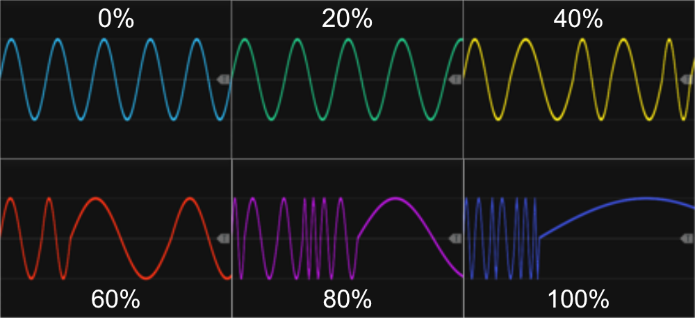
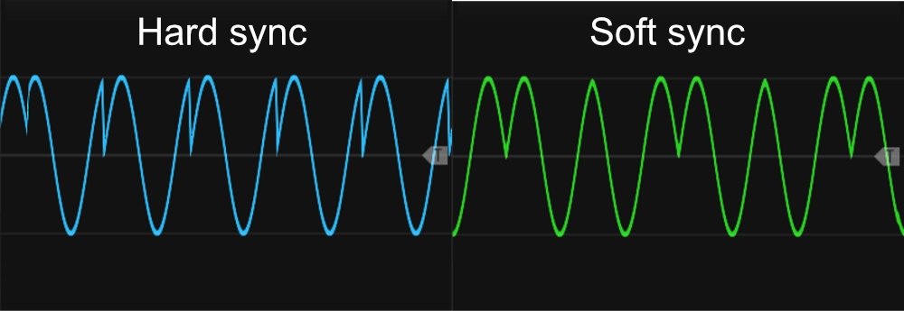

# LFO's
The frequency/rate is the most crucial parameter of any LFO, along with the output-range and waveform. All of the LFO modules allow you to adjust the frequency, covering a wide range from approximately 0.003 Hz to 1024 Hz, hence extending well into the audio range. Both TLFO and LFO1 also support CV modulation of frequency, essentially enabling frequency modulation (FM), whereas SLFO4ss and SLFO4st only lets you set the rate with a knob (don't have CV-input to modulate frequency). All of the LFO's have controls (or context-menu) to change output range, and use the same frequency-rate to output multiple basic waveforms, which in some cases can be further modulated.

Each LFO have a green indicator light next to the frequency knob that flashes at the start of a new phase, providing a visual cue of the LFO speed. The light remains on for the first half of the phase, but at frequencies above 60 Hz, it stays illuminated continuously. *However, these lights only function when the LFO is actively in use (i.e., an output cable is connected to one of the waveform-outputs or the LFO is synchronizing another LFO)*. 

All LFOs (except the Phase-Driven LFO) also support **Rate Chaos** via the context menu, which randomizes the speed of each individual cycle so the LFO runs slightly - or wildly - irregularly instead of at a perfectly steady rate. Since this same option appears on several other modules too, it is described in the [main manual](commonFeatures.md#rate-chaos).

By default, all LFOs are free-running, meaning they operate independently. The TLFO does not support any synchronization, while the LFO1 features both external sync inputs and outputs, and the SLFO4ss/SLFO4st include multiple sync modes, allowing internal synchronization between their 4 LFOs (e.g. syncing LFO-2 to LFO-1 and LFO-4 to LFO-3). When syncing, the default behavior is **hard sync**, which resets the phase. However, this can be changed via the context menu to **soft sync**, where the phase direction reverses instead of resetting. When switching between sync modes or disabling sync, the phase direction returns to its *default* increasing state.

Output range can be controlled differently across the LFO modules. On TLFO and LFO1, a two-way toggle switch allows selection between bipolar (**B**) and unipolar (**U**) modes. Alongside this switch, a range knob adjusts the voltage span from 0V to 10V. In bipolar mode (B) with the range set to 10V, the LFO outputs waveforms between -5V and +5V. In unipolar mode (U), the range starts at 0V, so with a range at 10V, the output spans from 0V to +10V. While TLFO only allows manual range adjustment, LFO1 supports CV modulation of range.

For SLFO4ss and SLFO4st, a three-way toggle switch sets the output range. Options include Unipolar (**U**) for a fixed 0V to 10V range, Bipolar (**B**) for a fixed -5V to +5V range, and Manual (**m**), which allows custom ranges set via the context menu. **Clicking the switch toggles only between unipolar and bipolar**, while the "manual" setting activates automatically when a custom range is selected via the context menu (e.g., -1V to +1V). If you need an output range beyond the available settings, the signal can be processed through one of the [Tweak modules](commonTweak.md) for manual scaling and offset adjustments or an [Auto-scale module](AutoScale4.md) module. Additionally, the context menu allows inversion of any LFO output, "flipping" the waveform according to the selected range.

Most Infinite-Noise modules process signals at audio rate (e.g., 48,000 times per second at a 48 kHz sample rate). However, the LFO modules default to **"Auto" mode**, where the internal processing rate dynamically adjusts based on the fastest LFO and the connected inputs/outputs. E.g. setting an LFO to use a very low frequency, the Process-quality might drop to "Very low"-rate (where the module will only change output values every 256th cycle, and then "sleep" for the next 255 cycles). If necessary, the process quality can be manually set via the context menu, but the "Auto" mode must be disabled first before making manual changes.

**Warning**: Lowering processing quality (whether auto or manual) reduces CPU usage, which is mostly a good thing, but in a few/edge cases it may have unintended side effects. If a slow-moving LFO is set to update every 16 cycles, it means that for 15 cycles, the module holds the exact same value, outputting an unchanged signal. While this is not an issue for most modules, it can interfere with detection-based modules, such as the [Slope Detector 2](SlopeDetector2.md#slope-detector-2), which may cause false state detections. If the LFO output is intended for use with a Slope Detector or similar modules, it is recommended to disable Auto mode and manually set the process quality to "Audio", ensuring small updates occur every cycle.

LFO modules: [Simple LFO4-ss](SLFO4ss.md), [Simple LFO4-st](SLFO4st.md), [Tiny LFO](TLFO.md), [LFO1](LFO1.md), [Phase-Driven LFO](PhaseDrivenLFO.md).

[Go back to modules overview](plugin.md#modules)
